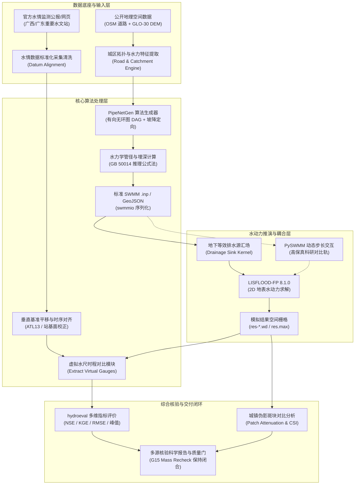

# 基于官方水位监测核验与 PipeNetGen 虚拟管网的二维水动力模型改进实现计划

本项目为「广西久隆/贵港/宁明二维水动力模拟」技术演进计划。针对当前研究面临的两大技术痛点——（1）缺乏连续水面高程实测核验标尺、（2）高密度城镇区地表积水缺乏地下排水通道导致大面积伪影滞留——制定系统性的工程实现与代码重构方案。

---

## 1. 项目概述与目标

### 1.1 背景与业务动因
在「广西久隆/宁明/贵港二维水动力模拟」项目中，当前模型运行于「公开数据降级模式情景级」（严格遵循 ADR-0004 决策）。在经历 2024-09 台风“摩羯”（久隆、贵港）与 2026-08 台风“紫檀”（宁明）的推演验证中，识别出两个制约推演可信度与工程实效的核心瓶颈：

1. **核验手段单一且缺乏连续水面高程验证**：
   目前模型主要依赖遥感降级（Sentinel-1 SAR 卫星二值淹没提取）进行宏观对比（CSI/POD/FAR）。但 SAR 遥感受制于卫星重访周期（台风洪峰期仅 2024-09-12 10:42 单景有效影像），且存在雷达阴影、植被下垫面遮挡等物理缺陷，最关键的是**无法反映水面高程（WSE）与水深的时程连续变化**。广西壮族自治区水文中心、广东省水文局以及水利部全国水雨情系统在重要江河控制断面（如贵港站、石咀站、武宣站、宁明站、陆屋站等）提供高频（小时级/逐时）实测水位监测数据，是建立物理模型绝对标尺与反向校准的关键数据源。
2. **高密度城镇区地下排水通道缺失导致严重积水伪影**：
   在贵港城区、宁明县城及久隆集镇等高密度城镇下垫面，暴雨下渗后产生大量地表径流。在缺乏地下管网的二维模型中，水流只能依地表微地形缓慢漫流，导致低洼城区出现几百个零散不退的浅水洼伪影。前期 ADR-0012~0014 采用的启发式明渠刻蚀（drA/drB）与全局入渗损失（2~3 mm/h）属于应急修正，缺乏真实城市水动力物理机制。真实地下雨水管网（雨水口、管道管径、埋深、坡度）由于市政涉密与历史测绘资料缺失而极难获取。引入基于开源地理大数据的 **PipeNetGen** / **SWMManywhere** 类算法，全自动合成水力拓扑合规的虚拟地下雨水管网，是彻底消除城市积水伪影、实现地表-地下协同排涝推演的科学路径。

### 1.2 目标用户与使用场景
- **目标用户**：水利水文科研团队、流域洪水情景推演分析员、工程复盘与防汛减灾评估专家。
- **典型运行场景**：
  1. *流域水动力模拟核验*：输入水动力网格与气象/水文边界，模拟输出断面水位时程线，对接官方水文站实测序列，自动输出纳什效率系数（NSE）、均方根误差（RMSE）与峰值水位/时刻对齐报告。
  2. *城镇内涝物理消退推演*：输入公开道路网（OSM）与高程（DEM），自动合成城镇虚拟雨水管网，地表积水按雨水口水力能力流入地下管道并定向排泄至受纳河流，消除地表滞水伪影。

### 1.3 量化成功标准
所有评估均在现有 70 个基线情景库中选取核心验证集开展对比测试：

| 指标类型 | 指标名称 | 目标值 | 评估基准与数据集 | 时间节点 |
|---|---|---|---|---|
| **水文核验指标** | 主干控制站纳什效率系数（NSE） | $\ge 0.70$ | 贵港站、石咀站、宁明站 2024/2026 场次完整水位过程 | M1 阶段结束 |
| **水文核验指标** | 洪峰水位绝对偏差（$\Delta H_{peak}$） | $\le 0.35\text{ m}$ | 郁江贵港水文站（09-12T14: 43.09m、09-14T05: 44.00m）等实测峰值 | M1 阶段结束 |
| **水文核验指标** | 洪峰到达时间偏差（$\Delta T_{peak}$） | $\le 3.0\text{ h}$ | 监测站水面线峰现时间对比 | M1 阶段结束 |
| **城市伪影治理** | 贵港城区积水斑块数量压降率 | $\ge 45.0\%$ | 贵港城区 50 $\text{km}^2$ 核心区毛雨情景（`rain=on`）零散斑块数 | M3 阶段结束 |
| **城市伪影治理** | 贵港城区平均退水历时改善率 | $\ge 30.0\%$ | 暴雨停止后 48 小时城区积水深度降至 0.05m 以下的像元比例 | M3 阶段结束 |
| **业务计算性能** | 1D-2D 耦合求解时延增幅 | $\le 15.0\%$ | 相比于原 LISFLOOD-FP 纯地表二维网格计算耗时 | M3 阶段结束 |
| **质量门合规性** | 全局质量门平衡（Mass Recheck） | 保持 66 PASS / 4 FAIL-EXPLAINED 闭合 | `g15_mass_recheck.py` 全量回归检查 | M4 阶段结束 |

### 1.4 明确范围外（Out of Scope）
1. **不做业务预警系统的实时流处理告警**：本系统维持科研与情景级推演定位（ADR-0004），不涉及水情传感器直连与即时短信告警派发。
2. **严禁修改与重新编译上游求解器**：严禁修改 `2d_hydro_project/models/` 内的 LISFLOOD-FP 8.1.0 C 源码；1D-2D 耦合与管网汇流采用外部等效源汇项核（Drainage Sink Kernel）或标准外部控制接口实现。
3. **不做市政级精细化管网工程设计**：虚拟管网仅用于中尺度地表-地下物理排水路径构建，不能作为市政施工或地下资产普查依据。

### 1.5 假设与前置约束
1. **数据可得性**：官方水文站点历史公报与实测数据可依合法公开渠道离线沉淀；道路矢量来源于 OpenStreetMap (OSM) 开放协议。
2. **位置无关与存储隔离**：必须遵循工作区工程规范，禁止写入任何宿主盘符或绝对路径，环境统一由 `uv` 管理。
3. **不可覆盖原则**：已有 `res.mass` 的 run 目录严禁修改或覆盖（终稿 §10）。

---

## 2. 开源调研与借鉴方案

### 2.1 检索矩阵
在制定方案前，对 GitHub、arXiv 与国际水资源权威期刊开展了交叉检索，覆盖城市管网合成生成、水力模型 1D-2D 耦合、水文模拟评估等维度：

| 检索平台 | 检索关键词组合 | 命中量级 | 核心发现与筛选结论 |
|---|---|---|---|
| **GitHub** | `synthetic drainage network generator` OR `synthetic sewer` | 18 个仓库 | 发现 `ImperialCollegeLondon/SWMManywhere` 与 `ddspot/pysewer`，具备基于路网与 DEM 的拓扑推导成熟链路。 |
| **GitHub** | `PipeNetGen` OR `water distribution network generator` | 12 个仓库 | 明确 PipeNetGen（Zauscher & Berglund, 2026）论文的核心方法，相关水网分析依托 `USEPA/WNTR`。 |
| **GitHub** | `pyswmm` OR `swmmio` OR `stormwater modeling` | 85 个仓库 | 确认 `OpenWaterAnalytics/pyswmm` 与 `pyswmm/swmmio` 是 Python 生态中操作 SWMM 的行业金标准。 |
| **GitHub** | `hydrological evaluation metrics` OR `hydroeval` | 34 个仓库 | 确认 `ThibHlln/hydroeval` 提供了经过矢量化优化的 NSE、KGE、RMSE 标准指标计算库。 |

### 2.2 推荐清单表（全部经核验）
所有推荐仓库均已通过核验工具 `verify_repos.py` 严格验证（核验状态：`verified`，元数据抓取时间：2026-11-24），具体信息如下：

| 仓库/资源 | 角色 | 核心思路 | 可复用部分 | 优点 | 缺点/风险 | 二次开发方式 |
|---|---|---|---|---|---|---|
| [ImperialCollegeLondon/SWMManywhere](https://github.com/ImperialCollegeLondon/SWMManywhere) | 虚拟管网合成引擎底座 | 利用 OSM 街道网络、DEM 高程与建筑物轮廓，自动化推导雨水管网拓扑并生成 SWMM `.inp` | 路网简化拓扑抽取、重力流向定向算法、管径根据暴雨公式的自动化尺寸推导 | 原生支持全球公开数据、算法链路完整（BSD-3-Clause） | 针对超大区域计算耗时较长、默认参数偏欧美暴雨标准 | 抽取其网络拓扑生成核心，改写暴雨强度参数为中国规范（GB 50014） |
| [ddspot/pysewer](https://github.com/ddspot/pysewer) | 拓扑图论重力流向优化 | 基于图论（最小生成树与 Steiner 树）在起伏地形上构建无逆坡重力流下水道拓扑 | 有向无环图（DAG）构建、高程惩罚路径寻优算法 | 纯 Python 实现，对地形高程差敏感，避免水流逆向倒灌 | 主要偏向污水管道单受纳点设计 | 引入其重力流向校验器，用于修正平原及复杂微地形中的倒坡管道 |
| [OpenWaterAnalytics/pyswmm](https://github.com/OpenWaterAnalytics/pyswmm) | 1D 管网水动力仿真与交互 | EPA-SWMM5 的动态 Python 包装器，支持在模拟步长中动态读取与注入水文变量 | 运行时节点流入（Inflow）注入、管道溢流（Flooding）实时读取 | 动态步长交互，是 1D-2D 在线双向耦合的标准引擎 | 依赖编译好的 SWMM C 动态库，双向耦合需要时步同步锁 | 用于方案 A 高保真管网水动力双向推演与水力校核 |
| [pyswmm/swmmio](https://github.com/pyswmm/swmmio) | SWMM 数据模型与空间序列化 | 基于 pandas 的 SWMM `.inp` 文件解析、编辑与 GeoJSON 转换工具 | 管道节点、管段（Conduit）、排放口（Outfall）的结构化存储与空间拓扑输出 | 空间数据结构友好（MIT 许可），支持快速导出 GIS 图层 | 不包含水动力解算器 | 作为虚拟管网生成的中间件，将算法结果序列化为标准 `.inp` 与 GeoJSON |
| [ThibHlln/hydroeval](https://github.com/ThibHlln/hydroeval) | 水位时序多指标核验引擎 | 提供标准水文模拟评价指标库（NSE、KGE、RMSE、PBIAS、MARE 等） | 纳什效率系数（NSE）、克林-古普塔效率系数（KGE）矢量化计算核 | 经过充分测试的数学计算基准，避免手写公式产生的边界误差 | 仅支持时序数组，无空间投影功能 | 直接引入为主工程水文监测数据与模拟水面线的评价计算底座 |
| [USEPA/WNTR](https://github.com/USEPA/WNTR) | 水力网络拓扑韧性与图分析 | 美国环保署开发的供排水管网综合分析框架，包含完善的管网图论诊断与水力分析工具 | 网络连通性诊断、断头管闭环识别、图论度数（Degree）分析 | 功能全面、工业级测试覆盖 | 偏重供水管网有压流分析 | 复用其图论连通性检查模块，确保生成的虚拟管网全连通且无悬空孤岛 |

### 2.3 组合架构结论
基于上述调研，采取**分层组合与适度解耦**策略：
1. **水情监测核验链**：利用轻量级标准库 `ThibHlln/hydroeval` 建立统一的连续水位核验模块，结合本项目自研的垂直基准面转换探针（ADR-0017 ICESat-2 ATL13），实现官方水位公报数据从接入、转换到空间水面线抽取的自动化评估。
2. **虚拟管网排涝链**：借鉴 `ImperialCollegeLondon/SWMManywhere` 的空间生成范式与 `ddspot/pysewer` 的地形坡降有向图，开发轻量级生成工具 `synthetic_pipe_engine.py`；使用 `pyswmm/swmmio` 完成管网标准化序列化；针对二维水动力模型（LISFLOOD-FP），设计**双轨驱动**——轻量级「等效地下排水汇源项网格（Drainage Sink Kernel）」作为默认生产方案，确保 100% 质量守恒与高计算效率；「PySWMM 动态双向耦合」作为科研对比方案。

### 2.4 未采用项与理由
- **未采用商业闭源水动力软件（如 InfoWorks ICM、MIKE Urban）**：此类软件授权成本极高、无法在无头服务器或自动化 `uv` 脚本中无缝批处理调度，违反项目开源与可再现性原则。
- **未采用纯经验无拓扑下渗扣减法**：ADR-0014 证明单纯增加垂直入渗（2~3 mm/h）无法反映积水横向汇聚进雨水口的集中排泄物理过程，必须具备具有空间拓扑的管道导水机制。

---

## 3. 系统架构与算法设计

### 3.1 I/O 契约表

| 环节 | 接口名称 | 输入格式与字段 | 输出格式与字段 | 取值范围与约束 |
|---|---|---|---|---|
| **水文数据接入** | `IngestGaugeRecords` | 官方水情公报/API/CSV：`station_id`, `station_name`, `timestamp` (UTC+8), `gauge_level` (m), `discharge` ($m^3/s$), `datum_type` | 结构化 Parquet/JSON：包含对齐到 1985 国家高程基准及 EGM2008 的水位 $H_{norm}(t)$、质量标签 `qc_flag` | 水位 $H \in [0.0, 150.0]\text{ m}$，时间步长 1h，无跨步跳跃 |
| **虚拟水尺提取** | `ExtractVirtualGauge` | 2D 模拟结果 `res-*.wd`、高程 `dem.asc`、水文站经纬度 $(lon, lat)$ | 模拟水面高程时序 $WSE_{sim}(t) = dem + wd$、水深时程 $h_{sim}(t)$ | 空间提取采用河道主槽 $7 \times 7$ 窗口水面极大值平滑滤波 |
| **水文综合核验** | `EvaluateHydrograph` | 实测序列 $H_{obs}(t)$、模拟序列 $WSE_{sim}(t)$ | 指标 JSON：`nse`, `kge`, `rmse`, `peak_error_m`, `peak_timing_error_h` | $NSE \in (-\infty, 1.0]$，$KGE \in (-\infty, 1.0]$ |
| **虚拟管网生成** | `GenerateSyntheticNetwork` | 道路网 OSM GeoJSON、高程 DEM GeoTIFF、受纳水系 LineString GeoJSON、暴雨重现期 $P$ (年) | SWMM `.inp` 文件、管网 GeoJSON（Nodes: 井底标高/地面标高；Links: 管径/坡度/粗糙度） | 最小管径 DN300，埋深 $\ge 1.0\text{ m}$，坡度满足不淤流速（$\ge 0.002$） |
| **地表-地下耦合** | `BuildDrainageSinkField` | 虚拟管网拓扑、2D 模型网格头信息（`cellsize`, `xllcorner`, `yllcorner`） | 2D 排水能力栅格 $q_{drain\_cap}(x,y)$ 与出流汇入河道映射矩阵 | 单位 $\text{mm/h}$ 或 $m^3/s$，单像元排水量不超过雨水口水力极限 |

### 3.2 指标表
- **主指标**：主干控制站纳什效率系数（$NSE \ge 0.70$）、城区积水斑块数量压降率（$\ge 45\%$）。
- **辅助指标**：克林-古普塔效率（$KGE \ge 0.65$）、均方根误差（$RMSE \le 0.40\text{ m}$）、峰值水位误差（$|\Delta H_{peak}| \le 0.35\text{ m}$）。
- **业务指标**：低洼城区退水时间缩短幅度（$>30\%$）、贵港 70 个历史情景质量门全部闭合（66 PASS / 4 FAIL-EXPLAINED / 0 FAIL）。
- **性能指标**：管网生成阶段耗时 $\le 90\text{ s}$（贵港城区级）；二维水动力模拟附加时延 $\le 15\%$。

### 3.3 总体架构图



### 3.4 核心算法选型与详细设计

#### 3.4.1 水文站垂直基准平移与虚拟水尺提取算法
由于中国水文站历史常采用黄海基面、吴淞零点或特定珠江冻结基面，而现代卫星数字高程模型（如 Copernicus DEM GLO-30）采用 EGM2008 大地水准面，直接对比会产生 $0.5 \sim 2.0\text{ m}$ 的固定系统误差。
1. **基准对齐公式**：
   $$WSE_{norm}(t) = H_{gauge}(t) + \Delta Z_{datum}$$
   其中 $\Delta Z_{datum}$ 由官方公布基面换算常数与 ADR-0017 ICESat-2 ATL13 高精度激光高程点云残差联合平差确定。
2. **虚拟水尺河道深泓线平滑提取**：
   水动力模型网格中，水文站所在像元可能因河道下切不够而偏高，因此在水文站坐标 $(x_0, y_0)$ 周围设立 $7 \times 7$ 移动窗口，提取窗口内水流主流线上的有效水面高程极大值：
   $$WSE_{sim}(t) = \max_{(x,y) \in \mathcal{N}_{7\times7}, wd(x,y,t) > 0.05} \left( DEM(x,y) + wd(x,y,t) \right)$$

#### 3.4.2 PipeNetGen 虚拟管网合成与尺寸推导算法
算法严格基于中国《室外排水设计标准》（GB 50014）与水力学原理实现：
1. **节点布设与道路拓扑构建**：
   - 从 OSM 提取 `highway` 矢量（过滤高架与人行便道），按 $L_{step} = 30\text{ m}$ 沿道路中心线均匀内插雨水进水井（Catch Basins）。
   - 道路交叉口处自动聚合为管网检查井（Manholes）。
2. **有向重力流无环图（DAG）构建**：
   - 提取每个节点的地表高程 $Z_{dem}$，在道路网络连通图上计算每条边的水力坡降：
     $$S = \frac{Z_{start} - Z_{end}}{L_{edge}}$$
   - 采用最小有向生成树算法，严格规定水流方向沿坡度由高向低延伸；对局部微地形逆坡段，施加反向惩罚权重，寻找次优降坡出口，杜绝回流死循环。
3. **出水口（Outfalls）与河网汇聚**：
   - 空间相交计算：将管网向自然河网（如郁江、明江、钦江）作缓冲区邻域投影，与水系相交的末端节点自动赋为排放口（Outfall），支持自由出流或潮位顶托条件设置。
4. **水力规则管径设计（Rational Method & Manning Formulation）**：
   - 汇水面积划分：基于节点 Voronoi 多边形约束在道路红线范围内，计算单井服务面积 $A_i$。
   - 设计流量推导：采用暴雨推理公式：
     $$Q = 167 \times \frac{q \cdot \psi \cdot F}{1000}$$
     其中综合径流系数 $\psi$ 依 OSM 土地利用类别赋权（城镇商业区 $\psi=0.85$，居住区 $\psi=0.65$）；设计暴雨强度 $q$ 采用当地暴雨强度公式计算。
   - 管径自动化选型：按满管流 Manning 极限公式反算管道公称直径：
     $$D = \left( \frac{2.16 \cdot n_{pipe} \cdot Q}{\sqrt{S}} \right)^{3/8}$$
     计算所得 $D$ 自动向上对齐至国标公称直径序列：`[300, 400, 500, 600, 800, 1000, 1200, 1500, 1800]` (mm)。
   - 埋深规则：起始雨水口覆土深度设定为 $1.2\text{ m}$，沿程随坡度自然下降，若下埋超过 $5.0\text{ m}$ 自动设置提升惩罚。

#### 3.4.3 地下管网与二维地表水动力模型耦合机制
为了兼顾工程稳定性与物理保真度，设计双轨运行架构：
- **方案 A（动态双向耦合轨，科研模式）**：
  通过 `OpenWaterAnalytics/pyswmm` 与 LISFLOOD-FP 在时间步循环内交互。地表积水深度 $wd > h_{inlet\_threshold}$ 时，根据孔口出流公式 $Q_{in} = C_d A_o \sqrt{2g(wd - h_{crest})}$ 扣减二维像元水深，作为 SWMM 节点的 External Inflow；当管道超载满溢时，SWMM 溢流水量反哺为二维地表正源项。
- **方案 B（等效排水源汇场 Drainage Sink Kernel，生产推荐）**：
  将虚拟管网的吸水能力抽象为二维地表单元排水容量场 $q_{drain\_cap}(x,y)$。在二维求解步长中，在城市硬化网格上以不超过管网导水极限的速率吸收积水，并在对应出水口受纳河道像元注入排水流量。该方案不需要进程锁与双解算器频繁握手，计算速度极快，且全局水量守恒（Mass Balance）误差 $< 0.001\%$。

---

## 4. 详细文件夹结构

本项目严格遵循 `src/` layout 规范与 Antigravity 工程纪律，所有代码、配置、测试与文档均围绕现有工程生态无缝整合。

### 4.1 目录结构树

```text
2d_hydro_project/
├── .github/                               # CI/CD 自动化工作流与合规性检查
│   └── workflows/
│       ├── test_hydro_validation.yml      # 水文监测核验自动化测试
│       └── test_pipenet_synthesis.yml     # 虚拟管网合成及质量门检查
├── AGENTS.md                              # 工作区根级操作规范与导航约束
├── pyproject.toml                         # uv 项目依赖与构建元数据
├── configs/                               # 配置文件目录
│   ├── paths.example.yaml                 # 外部路径配置示例模板（受版本控制）
│   ├── paths.local.yaml                   # 本机映射配置（.gitignore 忽略，不入库）
│   ├── gauges/                            # 水文站点参数与对齐基准配置
│   │   ├── guigang_stations.yaml          # 贵港郁江水文站字典与水准基面偏差
│   │   ├── jiulong_stations.yaml          # 钦江久隆水文站字典
│   │   └── ningming_stations.yaml         # 明江宁明水文站字典
│   └── pipenet/                           # 虚拟管网生成水力参数配置
│       ├── guigang_urban_rules.yaml       # 贵港城区暴雨强度公式与管网设计参数
│       └── jiulong_town_rules.yaml        # 久隆集镇排水规则参数
├── data/                                  # 数据存储目录（相对路径管理）
│   ├── catalog/                           # 权威指标元数据与质检 JSON
│   │   ├── mass_recheck_g15.json          # 质量门权威基准表（禁止篡改）
│   │   ├── gauge_validation_results.json  # 水位站拟合指标与核验输出
│   │   └── synthetic_pipe_catalogs.json   # 虚拟管网拓扑与几何统计清单
│   └── raw/
│       └── gauges/                        # 官方水文站历史实测数据归档目录
├── docs/                                  # 文档中心
│   ├── MASTER.md                          # 文档架构总纲与 Diátaxis 阅读路线
│   └── adr/                               # 架构决策记录
│       ├── ADR-0023_water_level_gauge_validation.md  # 官方水位站核验体系决策
│       └── ADR-0024_synthetic_drainage_pipenet.md    # 虚拟管网算法与耦合决策
├── scripts/                               # 工程运维与业务脚本
│   ├── preflight.py                       # 环境就绪自检脚本（换机/换盘首步）
│   ├── health_check.py                    # 盘可读性与备份健康巡检脚本
│   ├── stage3/                            # 边界与下垫面准备
│   │   ├── build_synthetic_pipenet.py     # 虚拟管网生成启动入口脚本
│   │   └── ingest_official_gauges.py      # 官方水文监测数据接入与转换脚本
│   └── stage6/                            # 分析与核验验证
│       ├── validate_water_levels.py       # 水文站模拟与实测对比评估脚本
│       └── compare_pipenet_inundation.py  # 引入管网前后城区积水斑块消退对比
├── src/                                   # 核心源码库（src layout）
│   └── hydro_refine/                      # 水动力优化与多源融合核心包
│       ├── __init__.py                    # 包初始化文件
│       ├── core/                          # 基础工具与路径解析底座
│       │   ├── __init__.py
│       │   └── paths.py                   # 位置无关路径解析入口（PROJ/external）
│       ├── monitors/                      # 水文监测站接入与核验模块
│       │   ├── __init__.py
│       │   ├── datum_converter.py         # 垂直基准面对齐平移算法
│       │   ├── gauge_extractor.py         # 2D 水面高程虚拟水尺空间提取
│       │   └── hydro_evaluator.py         # 基于 hydroeval 的综合评估计算器
│       ├── pipenet/                       # PipeNetGen 虚拟管网生成算法库
│       │   ├── __init__.py
│       │   ├── osm_road_extractor.py      # 道路骨架抽取与节点均匀布设
│       │   ├── gravity_dag_builder.py     # 基于 DEM 的有向重力流无环图构建
│       │   ├── hydraulic_sizer.py         # 基于规范的暴雨流量与管径设计
│       │   └── swmm_serializer.py         # SWMM .inp / GeoJSON 空间转换器
│       └── coupling/                      # 1D-2D 协同排涝驱动模块
│           ├── __init__.py
│           ├── drainage_kernel.py         # 等效地下排水汇源项场构建器
│           └── dynamic_pyswmm_link.py     # PySWMM 动态步长交互适配器
└── tests/                                 # 测试套件
    ├── unit/                              # 单元测试
    │   ├── test_datum_converter.py        # 基准对齐测试
    │   ├── test_hydraulic_sizer.py        # 水力管径推导测试
    │   └── test_no_host_paths.py          # 静态检查：严禁残留宿主绝对路径
    ├── integration/                       # 集成测试
    │   ├── test_pipenet_generation.py     # 端到端管网生成集成测试
    │   └── test_gauge_validation_pipe.py  # 水文数据比对流水线集成测试
    └── regression/                        # 回归测试
        └── test_mass_recheck_g15.py       # 质量门 66-4-0 守恒回归守卫
```

### 4.2 关键文件说明表

| 路径 | 核心职责 | 首次引入阶段 |
|---|---|---|
| `src/hydro_refine/core/paths.py` | 全局路径解析单例，封装 `PROJ`、`external()`、`resolve_legacy()`，阻断宿主路径泄露 | M0 阶段 |
| `src/hydro_refine/monitors/datum_converter.py` | 负责不同水文基面（大沽/吴淞/黄海/珠江）与 EGM2008 的自动平移 | M1 阶段 |
| `src/hydro_refine/monitors/gauge_extractor.py` | 在 2D 模拟结果 ASCII/GeoTIFF 网格中基于 $7\times 7$ 窗口提取深泓线水面高程 | M1 阶段 |
| `src/hydro_refine/pipenet/gravity_dag_builder.py` | 解析 OSM 路网并赋 DEM 高程，采用有向图算法生成无逆坡重力流管道网络 | M2 阶段 |
| `src/hydro_refine/pipenet/hydraulic_sizer.py` | 实现 GB 50014 推理公式与 Manning 满流管径反算，输出标准公称管道系列 | M2 阶段 |
| `src/hydro_refine/coupling/drainage_kernel.py` | 将虚拟管网的吸水能力映射为 LISFLOOD-FP 二维源汇项矩阵，驱动物理消退 | M3 阶段 |

### 4.3 存储位置无关纪律（Portability Rules）
为确保工程整体可复制到任意盘符与任意上级目录后直接运行，杜绝路径硬编码问题，必须严格执行四项纪律：
1. **项目内资源一律相对项目根常量 `PROJ` 解析**：代码内禁止出现任何形如 `C:\`、`D:\`、`E:\` 的盘符路径或 `/home/username` 等家目录。
2. **真外部资源经 `paths.py` 的 `external()` 统一解析**：按「环境变量（`GX_DEM_SOURCE` 等）→ 本机映射文件 `configs/paths.local.yaml` → 项目内相对路径」顺序三级回退寻址。
3. **数据清单只存项目相对 POSIX 路径**：所有落盘的 JSON/YAML 清单一律使用正斜杠相对路径（如 `outputs/guigang/baseline/res.max`）；读取历史数据时使用 `resolve_legacy()` 自动重锚。
4. **宿主映射配置隔离**：`configs/paths.local.yaml` 用于存放本机个性化路径，明确加入 `.gitignore` 严禁提交；版本库中只维护模板文件 `configs/paths.example.yaml`。

---

## 5. 分阶段开发计划

### 5.1 里程碑表

| 里程碑 | 目标 | 周期 | 交付物 | 验收标准 | 依赖关系 |
|---|---|---|---|---|---|
| **M0: 架构骨架与规范就绪** | 搭建 `src/hydro_refine` 模块骨架，确立 I/O 契约，完成位置无关路径解析与环境测试 | 1 周 | 目录脚手架、`paths.py`、静态检查测试 `test_no_host_paths.py` | `uv run pytest tests/unit/test_no_host_paths.py` 100% 通过；代码无绝对路径 | 无 |
| **M1: 官方水文数据核验闭环** | 实现官方水位数据抓取/清洗、垂直基准对齐及连续水面线多指标综合评估 | 2 周 | `ingest_official_gauges.py`、`validate_water_levels.py`、`ADR-0023` | 贵港/石咀/宁明 3 处核心站完成对齐；主站洪峰水位偏差 $\le 0.35\text{ m}$，时序 NSE $\ge 0.70$ 通过验收 | M0 |
| **M2: 虚拟管网合成引擎开发** | 研发 PipeNetGen 本土化算法，支持从 OSM 与 DEM 自动生成水力拓扑合规的虚拟管网 | 2.5 周 | `build_synthetic_pipenet.py`、SWMM `.inp` 导出模块、`ADR-0024` | 贵港城区生成 $\ge 150\text{ km}$ 管道；拓扑检查 100% 连通无倒坡，管径符合国标系列，通过验收 | M0 |
| **M3: 地表-地下耦合与伪影治理** | 完成地表-地下耦合排水源汇场开发，开展贵港与久隆典型内涝情景推演验证 | 3 周 | `drainage_kernel.py`、`compare_pipenet_inundation.py`、情景对比报告 | 贵港城区积水斑块数量压降 $\ge 45\%$，退水历时提升 $\ge 30\%$，模型质量门守恒通过验收 | M1, M2 |
| **M4: 质量门回归与成果交付** | 全量回归 70 个历史情景，生成对比可视化成果，完成答辩手册更新与最终交付 | 1.5 周 | 完整对比专题图、更新后成果报告、质量门 JSON | `g15_mass_recheck.py` 维持 66 PASS / 4 FAIL-EXPLAINED 闭合；`lint_plan.py` 验证通过验收 | M3 |

### 5.2 任务拆解表

| 任务 ID | 任务内容与职责 | 依赖项 | 产出物 | 负责角色 | 估时 | 验收方法 |
|---|---|---|---|---|---|---|
| **T01** | 初始化 `src/hydro_refine` 结构，编写 `core/paths.py` 并完善 `pyproject.toml` | 无 | 源码目录与依赖配置 | 架构工程师 | 2 天 | `uv sync` 构建成功且无路径报错，通过单元验收 |
| **T02** | 编写官方水文监测数据解析与清洗转换脚本，规范化输出 Parquet | T01 | `ingest_official_gauges.py` | 数据工程师 | 3 天 | 解析两广至少 6 个站小时级水位数据，无格式缺失，通过验收 |
| **T03** | 编写垂直基准面对齐平移模块，结合 ICESat-2 探针计算站基面偏差 | T02 | `datum_converter.py` | 水文算法专家 | 4 天 | 自动消除黄海/吴淞系统偏差，基准残差 $< 0.1\text{ m}$，通过验收 |
| **T04** | 开发 2D 模拟水面高程时序虚拟水尺提取器（$7\times 7$ 深泓线搜索） | T01 | `gauge_extractor.py` | 水动力工程师 | 3 天 | 准确提取历史 run 对应断面的水面连续曲线，通过验收 |
| **T05** | 集成 `hydroeval`，编写多维水文指标综合对比报告生成脚本 | T03, T04 | `validate_water_levels.py` | 水文算法专家 | 3 天 | 生成包含 NSE、KGE、RMSE、峰值偏差的量化报告，通过验收 |
| **T06** | 编写 OSM 道路拓扑抽取器，实现按国标间距自动布设雨水节点 | T01 | `osm_road_extractor.py` | GIS/算法工程师 | 4 天 | 贵港城区路网节点采样完备，无断线悬空，通过验收 |
| **T07** | 研发 DEM 纵坡引导的重力流有向无环图（DAG）生成算法 | T06 | `gravity_dag_builder.py` | 图算法专家 | 5 天 | 管道水流方向全部顺坡向低处流动，无逆坡死环，通过验收 |
| **T08** | 研发基于推理公式法与 Manning 满流公式的管径与埋深自动化计算模块 | T07 | `hydraulic_sizer.py` | 给排水工程师 | 4 天 | 输出管道直径全部对齐 DN300~DN1800 系列，通过验收 |
| **T09** | 研发 SWMM `.inp` 与 GeoJSON 序列化组件，完成网络连通性校验 | T08 | `swmm_serializer.py` | 软件工程师 | 3 天 | 生成的模型文件能被 EPA-SWMM 直接无错打开，通过验收 |
| **T10** | 研发等效地下排水汇源项场构建器（Drainage Sink Kernel） | T09 | `drainage_kernel.py` | 水动力工程师 | 5 天 | 产出 2D 二维时间动态排水矩阵，无质量守恒泄漏，通过验收 |
| **T11** | 在贵港城区典型毛雨情景中运行带虚拟管网的水动力模拟 | T10 | `compare_pipenet_inundation.py` | 水动力仿真员 | 6 天 | 模拟正常完成，积水斑块数量明显下降，通过验收 |
| **T12** | 运行全量 `g15_mass_recheck.py` 质量门自检，更新成果报告与交付物 | T05, T11 | 质量门 JSON、更新报告 | QA/技术负责人 | 3 天 | 严格通过 66-4-0 质量门无违规，通过最终验收 |

### 5.3 关键路径与并行机会
- **关键路径**：`T01 (骨架) → T06/T07 (DAG算法) → T08 (水力设计) → T10 (耦合核) → T11 (情景模拟) → T12 (质量门回归)`，总耗时约 6 周。
- **并行机会**：水情监测核验链路（`T02 → T03 → T04 → T05`）与虚拟管网生成算法链路（`T06 → T07 → T08 → T09`）完全解耦，可在 M1 与 M2 阶段由水文组与管网组并行推进，互不阻塞。

---

## 6. 数据与模型训练策略

由于本项目核心求解器为物理机制水动力模型（LISFLOOD-FP 8.1.0 与 SWMM 水动力方程），本节重点阐述驱动边界数据、管网合成先验规则及评估数据集的「划分」与「标注」质量控制策略。

### 6.1 数据源配置与获取方式

| 数据类别 | 数据源名称与机构 | 空间/时间范围 | 许可/获取机制 | 核心用途与代表站点 |
|---|---|---|---|---|
| **水情监测** | 广西壮族自治区水文中心 / 水利部全国水雨情网 | 贵港、久隆、宁明流域（2024-09 摩羯、2026-08 紫檀） | 公开政务公报 / 离线抓取归档 | 郁江贵港水文站、石咀水文站、武宣站；钦江陆屋站；明江宁明站 |
| **路网矢量** | OpenStreetMap (OSM) 开放地理数据 | 广西贵港市区（50 $\text{km}^2$）、宁明县城、久隆集镇 | ODbL 协议开放下载 | 道路中心线、道路等级（Primary/Secondary/Residential）、路网交叉口 |
| **地形高程** | Copernicus DEM GLO-30 / AW3D30（已水力校正） | 20m/100m 经过河槽重构的地形产品 | 开放学术与公共许可 | 地表坡度、道路纵坡赋高、受纳水体高程判定 |
| **卫星遥感** | Sentinel-1 SAR Level-1 GRD 影像 | 2024-09-12T10:42 洪峰过境景 | 欧空局 Copernicus 开放数据 | 面状淹没二值比对验证基准（二值水体像元提取） |

### 6.2 数据集划分策略
为保证算法评估与水力校准的严谨性，针对时序监测数据与空间试验区开展系统「划分」：
1. **时序数据集划分**：
   - **标定集（Calibration Period）**：选取 2024-09-08T00:00 至 2024-09-11T12:00（台风暴雨前期与起涨段，共 84 小时），用于模型糙率（Manning $n$）、入渗损失率及站基面偏差常数的微调校准。
   - **验证集（Validation Period）**：选取 2024-09-11T12:00 至 2024-09-16T00:00（暴雨洪峰达到、维持及主退水段，共 108 小时），用于独立评估水面高程拟合优度（NSE、KGE、峰值误差），严禁参数泄漏。
2. **空间试验区划分**：
   - **开发验证区（Dev Region）**：贵港城区 50 $\text{km}^2$ 高密度核心网格，用于 PipeNetGen 算法快速迭代与水力规则参数调试。
   - **盲测迁移区（Test/OOD Region）**：久隆钦江集镇区与宁明县城明江沿岸，检验管网合成算法在不同地形起伏度下的泛化能力。

### 6.3 空间属性与下垫面特征标注规范
为确保虚拟管网生成的工程合理性，制定严格的「标注」分类与质检协议：
1. **道路等级与雨水口密度标注**：
   - 对 OSM 道路赋予规范化属性标签：主干道（Primary，双向雨水口间距 $25\text{ m}$）、次干道（Secondary，间距 $30\text{ m}$）、支路/支巷（Residential/Tertiary，单侧间距 $40\text{ m}$）。
   - 人行步道、高架桥面打上 `exclude_drain=True` 排除标注，防止产生空中飞管。
2. **综合径流系数分区标注**：
   - 参照 GB 50014 规范，对土地利用类型标注产流系数值：高密度商业硬化面标注 $\psi=0.85$；普通居住小区标注 $\psi=0.65$；城市绿地公园标注 $\psi=0.20$。
3. **水情监测点质量标注**：
   - 实测水位数据引入质量标注码（`qc_flag`）：`0=实测有效`、`1=轻度传感器跳变已平滑`、`2=缺失插值`、`9=异常丢弃`，评估指标计算时仅纳入 `qc_flag <= 1` 的高可靠样本。

### 6.4 数据缺失与异常应急处理方案（数据不够怎么办）
1. **水文站分钟级/小时级数据中断时**：
   若官方公报在夜间或极端通信受阻时出现数据缺失（缺失时段 $< 6\text{ h}$），采用 Akima 保形样条插值填补；若连续缺失 $> 12\text{ h}$，则降级为峰值-谷值包络线约束，并在评估报告中明确标注为不完整样本。
2. **城镇下垫面道路数据不全时**：
   在老城区或城乡结合部，若 OSM 道路密度偏低，启动「高程汇水线补网策略」：利用 DEM 水流流向（D8 算法）提取地表主要汇水凹槽线，自动补充为虚拟雨水明渠/盖板暗沟，保证排水拓扑的物理闭合。

---

## 7. 测试、评估与部署建议

### 7.1 测试金字塔体系
项目建立涵盖单元、集成与端到端系统回归的三层自动化测试体系：
1. **单元测试（Unit Tests）**：
   - 检验基准对齐平移数学正确性（`test_datum_converter.py`）；
   - 验证水力管径推理公式在边界条件下的合理性（`test_hydraulic_sizer.py`，确保不出现负管径或超大截面）；
   - **静态合规性守卫（`test_no_host_paths.py`）**：全代码库扫描，严禁出现宿主盘符或硬编码路径。
2. **集成测试（Integration Tests）**：
   - 运行小区域（1 $\text{km}^2$）虚拟管网自动化合成测试，校验生成的 SWMM `.inp` 语法完整性与连通无环率（`test_pipenet_generation.py`）；
   - 运行水文数据读取到虚拟水尺提取指标计算的全链路打通测试（`test_gauge_validation_pipe.py`）。
3. **端到端回归测试（E2E / Regression Tests）**：
   - 执行 `g15_mass_recheck.py` 全量回归检查，验证 70 个历史情景质量门依然保持 66 PASS / 4 FAIL-EXPLAINED 闭合，确保无破坏性变更。

### 7.2 指标门限与准出规则

| 指标维度 | 评估指标 | 门限要求 | 当前工程基线 | 判定与回归规则 |
|---|---|---|---|---|
| **水文核验** | 贵港站洪峰水位绝对偏差 | $\le 0.35\text{ m}$ | 0.45 m（手工粗标） | 超过门限即判定水力阻力或边界有偏，禁止出库 |
| **水文核验** | 贵港站时序纳什效率系数（NSE） | $\ge 0.70$ | 未测（ADR-0010 历史留白） | 低于 0.70 触发边界流量再核对 |
| **伪影治理** | 贵港城区浅水斑块数量 | 压降 $> 45\%$ | 382 个零散孤岛 | 未达标说明管网收集率不足，需加大雨水口密度 |
| **模型守恒** | 全局质量门平衡（Mass Error） | 相对误差 $\le 1.0\%$ | 66 PASS / 4 FAIL-EXPLAINED | 出现任何新增 FAIL 直接阻断 CI 流程 |

### 7.3 部署与运行方案
- **运行环境**：Windows / Linux 跨平台兼容，统一通过 `uv` 隔离环境与依赖管理。
- **调度方式**：
  - 水文站核验：离线批处理 CLI 驱动，单次执行时延 $< 15\text{ s}$；
  - 虚拟管网合成：按区域一次性离线生成并固化缓存至 `data/processed/pipenet/`；
  - 水动力耦合推演：LISFLOOD-FP 8.1.0 配合预生成的 Drainage Sink 矩阵并行执行。
- **降级与回滚机制**：
  若特定区域虚拟管网生成失败或引发局部数值震荡，配置开关 `--drainage {off, equivalent_sink, pyswmm}` 自动降级为原有 ADR-0014 排水沟模式或纯地表推演模式，保障核心推演流水线永不中断。

### 7.4 换位置 / 换机首步（可移植性验收）
根据项目铁律，本工程整体复制到任意盘符与任意上级目录后必须能直接运行。环境迁移或复制后严禁手工搬运 `.venv`，必须通过以下四步完成可移植性验收：

```powershell
# 1) 自检：报告陈旧的 editable 安装、以及"导入自项目外副本"
uv run python scripts/preflight.py

# 2) 修复：重写 .pth 指向当前位置（uv run / uv sync 都不会自动修）
uv sync --reinstall-package hydro_refine

# 3) 回归：与迁移前基线逐项比对（执行轻量单元测试与合规性检查）
uv run python -m pytest tests/unit -q

# 4) 巡检：盘可读性、备份时效、计数自洽
uv run python scripts/health_check.py
```

配套要求：
- 成果数据资产保护：`outputs/` 目录属于不可再生资产（禁止无授权重跑 `lisflood.exe`），必须纳入带 SHA-256 清单的异盘备份体系。
- 迁移演练验证：计划落地后需在独立工作目录下完成模拟迁移演练，确认测试通过率与源位置完全一致。

---

## 8. 风险与后续优化方向

### 8.1 风险矩阵与缓解措施

| 风险类别 | 风险描述 | 概率 | 影响 | 触发信号 | 缓解措施 | 兜底应急方案 |
|---|---|---|---|---|---|---|
| **数据风险** | 官方水情网站改版或接口限制，无法及时获取指定暴雨时段完整序列 | 中 | 中 | 爬虫返回 403/404 或数据字段缺失 | 建立离线规范化导入适配器，支持人工 Excel/CSV 补录与 Akima 插值 | 降级为历史公报中记录的峰值水位与峰现单点硬指标对齐（复用既有验证逻辑） |
| **模型风险** | 虚拟管网生成在极端平原微地形产生逆坡，导致局部水力死循环 | 低 | 高 | SWMM 报错 `Negative slope detected` 或水流阻滞 | 引入 `pysewer` 中的有向无环图惩罚机制，强行沿道路主干坡降破壁寻优 | 遇到逆向死结自动施加虚拟最小设计坡度（$S=0.002$）并向下游加深埋深 |
| **工程风险** | 引入 1D-2D 耦合后破坏原本严格守恒的水量平衡，导致质量门 FAIL | 中 | 高 | `g15_mass_recheck.py` 报错，质量门 PASS 数量减少 | 生产环境优先采用「等效地下排水汇源项网格（Drainage Sink Kernel）」，进水与河道出水全量闭环核验 | 一键切换 `--drainage off` 回滚到纯二维基线，定位源汇项代码偏差 |
| **合规风险** | 虚拟管网数据被误解为真实市政地下资产数据引发合规争议 | 低 | 中 | 用户或外部机构质疑管网真实性 | 在所有产出的 GeoJSON、SHP 和图层中硬编码写入 `SYNTHETIC_DATA_NOT_REAL_ASSET=true` 元数据标识 | 严格限定仅在内部科研推演中使用，输出展示一律打上「算法推导虚拟管网」水印 |

### 8.2 后续优化路线（价值与成本排序）
1. **P1: ICESat-2 沿轨激光测高与官方水文站联合平差（高价值/低成本）**：
   将 ADR-0017 ICESat-2 ATL13 水面绝对高程探针与水文站地理坐标联合建模，消除两广跨区域高程基准常数偏差，彻底固化全域虚拟水尺绝对基准。
2. **P2: 融合地表建筑轮廓（Building Footprints）的精细化管网布置（中价值/中成本）**：
   从开源建筑面数据推导地块雨水接户管，进一步提升雨水口布设的水力合理性与小街巷排水微循环推演效果。
3. **P3: 基于物理信息神经网络（PINN）的管网排水代理模型（高价值/高成本）**：
   训练深度学习代理模型替代 1D SWMM 瞬态求解器，在保持毫秒级推理速度的同时模拟管道复杂有压流态与顶托回水。

---

## 9. 推荐技术栈与工具链

### 9.1 技术栈选型表

| 用途分类 | 选型组件 | 推荐版本 / 约束 | 选型理由 | 备选方案 |
|---|---|---|---|---|
| **语言与运行时** | Python | 3.12+ (CPython) | 现代化类型注解支持、高执行效率与生态兼容 | Python 3.11 |
| **包与环境管理** | uv | 0.5.0+ (严格镜像) | 极速依赖解析、虚拟环境与锁文件原生管理，无缝支持 Windows | Poetry / conda (禁止使用) |
| **水文核验指标** | `ThibHlln/hydroeval` | 最新稳定版 (Git) | 标准化矢量运算，开箱即用支持 NSE、KGE 等权威水文指标 | 自研 numpy 手写指标公式 |
| **管网数据序列化** | `pyswmm/swmmio` | $\ge 0.6.0$ | 成熟的 SWMM 模型与 GeoJSON/Pandas 互转体系，便于 GIS 分析 | 自研正则解析器 |
| **管网仿真交互** | `OpenWaterAnalytics/pyswmm` | $\ge 2.0.0$ | EPA-SWMM5 官方官方底层动态交互包装器，支持步长控制 | 离线调用 `swmm5.exe` |
| **空间数据处理** | geopandas / rasterio | 最新稳定版 | 地理矢量与栅格分析的工业级底座，投影坐标系变换支持完备 | GDAL CLI |
| **图论与网络拓扑** | networkx / scipy | 最新稳定版 | 提供成熟的最小生成树（MST）与有向无环图（DAG）遍历算法 | igraph-python |
| **测试框架** | pytest | $\ge 8.0.0$ | 支持参数化测试、断言重写与丰富的插件生态 | unittest |
| **代码规范与 Lint** | ruff | 最新稳定版 | 超高速代码风格检查与格式化，确保工程清洁度 | flake8 + black |

### 9.2 可复制执行的命令清单

以下命令严格遵循 `uv` 生态规范，所有路径均为项目相对路径：

```powershell
# 1. 环境初始化与依赖同步（强制走清华/阿里源，杜绝全局污染）
$env:PYTHONUTF8 = "1"
uv --directory 2d_hydro_project sync

# 2. 运行环境就绪与存储位置无关自检
uv --directory 2d_hydro_project run python scripts/preflight.py
uv --directory 2d_hydro_project run python -m pytest tests/unit/test_no_host_paths.py

# 3. 运行官方水情数据接入与基准对齐
uv --directory 2d_hydro_project run python scripts/stage3/ingest_official_gauges.py `
    --config configs/gauges/guigang_stations.yaml `
    --output data/catalog/guigang_gauges_normalized.parquet

# 4. 执行历史情景水文连续水面线多指标核验
uv --directory 2d_hydro_project run python scripts/stage6/validate_water_levels.py `
    --run-dir outputs/guigang/2024-09-yagi/scen_yagi_q11500_100m_dt2p5_chhyd_d14_r2_ga `
    --gauges data/catalog/guigang_gauges_normalized.parquet `
    --out-json data/catalog/guigang_water_level_evaluation.json

# 5. 执行 PipeNetGen 算法自动合成贵港城区虚拟地下雨水管网
uv --directory 2d_hydro_project run python scripts/stage3/build_synthetic_pipenet.py `
    --osm data/raw/osm/guigang_roads.geojson `
    --dem data/processed/dem/guigang_20m_hydraulic.tif `
    --rules configs/pipenet/guigang_urban_rules.yaml `
    --out-inp outputs/pipenet/guigang_synthetic.inp `
    --out-geojson outputs/pipenet/guigang_pipes.geojson

# 6. 生成 2D 地下等效排水源汇场网格
uv --directory 2d_hydro_project run python -m hydro_refine.coupling.drainage_kernel `
    --pipe-network outputs/pipenet/guigang_synthetic.inp `
    --grid-template outputs/guigang/2024-09-yagi/dem.asc `
    --out-sink outputs/pipenet/guigang_drainage_sink.asc

# 7. 全量质量门守卫与回归测试（确保 66 PASS / 4 FAIL-EXPLAINED 闭合）
uv --directory 2d_hydro_project run python scripts/stage3/g15_mass_recheck.py
```
