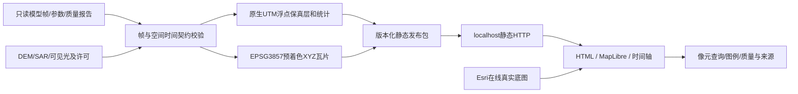

# 广西久隆、宁明、贵港二维洪涝可视化实现计划

> 编制与核验日期：2026-10-27。交付范围：实施计划、开源核验、资产与可见光检索证据。**尚未开发网页，未重跑模型。**
>
> 推荐方案：**本地 HTML 入口＋本地静态资源包＋回环 HTTP 服务＋可选在线 Esri 真实底图**。读取真实逐帧水深和时间元数据，提供三地切换、多源叠加、时间轴回放与数值查询。已有成果属于研究性情景，不是业务预警。
>
> 需求补充已纳入：①不用最大水深图伪造时间演变；②按案例显示影像可用状态；③补查宁明、贵港公开可下载可见光。结果见[可见光检索报告](<宁明_贵港_公开可见光影像检索结果.md>)。

## 1. 项目概述与目标

### 1.1 目标与使用场景

面向水动力研究、成果汇报和遥感复核。用户在一个页面选择久隆、宁明、贵港，然后查看二维洪水推进、扩展及退水过程。

必须实现的操作：

1. 三地切换，自动定位到所选模型范围，不用整个行政区冒充模型域。
2. 选择“仅可见光、仅 SAR、仅 DEM、仅淹没、全部可用图层、自定义”。底图单独开关。
3. 拖动时间轴、播放/暂停、上一帧/下一帧、调整播放速度。
4. 独立调节图层透明度，显示图例和真实获取/模拟时间。
5. 点击查询当前帧水深、模型网格分辨率和来源；显示面积—时间曲线。
6. 显示情景、质量门、数据缺口、来源和许可。切换案例时同步更新所有信息。

### 1.2 本地 HTML 的交付边界

- 主交付为一个 `index.html` 入口和同目录资源包，不把 GB 级影像嵌入单个 HTML。
- 通过本机 `127.0.0.1:8765` 打开。交付启动脚本；服务器只绑定回环，不向局域网开放。
- 本地 DEM、SAR、光学和水深在断网时仍能展示。在线 Esri 底图需要联网。
- 若强制要求单文件、双击 `file://` 且完全离线，只能另做小 AOI、降采样预览版；它不替代完整交互交付。
- 本项目网页与当前 DSH GUI 是两个产品。不得修改或替换 DSH 服务。本次规划不启动任何服务器。

### 1.3 已核验的实际基础

本次对六组 run 扫描了全部水深帧文件名及六行栅格头，核对了输出间隔。全部序号连续、每组栅格头一致。这不是逐像元数值或模型精度验收。

| 地点/用途 | run_id | 网格 | 水深帧数 | 间隔/覆盖时长 | 采用原则 |
|---|---|---:|---:|---|---|
| 久隆默认 | `scen_free_200m_sv6h` | 200 m，182×152 | 21 | 6 h；T+0～120 h | 已确认存在；不采用旧版仅2帧目录 |
| 久隆扩展退水 | `scen_free_200m_sv6h_recession` | 200 m | 53 | 6 h；T+0～312 h | 可选独立情景；说明退水验证限制 |
| 宁明默认参考 | `scen_q6000_n100_100m` | 100 m，244×224 | 19 | 6 h；T+0～108 h | 标“事后参考组合，非独立验证” |
| 宁明基线对照 | `scen_q4000_100m` | 100 m | 19 | 6 h；T+0～108 h | 可切换情景，不拼接为连续事件 |
| 贵港默认 | `scen_yagi_q11500_30m_b5` | 30 m，2230×1233 | 57 | 6 h；T+0～336 h | 展示最新区域30 m成果 |
| 贵港历史对照 | `scen_yagi_q11500_200m` | 200 m，334×185 | 57 | 6 h；T+0～336 h | 明示200 m对照，不冒充30 m |

证据：[逐帧审查](<visualization_research/frame_audit.json>)、[最新执行状态](<../2d_hydro_project/docs/execution_status.md#L5-L37>)。部分旧说明仍写“贵港30 m未执行”，以实际 run、最新状态及审查记录为准。

### 1.4 成功标准

以下为开发验收目标，不是已实测网页性能。测试基准为本机16 GB内存、SSD、Edge/Chrome、1920×1080。

| 指标 | 目标 | 数据/时点 |
|---|---|---|
| 三地覆盖 | 三个案例均能回放真实帧 | M1：21/19/57帧全量索引 |
| 图层状态 | 15个“地点×预设”用例行为正确；缺图层不显示空白假开关 | M2：含缺失/部分覆盖夹具 |
| 时间完整性 | 无重复、无未说明缺帧；显示实际帧时间与间隔 | M1：源参数及日志核对 |
| 查询数值 | 原生网格保真层与源值误差≤max(1e-5 m, 1e-6×绝对源值) | M1：三地抽样及边界值 |
| 统计一致性 | 当前帧面积与同阈值、同掩膜源统计相对差≤0.1% | M1；零面积单独断言 |
| 空间导出 | 算法定位误差≤0.5个源像元；无轴序或半像元偏移 | M1；不是遥感绝对定位精度承诺 |
| 本地首屏 | 冷启动≤5 s；首批可见业务瓦片≤2 s | M3：不计在线底图网络耗时 |
| 播放 | 预取后1～2帧/s稳定回放；超时缓冲不伪造帧 | M3：三个代表范围各30轮 |
| 点查询与交互 | 缓存命中查询p95≤200 ms；界面操作响应p95≤300 ms | M3：浏览器自动化 |
| 资源 | 元数据≤1 MB/案例；浏览器总内存目标≤1.5 GB | M3：贵港30 m压力测试 |
| 汇报可读性 | 5名试用者中≥4名在1分钟内完成选地、选时、开SAR | M3：标准任务表 |

### 1.5 非目标与约束

不改求解器，不训练神经网络，不输出未经计算的中间水深。暂不做三维、在线预报、账号系统、设备级安全判定。未确认 `u/v` 时不做“真实流速粒子”。不扩大模型域，不默认下载所有原始遥感场景。

当前关键限制：DEM产品来源/垂直基准未闭合；模型边界是降级情景；SAR只在其过境时刻提供范围证据；久隆本地可见光为2026年产品，而其主模型事件为2024年。三地不是同一场洪水，页面不得共用一个绝对时间轴。

## 2. 开源调研与借鉴方案

### 2.1 检索方法与真实性

通用 `web_search/web_fetch` 工具在本次会话配置失败。因此采用明确的官方端点、GitHub API/网页、STAC目录检索，不声称完成全网穷举。记录如下。

| 渠道/主题词 | 实际检索/核验规模 | 筛选结论 |
|---|---:|---|
| GitHub：WebGL map、GeoTIFF browser、COG、projection、PMTiles | 7个具名仓库 | 六个API verified；Proj4js为verified-web |
| Esri REST：World Imagery、World Street Map | 2个服务元数据＋两地4个瓦片请求 | 元数据200；瓦片200/jpeg；CORS为`*` |
| Earth Search：Sentinel-2 L2A＋宁明模型AOI＋2026-08-01～09-15 UTC | 44条STAC item | 选2景核验下载与AOI云量 |
| Earth Search：Sentinel-2 L2A＋贵港模型AOI＋2024-09-01～10-31 UTC | 25条STAC item | 选4景核验；保留云影/覆盖限制 |
| HF/Papers/arXiv | 未检索 | 本任务是GIS成果发布，不引入新模型/权重 |

仓库使用技能的`D:/SharedSkills/project-implementation-plan/scripts/verify_repos.py`。API限流/网络失败记录未伪装为成功；重试通过的原始JSON单独保留。汇总：[仓库核验JSON](<flood-visualization-repos.json>)、[核验表](<flood-visualization-repos.md>)。抓取UTC时间保留到每项。该脚本仅支持GitHub，不能用于STAC数据集或Esri服务；后两类使用实际HTTP响应和小范围读取核验，未写入伪造的仓库记录。

### 2.2 推荐与备选

评分采用场景30/复用20/本地数据适配20/许可15/维护15；这是本项目工程判断，不是公开性能排名。公开精度、FPS不可直接跨项目套用。

| 资源 | 角色/复用方式 | 优点 | 限制与二次开发 | 许可/状态 | 评分/决定 |
|---|---|---|---|---|---|
| [MapLibre GL JS](<https://github.com/maplibre/maplibre-gl-js>) | 地图交互、栅格XYZ、GeoJSON | 可用本地JS，无服务端GIS依赖 | 不原生解码COG；实现业务面板与帧切换 | BSD-3-Clause；verified | 93；主选 |
| [GDAL](<https://github.com/OSGeo/gdal>) | 通过rasterio调用地理栅格能力 | 裁剪、warp、读写成熟 | 不是浏览器库；避免Windows临时编译GDAL | 主体MIT-style，含第三方条款；verified | 95；主选 |
| [Proj4js](<https://github.com/proj4js/proj4js>) | 点击坐标WGS84→UTM | 查询能返回原生网格值 | 只注册32648/32649；与pyproj交叉测试 | MIT，许可原文已读；verified-web，stars/提交未确认 | 85；主选 |
| [geotiff.js](<https://github.com/geotiffjs/geotiff.js>) | 后续浏览器COG窗口查询 | 支持GeoTIFF解码 | 全量解码内存高；Range服务器需实测 | MIT；verified | 81；后续可选 |
| [PMTiles](<https://github.com/protomaps/PMTiles>) | 海量瓦片单文件分发 | 文件少，适合静态发布 | 需要Range服务；首版不引入 | 实现BSD-3-Clause、规范CC0；verified | 78；规模增大后 |
| [georaster-layer-for-leaflet](<https://github.com/GeoTIFF/georaster-layer-for-leaflet>) | 小AOI原型备用 | GeoTIFF集成短 | 属Leaflet生态；不与MapLibre混装 | Apache-2.0；verified；最近推送2025-09 | 71；备选 |
| [Tippecanoe](<https://github.com/mapbox/tippecanoe>) | 复杂矢量生成瓦片 | 成熟的GeoJSON切片 | 仅矢量；首版小GeoJSON已足够 | API报BSD-2-Clause；锁定版本时复核原文；verified | 69；不进首版 |

许可证说明：API的 `NOASSERTION` 仍保留在证据中。MapLibre、GDAL、PMTiles条款来自独立LICENSE核对。发布需复制实际锁定版本的许可证与NOTICE。模型软件本身的许可仍按[模型清单](<../2d_hydro_project/configs/model_manifest.yaml#L29-L30>)审查，不因网页使用宽松许可库而自动解决。

### 2.3 真实空间底图

首选两种在线底图，先做真实瓦片验证，再决定内部使用是否满足服务条款。

| 服务 | 官方元数据 | 栅格接入模板 | 验证/约束 |
|---|---|---|---|
| Esri World Imagery | [MapServer](<https://server.arcgisonline.com/ArcGIS/rest/services/World_Imagery/MapServer?f=pjson>) | `https://server.arcgisonline.com/ArcGIS/rest/services/World_Imagery/MapServer/tile/{z}/{y}/{x}` | WKID3857；在线影像背景，不是事件同期观测 |
| Esri World Street Map | [MapServer](<https://services.arcgisonline.com/ArcGIS/rest/services/World_Street_Map/MapServer?f=pjson>) | `https://services.arcgisonline.com/ArcGIS/rest/services/World_Street_Map/MapServer/tile/{z}/{y}/{x}` | 街道地名背景；保留完整署名 |

注意Esri路径是 `z/y/x`，不是机械照搬XYZ的 `z/x/y`。MapLibre source设为raster、tileSize=256、EPSG:3857。`exportTilesAllowed=false`，不得批量缓存并称为离线授权；能请求不等于免费无限使用。CORS响应已核验，但浏览器端集成未验证，见[底图探测](<visualization_research/basemap_probe.json>)。

署名从元数据加载，例如World Imagery当前为“Source: Esri, Vantor, Earthstar Geographics, and the GIS User Community”。在线失败时保留本地数据、比例尺和范围，显示“在线底图不可用”；不偷偷切换到未审核的地图。WGS84/UTM输入不施加GCJ-02偏移；若以后接入GCJ-02服务，必须另行登记坐标变换与合规。

## 3. 系统架构与算法设计

### 3.1 明确选型：首版不需要动态GIS服务



Python/rasterio/pyproj/Pillow负责离线预处理；MapLibre负责显示；Proj4js负责坐标查询。浏览器**不直接解析巨型ASCII或整省TIFF**。

首版数据分为两条链：

- **显示链**：各图层预生成透明PNG XYZ瓦片；底图可在线，本地业务瓦片始终同源。DEM/RGB可双线性，分类掩膜必须最近邻；洪水首版采用最近邻显示，固定色带，避免边界“新增淹没”。
- **保真链**：模型原生网格写Float32分块二进制，256×256、little-endian。NoData为NaN，干地0，负异常另记质量码。点击lon/lat经Proj4js→原生UTM→逆仿射行列号→对应块读取；不能从PNG颜色反算水深。每次只读需要的块，不需要HTTP Range。
- COG作为可选分析归档，保留原生投影和无损压缩。首版HTTP服务不依赖COG随机读取，普通Python 3.12 `http.server`不能当作已支持Range的COG/PMTiles服务。以后上Range版本必须新增206测试。
- 小AOI/站点/足迹用GeoJSON。掩膜无需逐帧全部矢量化，避免多边形爆炸。PNG瓦片不能作为定量统计来源。

### 3.2 可编码的I/O契约

| 对象 | 必填字段及类型 | 单位/校验 |
|---|---|---|
| 案例 | `case_id:enum`、`name:string`、`model_bbox:[number×4]`、`default_run_id:string` | case_id三选一；bbox为WGS84西南东北 |
| 运行 | `event_id`、`run_id`、`model_version`、`scenario_role`、`source_asset_ids`、`source_hashes` | 明确研究情景、参考/基线/敏感性；绝对source_paths只存私有构建台账，不进入发布包 |
| 网格 | `crs:string`、`shape:[rows,cols]`、`transform:[number×6]`、`grid_hash` | m制UTM；明确pixel-is-area与左上角 |
| 时间 | `time_origin:string|null`、`time_zone`、`origin_status`、`save_interval_s:number`、`simulation_duration_s:number` | ISO8601带+08:00；缺起点只显示相对小时 |
| 每帧 | `frame_id`、`source_sequence:int`、`sim_seconds:number`、`timestamp:string|null`、`depth_tiles`、`query_blocks`、`sha256` | 当前三地均6h；严格递增；末帧不得超模拟结束 |
| 光学/SAR | `asset_id`、`acquired_at`、`footprint`、`availability`、`coverage_fraction`、`reason`、`source_url` | 采集时间不随模拟滑块改变；原景云量和AOI云量分列 |
| 质量 | `mass_gate`、`e_mass`、`validation_status`、`warnings[]`、`vertical_datum_status` | PASS不能推导“预测正确”；不编造概率置信度 |
| 发布 | `schema_version`、`bundle_id`、`source_manifest_hash`、`created_utc`、`license_notice` | created_utc不是事件时间；所有URL为发布包相对路径或批准外链 |

`transform`固定为rasterio/Affine的 `[a,b,c,d,e,f]`，不是GDAL六元组顺序。像元中心满足 `x=a*(col+0.5)+b*(row+0.5)+c`、`y=d*(col+0.5)+e*(row+0.5)+f`。点查反变换后向下取整，越界返回“域外”，不夹到边缘像元。Float32 NaN只在二进制内使用；JSON缺值写null。

时间索引格式示例（贵港，用于说明字段；URL在开发时生成）：

```json
{
  "schema_version": "1.0",
  "case_id": "guigang",
  "event_id": "2024-09-yagi",
  "run_id": "scen_yagi_q11500_30m_b5",
  "time_origin": "2024-09-03T00:00:00+08:00",
  "time_zone": "Asia/Shanghai",
  "origin_status": "model_schedule_confirmed",
  "save_interval_s": 21600,
  "frame_count": 57,
  "temporal_interpolation": "none",
  "frames": [{
    "frame_id": "f0000",
    "source_sequence": 0,
    "sim_seconds": 0,
    "timestamp": "2024-09-03T00:00:00+08:00",
    "depth_tiles": "tiles/guigang/f0000/{z}/{x}/{y}.png",
    "query_blocks": "numeric/guigang/f0000/{block_y}/{block_x}.bin"
  }]
}
```

完整索引必须有全部57帧；示例只演示一个元素。缺失的哈希不填假值，schema在发布时要求真实sha256。

### 3.3 时间轴与逐帧正确性

1. 读取实际run参数、结果文件、运行日志。核实首帧是否T=0、快照计数约定和末帧策略。
2. 确认是本项目等间隔、无restart的run后，按 `source_sequence × saveint` 计算相对时间。未来不等间隔或断点续算直接用逐帧时间表，不能通用套公式。
3. 不用文件修改时间、目录名、GIF帧号或 `generated_utc` 充当模拟时刻。运行参数缺失时拒绝正式发布。
4. 模型时间候选：久隆从2024-09-05 00:00、宁明从2026-08-21 00:00、贵港从2024-09-03 00:00，北京时间。久隆/宁明在脚本构造中有依据，但旧meta缺规范t0；M0必须对照冻结雨量、边界及代码哈希后入索引。无法核对则保持`relative_only`。
5. 时间轴步进严格吸附实际帧。现有成果写“6小时离散回放”；播放2帧/s不代表0.5秒一个物理计算时刻。
6. 最大水深为独立“全程最大包络”产品，启用时暂停时间回放并显示不同标题。首次到达不是峰值时刻；区间采样只能给出到达时间精度上限。
7. 加密方案作为M4：先试1 h输出，关键涨水时段再试15～30 min。只缩短输出间隔，不声称提高物理精度。宁明/贵港当前脚本写死21600，统一入口也未传`--saveint`；必须先改参数传递并测试，不能直接给一个无效重跑命令。
8. 加密必须生成新run_id，不能覆盖历史run；不使用线性/AI插值冒充模型结果。贵港30 m原14天算例约12 h，新增I/O后耗时需重新测量。

依据：[久隆输出参数逻辑](<../2d_hydro_project/scripts/stage3/jiulong_scenarios.py#L37-L64>)、[宁明时间构造](<../2d_hydro_project/scripts/stage3/ningming_scenario.py#L224-L260>)、[贵港30 m元数据](<../2d_hydro_project/outputs/guigang/2024-09-yagi/scen_yagi_q11500_30m_b5/meta.json#L9-L14>)、[统一入口](<../2d_hydro_project/scripts/run_case.py#L35-L42>)。

### 3.4 图层可用性与交互草图

```text
┌ 久隆 | 宁明 | 贵港     事件/情景/网格     情景级·非预警 ┐
│ 左：图层与预设        中：真实地理地图      右：像元值  │
│ DEM   [√] 透明度      水深、观测足迹       面积/来源   │
│ SAR   [√] 获取日期    未覆盖区透明         质量告警    │
│ 光学  [状态/理由]     模拟域边界           图例       │
│ 洪水  [√]            比例尺/地名/署名                 │
├ 播放 | 上一帧 | 下一帧 | T+小时 / 绝对时间 | 6h/帧    ┤
└ 当前帧面积曲线；最大包络独立入口；影像时间不随滑块变  ┘
```

- 状态枚举：`remote_verified`可下载未导入、`local_unchecked`本地未验、`ready`可用、`partial`部分覆盖、`missing`未提供、`failed`失败。
- 只有`ready/partial`可勾选。未导入、缺失、加载失败都显示原因；不能亮着开关却没有图层。
- “全部”表示开启全部**可用**图层，不表示所有图层必须100%不透明。默认顺序：底图→DEM→光学→SAR→洪水→边界与站点；可调整透明度，支持SAR/光学卷帘或并排对比。
- 灾后影像不能被自动配给灾前时刻。显示“影像2026-09-03；模拟2026-08-24”，用户知道两者日期不同。
- 时间切换采用双缓冲；新帧可见瓦片和图例/统计准备好后统一提交。用case/run/frame令牌丢弃过期请求，避免快速拖动时错帧或混合两地。
- 预取前后1帧，LRU限制缓存256 MB。缺帧时暂停并指明缺失，不填0、不沿用旧帧却更新日期。

### 3.5 科学口径

显示阈值默认0.05 m，与现有产品一致；宁明SAR验证主阈值0.15 m必须独立保留，不能跟随可视化调色改变已报告CSI。统一深度分级可设0.05/0.15/0.3/0.5/1/2/5/10 m及≥10 m；三个案例/所有帧用同一图例，阈值写入元数据，不解释为资产安全等级。

当前面积是原生网格有效非海域内 `depth > threshold` 的单帧面积。与永久水体差集生成“新增淹没”时必须有同域基期水体；否则名称为“模拟积水范围”，不暗示都是新增洪灾。未知域不作干地。水位与DEM的垂直基准未统一，不能直接相减率定。

[质量记录](<../2d_hydro_project/data/catalog/mass_recheck_g15.json#L1-L15>)当前是36 PASS、3 FAIL-EXPLAINED、0 FAIL，三个解释性失败不算通过。页面展示所选run的状态而非写死总数。宁明事后参考CSI约0.357来自既有报告，不是本次重新验证；贵港30 m不能继承200 m的验证指标。

### 3.6 方案对比与处理流程

本次复用已完成的LISFLOOD-FP结果，不重新选择水动力模型。网站方案不会提高模型本身的空间精度。

| 方案 | 数值精度口径 | 时延/内存 | 数据与部署条件 | 结论 |
|---|---|---|---|---|
| 预渲染XYZ＋原生数值块 | 显示与原值分离；定量值按1.4验收 | 目标1～2帧/s、浏览器≤1.5 GB；网页未实测 | 21/19/57帧规模可控；只需静态HTTP | 主选；最少服务依赖 |
| 浏览器直接COG | 依解码/投影实现；不能以颜色当原值 | 时延/内存未验证；大范围解码有风险 | 必须有Range、COG客户端和并发测试 | 后续查询优化，不阻塞首版 |
| 动态瓦片服务器 | 可按请求切片/调色，仍需保真核对 | 服务器CPU/RAM和并发未验证 | 新增长期服务、部署与运维 | 仅多人/大规模数据时另评估 |

训练流程：不适用。离线处理流程为“冻结输入→验证帧/时间→原生统计与数值块→显示瓦片→内容校验→版本包”。在线读取流程为“选案例/运行→读时间索引→选择真实帧→缓冲瓦片/统计→统一提交画面→原生网格点查”。每一步输出均在第3.2节契约和第4节目录中落地。

## 4. 详细文件夹结构

### 4.1 与现有工程的差异

[现有项目元数据](<../2d_hydro_project/pyproject.toml>)使用setuptools、Python3.12和`dev` extra，不是`dev` dependency group。不能直接在旧项目照抄`uv sync --group dev`。本计划在 `2d_hydro_project/flood_visualization/` 创建隔离的发布子项目，仅读取父项目模型输出；不搬迁现有src、不覆盖现有锁文件或模型。

已执行技能脚手架`--dry-run`，会产生47个通用ML文件；没有真正生成。顶层目录沿用规范，业务包裁剪为GIS功能，**不生成无任务的train/models/detect空模块**。新项目使用uv+hatchling，后续锁定自己的环境。现有目录保留，新增项清单如下。

```text
2d_hydro_project/flood_visualization/
├── README.md                    # 使用方式、构建与启动
├── LICENSE                      # 发布授权，不替代数据条款
├── AGENTS.md                    # 路径、命令、只读源规则
├── pyproject.toml               # uv依赖、hatchling、pytest/ruff配置
├── uv.lock                      # 固定Python依赖
├── .python-version              # 3.12
├── .gitignore                   # 大数据、秘密、缓存、运行产物
├── justfile                     # 可复制命令入口
├── src/
│   └── floodviz/
│       ├── __init__.py          # 包版本
│       ├── __main__.py          # python -m floodviz入口
│       ├── cli.py               # inventory/prepare/validate/build
│       ├── config.py            # 路径和schema校验
│       ├── catalog/             # run、影像、时间与来源
│       ├── raster/              # 原生数值块、warp、XYZ导出
│       ├── quality/             # 帧、数值、掩膜、统计验收
│       └── publishing/          # 资源包、manifest、脱敏
├── configs/
│   ├── default.yaml            # 三案例源路径和发布参数
│   ├── cases/                  # 三地run、AOI、时间依据
│   ├── layers.yaml             # 状态、透明度、色带、足迹
│   └── basemaps.yaml           # Esri模板和署名
├── web/
│   ├── index.html             # 唯一主入口
│   ├── styles.css             # 中文布局和图例
│   ├── app.js                 # 状态管理和案例切换
│   ├── map.js                 # 地图/图层/点查询
│   ├── timeline.js            # 时间轴、预取、双缓冲
│   └── vendor/                # 固定版本JS/CSS及对应LICENSE
├── scripts/
│   ├── fetch_vendor.py        # 下载固定前端资源，校验sha256
│   ├── build_web.py           # 拷贝静态页面并生成发布索引
│   └── start_local.cmd        # ASCII启动器，仅绑定127.0.0.1
├── data/
│   ├── README.md              # 来源、规模、授权登记
│   ├── raw/                   # 只读引用或授权小样本
│   ├── interim/               # AOI裁剪和临时转换结果
│   ├── processed/             # 可发布影像与数值块
│   ├── external/              # 第三方条款与资源
│   └── splits/                # 固定验证抽样索引（入库）
├── schemas/                   # catalog/timeline/bundle JSON Schema
├── tests/
│   ├── conftest.py            # 合成网格与小样本
│   ├── unit/                 # 投影、时间、阈值、状态机
│   ├── integration/          # 源帧→发布产品
│   └── e2e/                  # Python Playwright网页测试
├── docs/                     # 数据契约、许可、验收、操作手册
└── .github/
    └── workflows/ci.yml      # lint→测试→小样本发布验收
```

运行产物不进入提交树；目录如下。bundle_id同时包含版本和日期，不覆盖历史包。

```text
outputs/web_bundle/<bundle_id>/
├── index.html                 # 页面入口
├── assets/                    # 本地JS/CSS/字体/许可
├── catalog.json               # 三案例与可用状态
├── cases/<case_id>/            # 各run时间轴和统计
├── tiles/<case_id>/            # 图层/帧/z/x/y.png
├── numeric/<case_id>/          # 原生网格256块及有效掩膜
├── licenses/                  # 数据与软件条款、署名
└── manifest.json              # 内容哈希、构建参数、质量摘要
```

### 4.2 关键文件和纪律

| 文件/目录 | 职责 | 首次阶段 |
|---|---|---|
| `configs/cases/`、`schemas/` | 明确run选择、时间和图层状态 | M0 |
| `src/floodviz/catalog/` | 从真实参数生成timeline，不由GIF推断 | M0 |
| `src/floodviz/raster/` | 数值保真与显示瓦片分离 | M1 |
| `web/timeline.js`、`web/map.js` | 案例令牌、预取与图层开关 | M1 |
| `scripts/fetch_vendor.py` | 固定MapLibre/Proj4js版本、哈希与许可证 | M1 |
| `tests/e2e/` | 可用/缺失/部分覆盖、切帧不串数据 | M2 |
| `docs/acceptance_report.md` | 时间、空间、数值、性能验收证据 | M3 |

目录与Python包统一snake_case；已有中文源路径仅作配置，不复制到公开URL。每个重要目录有说明；纯占位目录用`.gitkeep`。`.gitignore`覆盖data大文件、outputs、logs、.venv、缓存、构建物、凭证；保留data README、splits索引、schema与许可。禁建`utils/`、`misc/`、`temp/`、`test2/`、`new/`噪音目录。根目录只放元文件，不放业务.py、栅格或日志。

## 5. 分阶段开发计划

### 5.1 里程碑与验收

估算为1名前端/全栈＋GIS协作的工作日，核心12日。许可等待、整景下载及模型重跑另计。先有可以独立演示的三地逐帧MVP，不等待全量光学补齐。

| 里程碑 | 目标 | 周期 | 交付物 | 验收标准 | 依赖 |
|---|---|---:|---|---|---|
| M0 数据契约 | 冻结源与真实时序 | 2日 | run登记、schema、图层矩阵、环境 | 三地默认run文件全齐；时间有依据；影像状态无混淆 | 当前证据 |
| M1 三地MVP | 地图＋逐帧淹没 | 4日 | HTML、XYZ、数值查询、timeline | 三地21/19/57帧均可回放；最大包络独立；缺帧测试失败即阻止发布 | M0 |
| M2 多源叠加 | DEM/SAR/可见光与真实底图 | 3日 | 图层预设、透明度、影像足迹/时间 | 每案例状态正确；单层/全部可用；光学未导入时禁用 | M1；光学裁剪可并行 |
| M3 发布验收 | 性能、质量、离线启动 | 3日 | bundle、启动器、手册、验收报告 | 数值/空间/时间门通过；两浏览器、断网、100次切换、回滚演练通过 | M2 |
| M4 可选加密 | 1 h/15～30 min真实输出 | 先1日实验＋按算例机时 | 新run与新timeline | 参数传递测试通过；冻结原run；质量守恒复验；不改标称原帧精度 | 用户认可成本后 |

### 5.2 可执行任务表

| ID | 任务 | 依赖 | 产出物 | 负责角色 | 估时/验收 |
|---|---|---|---|---|---|
| T01 | 冻结run白名单，排除invalid/interrupted | 无 | `configs/cases/` | GIS | 0.5日；21/19/57帧与头一致 |
| T02 | 补规范时间、schema、影像状态 | T01 | catalog/timeline schema与依据 | GIS | 0.75日；未知时间不得填实测 |
| T03 | 创建隔离uv项目与基础测试 | 无 | 子项目骨架与锁文件 | 全栈 | 0.75日；不改父项目依赖 |
| T04 | 导出原生块和当前帧统计 | T01/T03 | numeric、statistics、校验日志 | GIS | 1日；容差与掩膜一致 |
| T05 | 输出XYZ并固定色带 | T04 | 瓦片包、投影回归 | GIS | 1日；无半像元偏移/NoData污染 |
| T06 | 三案例、地图、时间轴与查询 | T02/T05 | 可独立演示MVP | 前端 | 2日；不串帧、卡顿显示缓冲 |
| T07 | 导入公开光学，SCL与人工复核 | T02 | AOI RGB、云影/有效足迹、许可 | GIS | 1日＋下载；ready/partial才启用 |
| T08 | 图层预设、透明度、卷帘、来源面板 | T06/T07 | 交互和可用状态 | 前端 | 2日；15个预设用例通过 |
| T09 | 全量内容和浏览器验收 | T08 | 单元/集成/e2e/性能报告 | QA | 1.5日；必需门禁全过 |
| T10 | 打包、启动、回滚、移交 | T09 | 两版bundle和操作手册 | 全栈 | 1.5日；路径含中文可运行 |

关键路径：T01→T02/T04→T05→T06→T08→T09→T10。T03可与盘点并行，T07可在MVP期间进行。T07未完成不阻止MVP，但不能声称“所有三地光学均已交付”。M3不以网页漂亮代替科学质量状态。

## 6. 数据与模型训练策略

### 6.1 本地数据源与覆盖

实测空间元数据留在[本地资产抽查](<visualization_research/local_assets_metadata.json>)。只读头和范围，不代表完成所有像元质量审查。

| 来源 | 规模/格式 | 已知覆盖与时间 | 权限/接入策略 |
|---|---|---|---|
| `广西DEM` (`D:/NWKYYSJZX/2026年工作/0731 五省区DEM/广西/广西.tif`) | 2.05 GB；61834×49239；int16；12.5 m；EPSG32648 | 覆盖三地；NoData=0需谨慎 | 原始文件只读；来源/垂直基准/外发许可未闭合 |
| `久隆RGB` (`D:/NWKYYSJZX/2026年工作/0731 五省区DEM/淹没分析 7.8/data/500kV久隆站附近/灾前可见光/SVN3-01_20260403_L4D0000293335_02_6042500742470001_RGB.tiff`) | 4.72 GB；3波段uint8；EPSG4326 | 范围108.598887～108.8562015E、21.829158～22.075983N；仅覆盖部分模型域；文件名日期2026-04-03 | `local_unchecked`→质检后partial；只作2026背景，不作2024事件观测 |
| `久隆SAR派生` (`D:/NWKYYSJZX/2026年工作/0731 五省区DEM/淹没分析 7.8/data/灾后SAR_久隆区域.tif`) | 60.9 MB；3 m派生网格 | 部分AOI；不是3 m原生地形精度 | 核对传感器/日期/处理链；2026旧成果不能默认为2024同期 |
| [宁明GF-3 SAR](<../2d_hydro_project/data/raw/ningming_validation/淹没深度验证数据-崇左宁明县/宁明县8月24日SAR.tif>) | 122.7 MB；uint8；EPSG4326 | 有8/6与8/24两期；精确时刻待证据 | 遥感观测背景；水体掩膜独立层，不当作水深 |
| [贵港S1后向散射](<../2d_hydro_project/data/processed/s1_water/guigang_20240912T104222_sigma20m.tif>) | 28.0 MB；20 m；EPSG32649 | 2024-09-12；只覆盖模型域东部一部分 | 保留G17降级说明，必须画足迹；不宣称全市覆盖 |
| 模型帧 | 久隆默认约3.49 MB、宁明参考6.24 MB、贵港30 m约940 MB ASCII水深 | 21/19/57帧；6 h | 采用[逐帧证据](<visualization_research/frame_audit.json>)中的路径，禁止扫描后混选废弃版本 |

不得仅按目录名判定模态：外部“灾前SAR”目录出现与RGB同名同大小影像，必须核验波段/数据类型/传感器元数据后分类。RGB对比度方案与SAR单位、拉伸范围固定到asset配置；SAR后向散射不是水深，不能共用深度图例。

### 6.2 宁明、贵港公开可见光检索

已查询Earth Search `sentinel-2-l2a`。宁明44条，贵港25条；“条目”不等于无云日期。六景的TCI、B04、B03、B02、SCL共30个资产均做了匿名HTTPS Range请求，返回206且文件头为TIFF。为避免只按整景云量误判，额外读取约13.6 MB的六景SCL在模型AOI内统计。

| 地点/候选（北京时间） | 公共景ID | AOI有效覆盖 | AOI云/云影占有效像元 | 决策 |
|---|---|---:|---|---|
| 宁明 2026-09-03 11:32 | `S2A_48QYK_20260903_0_L2A` | 100% | 0% / 0% | 推荐背景；晚于事件，不是洪峰观测 |
| 宁明 2026-08-12 11:31 | `S2C_48QYK_20260812_0_L2A` | 100% | 31.4821% / 0.6487% | 灾前候选；不能因整景云量8.35%就认定AOI清晰 |
| 贵港 2024-10-03 11:21 | `S2B_49QCF_20241003_0_L2A` | 96.8428% | 0.0005% / 0% | 推荐低云背景；约3.16%空缺透明 |
| 贵港 2024-10-31 11:31 | `S2A_49QCF_20241031_0_L2A` | 67.6182% | 0.0032% / 0.0090% | 补缺候选；联合覆盖率未确认，不能宣称拼接已成功 |
| 贵港 2024-09-03 11:21 | `S2B_49QCF_20240903_0_L2A` | 97.0434% | 15.1739% / 0.1500% | 事件初期有云背景 |
| 贵港 2024-09-13 11:21 | `S2B_49QCF_20240913_0_L2A` | 96.7495% | 34.3356% / 5.8748% | 近洪峰候选，云影限制明显 |

下载链接、拍摄秒级时间、分辨率与证据见[检索报告](<宁明_贵港_公开可见光影像检索结果.md>)、[HTTP/STAC证据](<visualization_research/optical_search_evidence.json>)、[AOI质量统计](<visualization_research/optical_aoi_quality.json>)。

- 可见光TCI或B04/B03/B02为10 m；SCL为20 m。SCL云是8/9/10类，云影3类，NoData0类。自动SCL不是人工无云证明。
- [AWS Open Data](<https://registry.opendata.aws/sentinel-2-l2a-cogs/>)与[Copernicus官方介绍](<https://dataspace.copernicus.eu/explore-data/data-collections/sentinel-data/sentinel-2>)确认Sentinel数据免费开放，包含商业用户。AWS本次读取无需token；[官方门户条款](<https://dataspace.copernicus.eu/terms-and-conditions>)要求注册访问数据。
- STAC `license=proprietary`指自定义Sentinel条款，不是MIT；官方条款区分Sentinel数据与门户其他内容。旧ESA链接读取失败，但[现行官方法律声明](<https://sentinels.copernicus.eu/documents/247904/690755/Sentinel_Data_Legal_Notice>)已返回HTTP 200并[归档PDF](<visualization_research/Sentinel_Data_Legal_Notice.pdf>)。允许合法复制、分发、修改、组合。原始公开传播署名 `Copernicus Sentinel data [Year]`，修改后署名 `Contains modified Copernicus Sentinel data [Year]`；宁明2026、贵港2024。数据无质量/适用性保证。
- 六景完整RGB未下载、未裁剪发布，当前状态是`remote_verified`。不得把新检索结果当本地已可用。网页首版可显示“可下载，尚未导入”并禁用开关。
- 贵港补缺若跨日期拼接，必须标“2024-10多时相背景”，保存每像元来源；不能当单日观测。

### 6.3 处理、标注、划分和数据不足策略

本次不训练模型。预训练权重、损失、优化器、批大小、增强和蒸馏均不适用，不为套模板引入AI模型。

“标注”指产品语义与人工质检：模型水深、SAR水体、光学背景、遥感反演各自命名；人工复核全部选中光学景，抽查每地≥20个稳定地物/NoData边界。数据按case/event/run划分；固定5%的有效像元及干湿边界/NoData/最大值样本用于导出回归，索引入data/splits。此划分只检验发布保真，不是独立水动力验证。

数据不足时：缺光学则灰显；部分足迹则透明显示空缺；缺时间起点则T+小时；无速度就不画流速；无质量概率就只展示原有质量等级。宁明/贵港没有同洪峰低云光学时，继续用SAR弱证据和模型情景，不能把几周后的晴空图当洪峰事实。

原生数值保留；显示用3857不替代计算用UTM。栅格重投影需处理NoData、轴序、像元边界和目标网格；不能仅把UTM矩形四角当作精确WGS84图像边界。源DEM的0值不能一律解释海面或干地。

## 7. 测试、评估与部署建议

### 7.1 测试金字塔与门禁

| 层次 | 用例 | 门禁 |
|---|---|---|
| 单元 | 帧号解析、参数缺失、restart拒绝、时区、图层状态、阈值、NoData、投影轴序 | 全过；未知时间不得自动猜填 |
| 集成 | 三地小样本导出、真实统计、原生查询块、瓦片足迹 | 保真容差与同源面积门限满足 |
| e2e | 三地切换、五预设、透明度、最大包络、SAR日期、播放/暂停/逐帧 | 信息与当前run/frame一致，无过期请求污染 |
| 故障 | 缺一个frame/瓦片、HTTP404、断网、token失效、未导入光学 | 明确提示；不显示假0水深或旧帧新时间 |
| 性能 | 贵港30 m、100次切地、30分钟播放、冷/热缓存 | 内存目标、p95目标、无持续增长 |
| 科学语义 | 最大包络与当前帧；首湿与峰值；质量门；模型/遥感时间不匹配 | 无误称；沿用所选run真实质量等级 |

当前基线：文件名/头已验，UI时延/像元保真/PNG定位未测。不能写成已达目标。量化目标见1.4；若不达标先减少预取、限制原生分辨率以上缩放、按可见范围切片，不牺牲时间与数值真实性。

### 7.2 部署与容量

- 本地CPU离线导出，单进程起步；分块读取，内存预算≤4 GB。贵港30 m Float32一帧约11 MB、57帧约0.63 GB未压缩；ASCII现有约0.94 GB。1 h输出337帧约3.71 GB Float32，15 min约1345帧/14.8 GB，未含其他产品。
- 2026-10-27实测D盘可用约45.8 GB。首版新增产物预算≤10 GB，导出前估算瓦片数量/缩放层级，保留≥15 GB余量。全域15 min方案必须另评估存储，不能先无界输出。
- 发布器M0先取3帧实测I/O与压缩率，估全量时长；主页面不是实时求解器。模型重跑、影像整景下载另列成本。
- 本地许可证合规前提下新增云资源成本为0；磁盘与网络按本机承担。在线Esri授权成本未确认，不承诺免费或无限调用。
- 默认仅静态XYZ＋数值块，Python静态服务足够。若以后引入COG/PMTiles在线窗口读取，改为经206/Range/CORS测试的服务，不盲目沿用基础HTTP服务器。
- 服务根只指向发布包，不暴露父项目、`.env`、源盘路径或站区未脱敏资料。HTML不嵌入私钥、下载token；联网底图会把视口位置发给供应商，敏感场景使用断网本地模式。

### 7.3 CI、发布与回滚

流水线：锁文件校验→ruff→pytest单元/集成→生成合成小样本bundle→Playwright浏览器测试→manifest校验→打包。CI不下载大遥感、不使用实际敏感坐标、不运行12 h模型。发布完整性在用户机跑，不用公共CI上传电网资料。

保留两个完整bundle；新包先校验再改启动器目标，失败恢复旧路径。不覆盖原模型、原影像和旧包。包内记录构建版本、输入sha256、参数、图例、投影、许可、时间证据。新增run需重新检测输入哈希、缺帧、质量门及图层状态；元数据发生变化触发重建，不需要“再训练”。

上线验收清单：三地真实帧均播放；光学/SAR日期可见；部分范围明确；单层/全部可用图层正确；最大包络独立；像元值、面积与源一致；弱验证和FAIL-EXPLAINED可见；中文路径启动；无跨域控制台错误；在线失败本地仍能用；署名和许可证齐全；回滚通过。

## 8. 风险与后续优化方向

| 类别/风险 | 概率 | 影响 | 触发信号 | 缓解措施 | 可执行兜底 |
|---|---|---|---|---|---|
| 数据：缺/部分影像 | 高 | 空白图层误导 | 状态非ready，足迹不足 | 按案例状态与coverage控制UI | 禁用开关或partial透明区 |
| 数据：拍摄与模型时间不同 | 高 | 把背景当洪峰实测 | 两日期不同 | 双时间标签、背景/观测角色 | 只作背景，不参与事件验证 |
| 时序：6h过稀 | 高 | 看不到短时涨水 | 首湿/峰值只能6h定位 | 显示离散精度；M4真实加密 | 逐帧步进，不伪造中间值 |
| 模型：降级边界/DEM误差 | 高 | 空间预测不可靠 | 低CSI、G7/G17、退水反向 | 展示质量和限制，默认合格run | 仅研究性演示 |
| 空间：投影/半像元错误 | 中 | 漂移、点击错误 | 控制点和网格断言失败 | 原生网格与3857分链验收 | 拒绝发布有偏移图层 |
| 工程：串帧/内存暴涨 | 中 | 播放错误/崩溃 | 快拖后日期值不一致 | 请求令牌、双缓冲、LRU上限 | 暂停播放，单帧查看 |
| 存储：加密时序膨胀 | 中 | D盘不足 | 估算超过预算 | 3帧测量，限制zoom/输出频率 | 保留6h包，停止新增导出 |
| 合规：底图/遥感/模型许可 | 中 | 不能外发 | 条款未存档或exportTilesAllowed=false | 发布白名单、署名、法务核对 | 仅内部访问；不打包受限数据 |
| 保密：在线视口/源路径泄露 | 中 | 暴露设施位置 | 外部请求含敏感视口 | 网络白名单、脱敏、不发源文件 | 关闭在线底图 |
| 科学：混用旧/新run指标 | 中 | 结果口径不一致 | 30m页面出现200m指标 | run_id贯穿每帧、统计、验证 | 只显示已匹配指标；缺项写未验证 |

优化优先级：①补规范时间与影像质检（低成本、避免误解）；②小范围1 h输出实验（量化时间分辨率收益）；③贵港背景足迹补齐（核验联合覆盖与日期标识）；④数值Range/PMTiles优化（达到文件数/体量阈值再引入）；⑤有真实速度帧和验证后再做流场。不把在线预报或三维列入首版验收。

## 9. 推荐技术栈与工具链

### 9.1 版本与职责

| 用途 | 主选/约束 | 理由 | 替代或不采用 |
|---|---|---|---|
| Python | 3.12；uv、独立pyproject/uv.lock、hatchling | 与现有环境兼容，不影响父工程 | 不另建第二套包管理流程 |
| 地理计算 | rasterio 1.5.x、pyproj 3.8.x、numpy 2.x | 本机已存在可读环境；在新项目锁具体补丁 | 不直接依赖本机ArcGIS安装 |
| 图像导出 | Pillow，固定锁版本 | PNG/色带，低依赖 | GDAL独立命令只在验证安装后启用 |
| 地图/投影 | MapLibre＋Proj4js本地vendor | 纯JS首版不需要Node构建链 | 后续再引入TS/Vite，不增加当前门槛 |
| 前端锁定 | vendor清单记录具体release URL、sha256、LICENSE | 不使用`latest`或运行时CDN | API tag需M0确认，不编造未测试版本 |
| 浮点发布 | 原生UTM分块Float32＋JSON schema | 无Range服务器也能精确点查 | COG归档；浏览器COG属后续 |
| 静态地图 | 本地XYZ＋小GeoJSON；可选Esri在线 | 本地资源可离线，真实地理背景独立 | PMTiles/TiTiler不进首版 |
| 测试 | pytest、pytest-cov、Python Playwright、ruff | 可由uv统一管理 | 不额外引入Node测试生态 |
| 实验/训练 | run_id、sha256、参数快照；无训练框架 | 发布工程，不训练新模型 | 不引入Torch/MLflow |
| 人工GIS核查 | 已有ArcGIS或QGIS，均非运行必需 | 对照稳定地物、投影、足迹 | 无GUI时用rasterio数值校验 |
| 部署/监控 | 本地静态HTTP＋构建日志＋加载错误统计 | 无云服务器；无常驻数据库 | 容器可选，首版不用 |
| 文档 | Markdown、JSON证据、操作手册 | 可定位可复查 | Word/PDF另有需求再转 |

开发依赖写`[dependency-groups].dev`；运行依赖写`[project].dependencies`；大型可选项写extras。Python基线target=py312，ruff检查E/F/I/UP/B/SIM/RUF，pytest固定tests路径和slow标记。所有测试都禁止隐式获取大数据。

### 9.2 现在可复制的只读检查

从本任务工作区执行，不会重跑模型或修改其输入。这两条本次已经执行成功。后者依赖本项目已有rasterio环境。

```powershell
$env:PYTHONUTF8 = '1'
uv run --no-project --python 3.12 python plans/visualization_research/audit_frames.py
uv run --project ./2d_hydro_project --no-sync python -c "import rasterio, pyproj; print(rasterio.__version__, pyproj.__version__)"
```

这类规划证据脚本仅写plans下的审查JSON。光学检索脚本、STAC查询URL见[检索报告](<宁明_贵港_公开可见光影像检索结果.md>)，不会触发整景RGB批量下载。

### 9.3 M0批准开发后初始化

以下命令是**未来实施步骤，本次未执行**。路径已统一为新的子项目，避免旧环境没有dev组的问题。

```powershell
$env:PYTHONUTF8 = '1'
if (Test-Path './2d_hydro_project/flood_visualization') {
    throw 'Target exists. Read it and merge missing files; do not overwrite.'
}
uv init --package --build-backend hatch --name floodviz --python 3.12 --vcs none --no-workspace './2d_hydro_project/flood_visualization'
uv --directory './2d_hydro_project/flood_visualization' add numpy rasterio pyproj pyyaml pillow jsonschema
uv --directory './2d_hydro_project/flood_visualization' add --group dev pytest pytest-cov ruff mypy playwright
uv --directory './2d_hydro_project/flood_visualization' lock --check
uv --directory './2d_hydro_project/flood_visualization' sync --frozen --group dev
```

uv的初始化参数已经通过help核对。M0按第4节补AGENTS、configs、schema、CI、测试和web；不会使用通用ML模板的空训练代码。国内镜像继承机器既定uv配置。

### 9.4 M1/M2代码完成后运行契约

**以下接口尚未实现，不能现在当成可运行命令。** T02/T04/T05/T06须实现并以集成测试验收。M0锁定前端版本后，先抓本地vendor。

```powershell
# 在本任务工作区根目录执行；实现后才可使用
uv --directory './2d_hydro_project/flood_visualization' run python scripts/fetch_vendor.py --config configs/default.yaml
uv --directory './2d_hydro_project/flood_visualization' run python -m floodviz inventory --config configs/default.yaml
uv --directory './2d_hydro_project/flood_visualization' run python -m floodviz prepare --config configs/default.yaml --bundle-id v1
uv --directory './2d_hydro_project/flood_visualization' run python scripts/build_web.py --bundle-id v1
uv --directory './2d_hydro_project/flood_visualization' run python -m floodviz validate --bundle outputs/web_bundle/v1
uv --directory './2d_hydro_project/flood_visualization' run ruff check src tests scripts
uv --directory './2d_hydro_project/flood_visualization' run pytest -m 'not slow' -q
# 首次自动化浏览器测试需下载Chromium；离线机器使用预置浏览器并登记
uv --directory './2d_hydro_project/flood_visualization' run playwright install chromium
uv --directory './2d_hydro_project/flood_visualization' run pytest tests/e2e -q
# 启动前确认8765空闲；服务器只暴露发布包
uv --directory './2d_hydro_project/flood_visualization' run python -m http.server 8765 --bind 127.0.0.1 --directory outputs/web_bundle/v1
```

浏览器入口为 `http://127.0.0.1:8765/index.html`。构建器必须把页面和本地vendor复制到包根，不能让HTTP只暴露有数据没有页面的目录。

### 9.5 计划自检与交付边界

```powershell
uv run --no-project --python 3.12 python 'D:/SharedSkills/project-implementation-plan/scripts/lint_plan.py' 'plans/广西久隆_宁明_贵港_二维洪涝可视化实现计划.md' --repos 'plans/flood-visualization-repos.json' --strict
```

计划lint检验九节、资源记录和任务表，不证明网页已实现。实施前仍需：M0规范时间元数据、光学下载裁剪与目视复核、许可归档、前端版本冻结。可直接复用现有三地逐帧成果启动MVP；**无需先从最大水深图“还原”动画，也无需为了第一次演示重复跑全部模型。**
