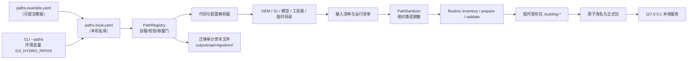

# 广西久隆/贵港/宁明 二维水动力模拟 —— 存储位置迁移兼容性排查、修复与验收计划

> ⚠️ **已被取代（2026-11-16）**：本计划编制于 `F:` 盘时代，其核心设计（`configs/paths.local.yaml`
> 14 键注册表、`path_policy.py`、`path_sanitizer.py`）**从未实现**，且其中的路径映射已全部过期
> （当时为 `F:\NWKYYSJZX\2026年工作\...`，现为 `E:\NWKYYSJZX\2026\...`）。
>
> 实际落地的可移植化方案见根 `AGENTS.md`「换盘 / 换位置后的首步」节，代码为
> `2d_hydro_project/scripts/common/paths.py`（锚点重挂，不依赖具体盘符与中间目录名）
> 与 `scripts/maintenance/{preflight,health_check,make_backup,verify_backup}.py`。
> 2026-11-16 已实测：项目复制到另一盘符且中间目录改名后，父子工程测试、质量门与 inventory 结果全部与源位置一致
> （当时计数为父 383 / 子 253 / 质量门 61-3-0 / inventory 18 run；现役计数见根 `AGENTS.md`「验证入口」，不作为迁移判据的固定值）。
>
> 本文件保留作为决策史，不再作为实施依据。

> 状态：计划已批准，等待 M0 目标映射确认后进入实施。
> 编制依据：2026-10-30 只读审计（工作区、`2d_hydro_project`、`flood_visualization`、`configs`、`data/catalog`、`outputs`、`docs`、`scripts`）。
> 事实纪律：本文区分「已验证」「未验证」「未确认」。未执行的检查一律写「未验证」，不把目标值写成实测值。

---

## 1. 项目概述与目标

### 1.1 背景与问题

项目工作区当前位于 `F:` 盘，但代码、配置、清单和文档仍绑定旧的 `D:`、`E:` 盘位置。磁盘存储位置已发生迁移，因此存在以下已确认的不适配：

| 类别 | 已确认问题 | 证据 |
|---|---|---|
| 地形主源 | DEM 绝对路径在 7 处以上重复出现 | `2d_hydro_project/configs/base.yaml:54`、`configs/cases/jiulong.yaml:35`、`configs/cases/ningming.yaml:34`、`configs/cases/guigang.yaml:36`、`scripts/stage1/clip_dem.py:24`、`scripts/stage0/dem_artifact_qa.py:26`、`scripts/stage0/make_input_manifest.py:26`、`scripts/stage5/guigang_scenario.py:36` |
| 卫星数据 | 同一数据链默认盘符互相冲突 | `scripts/stage1/download_s1.py:23` 默认 `D:/S1_gxhydro/sentinel1`；`scripts/stage1/verify_s1.py:14` 固定 `E:/S1_gxhydro/sentinel1`；`data/catalog/s1_downloads.json:5-40` 固定 `E:` |
| 工具链 | 编译器与临时目录写死 `D:` | `scripts/stage2/setup_toolchain.py:18,32,71`、`scripts/stage2/setup_w64devkit.py:14,28,54-55`、`configs/model_manifest.yaml:20` |
| 临时目录 | `TEMP`/`TMP` 指向低余量盘 | `data/catalog/hardware_inventory.md:14`；实测 `D:` 可用约 23.7 GB |
| Python | 项目锁定 3.12，系统 `python` 为 3.13.13 | `2d_hydro_project/pyproject.toml:10`、`.python-version:1`；两个 `.venv/pyvenv.cfg:1` 指向旧用户目录 |
| 清单与证据 | 生成物写入宿主绝对路径 | `data/catalog/input_manifest.json:56`、`data/catalog/s1_water_masks.json:33`、`flood_visualization/outputs/qa/standalone_bundle.json:2` |
| 光学资产 | 外部 RGB/SAR 源写死 `D:` | `flood_visualization/scripts/prepare_optical.py:180,248` |
| 凭证 | `.env` 含真实账号密码字段 | `2d_hydro_project/.env:1-6`（值不回显） |
| 发布包 | 存在 v2–v6 多版，文档记录不一致 | `flood_visualization/outputs/web_bundle/`；`flood_visualization/docs/runbook.md:66` 仍写 v3 |
| **外置盘盘符变化** | **`E:` 盘已不存在；外置硬盘现为 `F:`（卷标 `BAMSHO 捌木熊`，931.5 GB，MBR）** | 本次 `Get-Volume` 与 `Get-Partition` 探针（2026-10-30） |
| **项目双副本** | `D:` 与 `F:` 各有一份项目，文件数与关键清单哈希完全相同 | 两份均 29 576 个文件、9.59 GB；`input_manifest.json` 与 `code_manifest.json` 哈希一致 |
| **S1 原始数据缺口** | 清单登记 6 个 `E:` ZIP，实际仅 1 个可找到 | `data/catalog/s1_downloads.json:5-40`；全盘搜索仅 `D:\BaiduNetdiskDownload\...0905...3DD2.SAFE.zip`（1.59 GB） |
| 虚拟环境 | `pyvenv.cfg` 的 `home` 指向 `C:` 盘 uv 缓存，该路径存在 | `2d_hydro_project/.venv/pyvenv.cfg:1`；F 盘副本 imports 与 GDAL 3.12.2 实测通过 |

### 1.2 目标

1. 把路径来源收敛为**唯一注册表**，代码、配置、脚本只读注册表或环境变量。
2. 让项目不依赖固定盘符、当前工作目录、旧用户目录和旧临时目录。
3. 保证迁移前后输入文件字节数与 SHA-256 一致。
4. 保证 Python 3.12、GDAL/PROJ、LISFLOOD-FP 和 floodviz 在新位置可运行。
5. 保证失败时 fail closed：不生成可服务半包，不破坏旧数据与旧发布包。
6. 建立持续扫描门，防止后续再次写入宿主绝对路径。

### 1.3 术语

- **路径注册表**：保存「逻辑资源名 → 本机路径」映射的配置文件。
- **逻辑路径**：清单与发布包使用的 `source_id` 加项目相对 POSIX 路径。
- **宿主路径**：当前机器上的盘符、用户目录或临时目录。
- **迁移快照**：迁移前的环境、文件、容量、权限与哈希证据。
- **旁车文件**：迁移审计专用文件，不进 `data/catalog`、发布包与公开文档。

### 1.4 成功标准（可度量）

| 编号 | 目标 | 目标值 | 评估数据 | 证据文件 |
|---|---|---|---|---|
| SC-01 | 运行路径清理 | 运行代码/配置/清单/发布包 P0 绝对路径 = 0 | 全范围静态扫描 | `static_scan.json` |
| SC-02 | 注册解析一致 | 100% 必需资源可解析；跨 cwd、跨盘、中文路径结果一致 | 路径矩阵测试 | `path_resolution.json` |
| SC-03 | 数据完整性 | DEM、S1、模型 exe、发布输入 SHA-256 全部与迁移前一致；S1 ZIP CRC 全通过 | 复制前后哈希比对 | `hash_report.json` |
| SC-04 | Python 环境 | 两项目 `uv sync --frozen` 后解释器为 3.12.x；`.venv` 不含旧用户路径 | 环境探针 | `deps.json` |
| SC-05 | 模型可用 | `lisflood.exe -v` 成功且版本/构建/哈希符合批准基线 | 模型冒烟 | `model_smoke.json` |
| SC-06 | 工程回归 | 父项目测试、floodviz 测试、schema 检查失败项 = 0 | pytest 与 schema 输出 | 测试日志 |
| SC-07 | 三案例发布 | 配置未变更时默认 run 帧数达 21/19/57；全量发布门通过 | inventory 与 validate | `inventory.json`、`validate_full.json` |
| SC-08 | 数值保真 | 固定抽样误差 ≤ `max(1e-5, 1e-6*|src|)`；统计误差 ≤ 0.1%；空间残差 ≤ 0.5 像元 | 固定抽样与复算 | `hash_report.json` |
| SC-09 | 服务与安全 | standalone 仅监听 `127.0.0.1`；资源请求 200；路径穿越 404；离线本地图层可用 | HTTP 与 e2e | `http_smoke.json` |
| SC-10 | 回滚可用 | 至少 2 个完整可服务包；新旧包均可启动；切换不改包、不删包 | 回滚演练 | `rollback_matrix.json` |

其中 SC-09 的「资源请求 200」与「路径穿越 404」属业务可用性指标，SC-10 的「回滚耗时」目标为人工切换 ≤ 5 分钟。

### 1.5 范围外

- 不改变水动力方程、求解器算法、率定参数与业务结论。
- 不把研究性情景成果升级为业务预警系统。
- 不把 WSL 设为 Windows MinGW 生产路线的硬依赖。
- 不在本计划内修复 LISFLOOD-FP 上游 `make test` 在 GCC16 下的接口漂移问题。

### 1.6 前置假设与约束

- 工作副本已定为 `F:`（可用 798.3 GB）。用户决定只保留 `F:`，`D:` 副本将删除。
- `E:` 盘已消失，任何依赖 `E:` 的配置必须重写。
- 大数据、临时目录与缓存不得继续放在 `D:`（可用仅 25.1 GB）。
- 目标文件系统必须为 NTFS。网络盘、exFAT 与无稳定 ACL 的介质不作为生产输出盘。
- S1 原始数据已落在项目内 `data/S1_gxhydro/sentinel1/`，6 个 ZIP 全部 CRC 通过。
- 迁移期禁止直接执行 `scripts/stage3/queue_*.sh`：这些脚本含固定 `D:` 路径与 `rm -rf` 删除逻辑。
- 30 分钟连续播放已纳入发布门，未测状态阻断发布。
- `D:\w64devkit` 不随 `D:` 清理删除；并在 `F:` 新建一份用于模型编译。
- `.env` 凭证用户已决定不轮换，但凭证不得进入迁移包、清单与发布包。
- 未确认项：`temp_root`、`uv_cache_root` 的最终取值。
- 未确认项：当前交付包与回滚包 ID。候选为 `v6-20261029` 与 `v5-20261028`，但必须先通过完整性检查才能定为基线。
- 未确认项：`D:\WSL\Ubuntu` 保留或卸载，建议 M7 后决定。

### 1.7 M0 现场核实结果（2026-10-30 实测，含阻断项）

本节为计划批准后追加的现场核实，取代审计阶段的推测。

| 编号 | 核实项 | 实测结果 | 影响 | 状态 |
|---|---|---|---|---|
| M0-1 | `E:` 盘 | **不存在**。`Test-Path 'E:\'` 为 `False` | 所有固定 `E:` 的脚本与清单必然失效 | **阻断** |
| M0-2 | 外置硬盘 | 现为 `F:`，卷标 `BAMSHO 捌木熊`，931.5 GB，可用 798.3 GB，MBR 分区，NTFS | 外置数据新家为 `F:` | 已验证 |
| M0-3 | `D:` 可用空间 | 25.1 GB（375.7 GB 总量，NTFS） | 低于 100 GB 预留要求 | 风险 |
| M0-4 | 项目双副本 | `D:` 与 `F:` 各一份，均 29 576 文件、9.59 GB；`input_manifest.json`、`code_manifest.json`、`uv.lock`、`pyproject.toml` 哈希完全一致 | 存在「改错副本」风险 | 需决策 |
| M0-5 | S1 原始 ZIP | **用户已复制到项目内**：`data/S1_gxhydro/sentinel1/`，6 个 ZIP 全部到位，合计 10 537 024 372 字节（9.81 GiB） | **缺口已解决** | **已解决** |
| M0-5a | S1 ZIP 完整性 | 6 个 ZIP 全部 `testzip()` 通过；成员数均为 26，与清单登记一致；每个都含 `manifest.safe`；CRC 全通过 | 可重建 S1 提取流程 | 已验证 |
| M0-5b | S1 ZIP 体积与清单一致性 | 实测总字节 **10 537 024 372**（10.54 GB / 9.81 GiB）；`s1_downloads.json` 的 `size_gb` 合计 10.538 GB；比值 **0.9999** | 清单口径正确，无文件损坏或截断 | 已验证 |
| M0-5c | S1 派生掩膜可读性 | 6 个 `*_water20m.tif` 全部可被 rasterio 打开；CRS 正确（久隆/贵港 EPSG:32649，宁明 EPSG:32648） | 已发布成果可直接复用 | 已验证 |
| M0-6 | S1 派生成果 | `data/processed/s1_water/` 13 个文件完整（水体掩膜与 σ⁰），合计约 187 MB | 已发布成果不受影响，但不可重建 | 已验证 |
| M0-7 | `D:\S1_gxhydro` | 存在，但 `sentinel1\guigang` 为空目录，0 个 ZIP | 目录残留，无数据 | 已验证 |
| M0-8 | 虚拟环境 | `pyvenv.cfg` 的 `home` 为 `C:\Users\...\uv\python\cpython-3.12-windows-x86_64-none`，路径存在；F 盘副本实测 imports 全通过，GDAL 3.12.2，Python 3.12.13 | 环境可用；但不应复制 `.venv` 到新机器 | 已验证 |
| M0-9 | 系统 `python` | `D:\ProgramFiles\MiniCondaInstallArea\python.exe`，版本 3.13.13 | 与项目锁定 3.12 不符，必须用 `uv run` | 已验证 |
| M0-10 | `TEMP`/`TMP` | `D:\AppData\Local\Temp`（低余量盘） | 大文件中间件会挤占 `D:` | 风险 |
| M0-11 | uv 缓存 | `C:\Users\xiongjiabing\AppData\Local\uv\cache`（`C:` 可用 34 GB） | 可用但偏小；建议迁移 | 风险 |
| M0-12 | 模型 exe 哈希 | `651306080E20529DC6A72C8113037A4333C943C7D6ADAD712457D41F4D321EE8` | 与审计一致 | 已验证 |
| M0-13 | 发布包 | `v2-20261027`、`v3-20261028`、`v4-20261028`、`v5-20261028`、`v6-20261029` 共 5 个 | 回滚对象需确认 | 需决策 |
| M0-14 | `.env` | 两份副本均存在，372 字节，`mtime=2026-10-24 18:05:34` | **用户已决定不轮换**；但凭证不得进入迁移包、清单与发布包 | **用户接受风险** |
| M0-15 | ReparsePoint | `D:\NWKYYSJZX` 与 `D:\S1_gxhydro` 均为普通目录，`fsutil reparsepoint query` 报「不是重解析点」 | 两份是独立物理副本，不是链接 | 已验证 |
| M0-16 | **S1 未被 git 忽略** | `data/S1_gxhydro/` 不在 `2d_hydro_project/.gitignore`；`git status -uall` 列出 6 个 ZIP 为未跟踪；`git check-ignore` 返回 1 | **9.81 GiB 会被提交入库** | **阻断** |
| M0-17 | `D:\w64devkit` | 存在，0.69 GB，9 118 个文件；GCC 16.2.0、GNU Make 4.4.1 | 用户决定**不随 `D:` 清理删除** | **已决策** |
| M0-18 | w64devkit 可移植性 | `-print-search-dirs` 全部基于自身位置推导；README 声明「Extract wherever is convenient / No installation required」。实测复制到 `F:` 后编译 C++14 + OpenMP + static 成功，产物运行正常（16 线程） | **可在 `F:` 新建一份** | 已验证 |
| M0-19 | `D:\WSL\Ubuntu` | 仅 1 个文件 `ext4.vhdx`，20.73 GB；`wsl -l -v` 显示 Ubuntu 版本 2、状态 Stopped | WSL2 发行版虚拟磁盘 | 已验证 |
| M0-20 | 项目是否依赖 WSL | 代码零引用；仅 3 处文档提及，且 `docs/stage2_build_report.md:11` 明确记录 WSL 启动失败（HCS `ERROR_NO_SYSTEM_RESOURCES`）已放弃 | **非项目依赖** | 已验证 |
| M0-21 | **`F:` 工具链已落位** | `F:\NWKYYSJZX\ProgramFiles\w64devkit` 已复制完成：9 118 个文件、0.69 GB、耗时 51.7 秒。`g++ 16.2.0`、`gcc 16.2.0`、`make 4.4.1`；搜索路径指向 `F:`；OpenMP 静态编译退出码 0，产物 440 396 字节、16 线程运行正常；4 个关键文件 SHA-256 与 `D:` 源完全一致 | 工具链已可脱离 `D:` | **已完成** |
| M0-22 | 发布包完整性 | 5 个包均满足 `index.html` + `manifest.json` + `catalog.json` 三件套。v2–v4 为 200 m 旧版（654–660 MB），v5/v6 为 100 m 真实DEM 新版（94–104 MB） | 版本分两代，需明确区分 | 已验证 |
| M0-23 | v5 与 v6 差异 | v6 是 v5 的严格超集：文件数 714 vs 706，仅多 8 个品牌图片资源（`assets/images/*`）。两者验证结果完全相同 | v6 可作交付包 | 已验证 |
| M0-24 | v6 全量验证结果 | `gate_summary.ok=true`、`full=true`，9 组共 16 946 项检查 0 失败；数值抽样 3 915 点误差 0.0 m；统计 135 帧相对差 0.0；空间残差最大 0.364 像元（门禁 0.5）；`res.max ≥ 逐帧` 恒成立 | v6 通过全量发布门 | 已验证 |
| M0-25 | **standalone 残留污染** | standalone 的 `index.html`/`catalog.json`/`manifest.json` 与 v6 完全一致，但目录内有 **2 876 个残留文件、639.8 MB**（旧 200m/30m run 的 `numeric/` 与 `frames/`） | 用户双击打开会看到旧数据，存在语义错配风险 | **阻断** |
| M0-26 | standalone 残留构成 | `numeric/guigang` 2 612 个、`frames/guigang` 118 个、`numeric/ningming` 44 个、`frames/ningming` 43 个、`numeric/jiulong` 24 个、`frames/jiulong` 23 个、`cases/*` 8 个；启动器 4 个文件属正常 | `sync_standalone.py` 只镜像不清理 | **已修复** |
| M0-27 | **v5 与 v6 数值完全相同** | `numeric/` 下 506 个数值块逐位比对：**506 一致、0 不同**。v6 只多 8 张品牌图片 | **退回 v5 无法排除数据错误** | **已验证** |
| M0-28 | **旧 200 m 数据仅存于 v2–v4** | v2/v3/v4 含 `scen_free_200m_sv6h`、`scen_yagi_q11500_30m_b5`；v5/v6 已换成 100 m `realdem` 算例 | **v2–v4 是唯一数据级回滚源** | **已验证** |
| M0-29 | **prune 规则会删掉数据级回滚源** | `prune_bundles.py` 硬下限 `MIN_KEEP=2`；保留最新两个即 v5/v6，v2–v4 会被删除且不可恢复 | **执行 `--apply` 将永久失去 200 m 数据** | **已处置** |
| M0-30 | **v2–v4 已归档** | 已移动到 `outputs/_archive_bundles/`：v2 2 912 文件、v3 2 921 文件、v4 2 960 文件，与归档前完全一致 | 数据级回滚源已保全 | **已完成** |
| M0-31 | 归档 v4 可独立服务 | 用 `http.server` 验证：`/index.html`、`/catalog.json`、`/manifest.json`、`numeric/jiulong/scen_free_200m_sv6h/f0000/0/0.bin` 全部 200 | 归档包可直接回滚使目 | 已验证 |
| M0-32 | prune dry-run 安全 | `web_bundle/` 只剩 v5/v6；dry-run 显示「保留 2 个、候选删除 0 个」 | 满足 `MIN_KEEP=2`，无删除风险 | 已验证 |
| M0-33 | **数据级回滚已演练** | 按 runbook §6.3 把 v4 移回 `web_bundle/`，用 `http.server` 服务，`/index.html` 与 `/catalog.json` 均 200；随后移回归档，目录恢复 v5/v6 + v2/v3/v4 | 数据级回滚路径可执行 | 已验证 |
| M0-34 | **runbook 已更新** | 修正 5 处过期包引用（v3→v6）；新增 §4「发布包版本现状」、§6「两级回滚 + 归档」6 个小节；章节编号 1–10 连续；文中 6 个脚本路径与 3 个归档包全部实测存在 | 运维手册与现状一致 | 已完成 |
| M0-35 | **归档目录未被 git 忽略** | `flood_visualization/.gitignore` 原只有 `outputs/web_bundle/`，不含 `outputs/_archive_bundles/`；`git status -uall` 列出 **8 793 条**归档文件、约 1.97 GB 待追踪 | 提交后仓库膨胀，推送可能失败 | **已修复** |
| M0-36 | **S1 ZIP 未被 git 忽略** | 父项目 `.gitignore` 无 `data/S1_gxhydro/`；`git status -uall` 列出 6 个 ZIP、共 9.81 GiB | 提交后仓库不可用 | **已修复** |
| M0-37 | gitignore 修复已验证 | `git check-ignore` 对 `outputs/_archive_bundles/v4-20261028`、归档内 `.bin`、`data/S1_gxhydro/*.zip` 全部返回 0；`standalone/_launcher/` 仍正确追踪；待处理体积从 9.9 GiB 降至 75.9 MB | 大文件已隔离 | 已验证 |
| M0-38 | 本轮改动已提交 | 提交 `a1e4ab6`：6 文件、1 638 行新增（计划、仓库核验、runbook、sync_standalone、两处 gitignore） | 改动已固化 | 已完成 |
| M0-39 | **30 分钟连续播放门已通过** | 1 802 s、326 采样点、0 错误；缓存 66.7 MB 恒定（0 溢出/0 失败/0 淘汰）；三地全覆盖、24 个不同帧号；内存峰值 748.4 MB（门 1 536）；稳态增长 +3.38%（门 20%）；稳态斜率 −2.16 MB/min（门 2.0） | **P10 发布门通过** | **已验证** |
| M0-40 | 30 分钟门首跑失败源于门缺陷 | 首跑按「起始值」口径判 +44.3% 失败；分段分析显示预热期 +45.8 MB/min、稳态仅 +0.36 MB/min、前后 1/4 均值差 +0.1%。且 `rss_start`=473.0 MB 高于首采 366.2 MB，基线被残留进程污染 | 门定义已更正为三层判定 | 已验证 |

**M0 结论**：迁移处于「部分迁移 + 双副本并存」的中间状态。用户已就三项关键事项作出决策，剩余 1 个硬阻断项（M0-14 凭证）待处理。

用户已决策：

1. S1 原始数据已复制到项目内 `data/S1_gxhydro/sentinel1/`，6 个 ZIP 全部 CRC 通过（见 M0-5a）。**M0-5 关闭**；但新发现 M0-16（未被 git 忽略）必须一并修复。
2. 只保留 `F:` 盘副本，`D:` 盘副本将删除。**双副本问题关闭**，但删除前必须完成哈希核对与只读冻结。
3. 30 分钟连续播放纳入发布门。**P10 门禁扩展**。

剩余待处理：M0-16（`data/S1_gxhydro/` 加入忽略规则）、M0-1（`E:` 引用重写，属 M3 实施范围）。M0-14（凭证）用户已决定不轮换，风险由用户接受。

工具链与 WSL 已决策并执行：

- **`F:` 工具链已落位并验证**：`F:\NWKYYSJZX\ProgramFiles\w64devkit`，9 118 文件、0.69 GB，GCC 16.2.0 / Make 4.4.1，OpenMP 静态编译通过，关键文件哈希与 `D:` 源一致（M0-21）。
- `D:\w64devkit` 保留作只读回退，不随 `D:` 清理删除。
- `D:\WSL\Ubuntu` 用户决策**保留**，后续通过删除其它文件释放 `D:` 空间；本次迁移不涉及 WSL。

发布包已决策（两级回滚）：

- **交付包 = `v6-20261029`**（100 m 真实DEM，16 946 项全量验证 0 失败）。
- **构建级回滚 = `v5-20261028`**：只能恢复页面，**不能恢复数据**（与 v6 数值逐位相同）。
- **数据级回滚 = `v4-20261028`**：唯一能退回 200 m 旧数据的可服务包。
- `v2`/`v3` 同样归档保留。
- **阻断项 M0-29**：`prune_bundles.py` 硬下限 2，`--apply` 会删掉 v2–v4。**必须先归档再 prune**。

工具链可复现性已验证（M0-21 延伸）：

- 用 `F:` 工具链在 13.4 秒内重编 `lisflood.exe`，产物 SHA-256 与基线 `651306080E...321EE8` **完全一致**。
- T016c 冒烟重跑 exit 0，59.5 秒，12 个输出文件与既有结果**逐位一致**。
- 结论：构建完全可复现，`F:` 工具链可替代 `D:` 工具链。

standalone 残留已修复（M0-25/M0-26）：

- `sync_standalone.py` 已补残留清理逻辑，实测清理 2 872 个文件 / 640 MB / 484 个空目录。
- 清理后 standalone 为 718 文件（714 + 4 启动器），与 v6 **0 多余、0 缺失**，5 项 HTTP 抽查全部 200。
- 备份在 `standalone\_backup_20261030`。

### 1.8 M0 阻断项的处置方案

**阻断项 1：`E:` 盘消失**

- 所有固定 `E:` 的代码与清单必须改为注册表解析。
- 优先处理：`scripts/stage1/verify_s1.py:14`、`data/catalog/s1_downloads.json:5-40`、`docs/RUNBOOK.md:10`、`docs/s1_validation.md:3`。
- `scripts/stage1/download_s1.py:23` 的默认值 `D:/S1_gxhydro/sentinel1` 与新外置盘 `F:` 不一致，必须改为从注册表读取。

**阻断项 2：S1 原始数据（已落位，但存在 git 入库风险）**

用户已把 6 个 S1 ZIP 复制到项目内 `2d_hydro_project/data/S1_gxhydro/sentinel1/`。实测结果：

| 检查 | 结果 |
|---|---|
| ZIP 数量 | 6 个（`guigang` 2 个、`jiulong` 2 个、`ningming` 2 个） |
| 总字节 | 10 537 024 372（9.81 GiB / 10.54 GB），与清单 `size_gb` 合计比值 0.9999 |
| CRC（`testzip()`） | 6/6 通过 |
| 成员数 | 6/6 为 26，与 `s1_downloads.json` 登记一致 |
| `manifest.safe` 存在 | 6/6 存在 |
| SHA-256 | 已计算并记录；`guigang` 与 `jiulong` 的 2024-09-05 景哈希相同（同一产品复制两份） |
| **git 追踪状态** | **`data/S1_gxhydro/` 不在 `.gitignore` 中；`git status -uall` 显示 6 个 ZIP 全部为未跟踪**。若不修复，9.81 GiB 会被提交入库 |

处置动作：

1. **立即在 `2d_hydro_project/.gitignore` 增加 `data/S1_gxhydro/`**，并验证 `git check-ignore` 返回 0。这是 M0 必须关闭的缺陷，否则仓库体积失控。
2. 把 `s1_root` 注册键定为项目内相对路径 `data/S1_gxhydro`，不再引用任何盘符。
3. 重写 `data/catalog/s1_downloads.json`：`path` 字段改为项目相对 POSIX 路径，新增 `bytes` 与 `sha256`；`size_gb` 口径已验证正确（比值 0.9999），可保留但建议同时给出 `size_bytes` 消除 GB/GiB 歧义。
4. 重写 `scripts/stage1/verify_s1.py:14`：从注册表读取根，不再固定 `E:`。
5. 修正 `scripts/stage1/download_s1.py:23` 的默认值：改为注册表键，不再硬编码 `D:/S1_gxhydro/sentinel1`。
6. 迁移后重跑一次 `s1_water_extract.py` 抽样比对，确认从新位置读出的水体掩膜与既有 `data/processed/s1_water/` 一致（容差按现有 G17 降级口径）。
7. 注意：`guigang` 与 `jiulong` 共用同一景 2024-09-05 影像，删除任一份前必须确认两者都被引用。

**阻断项 3：`.env` 凭证随双副本扩散（待用户执行）**

- 立即轮换 Copernicus Dataspace 账号密码或撤销 token。
- `F:` 目标机由人工注入新凭证，不复制 `.env`。
- `D:` 副本删除前，其 `.env` 必须一并销毁。
- 静态扫描必须把 `.env`、`token`、`password` 列为 P0 规则。

**双副本处置（用户已决策：只保留 `F:`）**

用户决定未来只保留 `F:` 盘文件夹，`D:` 副本将删除。执行顺序必须固定，不得颠倒：

| 步骤 | 动作 | 门禁 |
|---:|---|---|
| 1 | 确认 `F:` 副本为当前工作副本；`git status` 与 `git log` 记录 | 无未提交关键改动遗漏 |
| 2 | 全量比对 `D:` 与 `F:` 的文件清单与哈希（排除 `.venv`、`.pytest_cache`、`__pycache__`） | 差异清单为空，或有差异项逐条人工确认 |
| 3 | 把 `D:` 副本设为只读并改名 `_archive_D_YYYYMMDD` | 只读生效 |
| 4 | 在 `F:` 副本完成 M1–M7 全部验收 | 全部门通过 |
| 5 | 单独审批后删除 `D:` 归档副本，同时销毁其 `.env` | 审批记录已归档 |

禁止在 M7 通过前删除 `D:` 副本：它是当前唯一的物理回滚源。

### 1.9 编译器工具链处置（`w64devkit`）—— 已完成落位

**现状**：`D:\w64devkit` 存在，0.69 GB，9 118 个文件，GCC 16.2.0，GNU Make 4.4.1。用户决定不随 `D:` 清理删除。

**问题**：若模型编译工具链只在 `D:`，则 `F:` 唯一副本策略不完整——换机或 `D:` 变动后无法重新编译 `lisflood.exe`。

**结论：可在 `F:` 新建一份 w64devkit。已实测确认并执行完毕。**

可行性依据：

| 检查 | 结果 |
|---|---|
| 工具链是否绑定安装点 | 否。`g++ -print-search-dirs` 全部路径由自身位置推导（`bin/../lib/...`） |
| 官方可移植性声明 | README 明确「Extract wherever is convenient」「No installation required. Run it anywhere as any user」 |
| 实测复制到 `F:` | 通过。C++14 + `-fopenmp` + `-static` 编译退出码 0；产物运行正常，OpenMP 16 线程 |
| 体积 | 0.69 GB，`F:` 可用 788 GB，空间无压力 |
| 注册表/服务依赖 | 无。解压即用，不写注册表 |

**已完成的落位与验证（M0-21）**：

| 步骤 | 执行结果 | 状态 |
|---|---|---|
| 1. 复制 `D:\w64devkit` → `F:\NWKYYSJZX\ProgramFiles\w64devkit` | 9 118 个文件、0.69 GB，耗时 51.7 秒，文件数与源一致 | 已完成 |
| 2. 版本自检 | `g++.exe (GCC) 16.2.0`、`gcc.exe (GCC) 16.2.0`、`GNU Make 4.4.1` | 已验证 |
| 3. 搜索路径确认 | `g++ -print-search-dirs` 首行为 `install: F:/NWKYYSJZX/ProgramFiles/w64devkit/bin/../lib/gcc/x86_64-w64-mingw32/16.2.0/` | 已验证 |
| 4. OpenMP 静态编译 | 退出码 0，产物 440 396 字节，运行输出 `sum=1000.0 threads=16` | 已验证 |
| 5. 关键文件哈希比对 | `g++.exe`、`gcc.exe`、`mingw32-make.exe`、`VERSION.txt` 四个文件 SHA-256 与 `D:` 源完全一致 | 已验证 |
| 6. 用 `config/local-mingw` 重新编译 `lisflood.exe` | **未执行**。属可选动作，需用户确认是否要做 | 未开始 |

**后续可选动作（需用户决定）**：

用 `F:` 工具链重新编译 `lisflood.exe`，并与当前基线哈希 `651306080E20529DC6A72C8113037A4333C943C7D6ADAD712457D41F4D321EE8` 比对。

- **若哈希相同**：说明构建可复现，可直接替换。
- **若哈希不同**：**不得直接替换生产 exe**。保留旧 exe 作基线，新 exe 作候选，跑 T016c 短冒烟与单案例回归后再决定。
- 当前已有 exe 可正常运行，因此重编不是迁移的必要条件。

**风险提示**：

- GCC 版本相同但构建环境不同，可能产生字节不同的 exe（时间戳、路径内嵌）。**哈希不同不等于功能不同**，必须用冒烟与数值回归判定。
- `make test` 在 GCC16 下已知失败（上游接口漂移），不作为编译成功判据。
- `_NETCDF=0` 保持现状，不因迁移而改变输出格式。

**注册表键更新**：

| 键 | 值 | 说明 |
|---|---|---|
| `toolchain_root` | `F:\NWKYYSJZX\ProgramFiles\w64devkit` | 已落位并验证；不再依赖 `D:` |
| `toolchain_root_legacy` | `D:\w64devkit` | 保留只读，作为对照与回退 |

### 1.10 `D:\WSL\Ubuntu` 是什么，是否需要保留

**它是什么**：`D:\WSL\Ubuntu` 是 WSL2 Ubuntu 发行版的虚拟磁盘存放目录，里面只有 1 个文件：

| 项 | 值 |
|---|---|
| 文件 | `ext4.vhdx` |
| 大小 | 20.73 GB |
| 类型 | WSL2 发行版的 ext4 文件系统虚拟磁盘 |
| 发行版状态 | `wsl -l -v` 显示 Ubuntu、版本 2、状态 Stopped |

**它的作用**：在 Windows 上运行 Linux 命令行环境。本项目当初把它作为 LISFLOOD-FP 的**备选编译路线**（Linux + gfortran / makefile），见 `configs/model_manifest.yaml:35`。

**本项目是否需要它**：**不需要。** 依据：

1. 项目代码零引用 WSL。扫描 `scripts/**` 与 `src/**` 无任何 `wsl` 字样。
2. 历史已判定不可用：`docs/stage2_build_report.md:11` 记录「WSL Ubuntu **不可用**：虚拟机启动失败（HCS `ERROR_NO_SYSTEM_RESOURCES`），放弃该路线」。
3. 生产路线已确定走 Windows + MinGW（w64devkit），`lisflood.exe` 已构建并验证。
4. 仅 3 处文档提及 WSL，均为历史记录或备选说明。

**建议**：可放弃，但**不要立即删除**。理由与做法：

- 删除可释放 `D:` 20.73 GB，对当前仅 25.1 GB 可用的 `D:` 有明显帮助。
- 但它是 WSL2 发行版本体，删除等同于卸载 Ubuntu。若未来需要 Linux 环境（例如换用 Linux 版 LISFLOOD-FP 或其它工具），需要重新安装并重新配置。
- 建议顺序：先完成 M7 全部验收，再决定。若决定放弃，用 `wsl --unregister Ubuntu` 正规卸载，不要直接删 `ext4.vhdx` 文件（会留下损坏的注册项）。
- 若希望保留 WSL 但省空间：可用 `wsl --manage Ubuntu --set-sparse true` 或 `Optimize-VHD` 压缩虚拟磁盘。

**登记为待确认项**：是否保留 WSL。**用户已决策：保留 `D:\WSL\Ubuntu`，后续通过删除其它文件释放 `D:` 空间。** 因此本计划不包含 WSL 卸载动作，`wsl_distro_root` 注册键保留为 `D:\WSL\Ubuntu`。
### 1.11 发布包与回滚包决策（2026-10-30 已更新）

**当前状态**：`outputs/web_bundle/` 下有 5 个包。

| 包 | 生成时间 | 分辨率 | 体积 | 文件数 | 全量验证 |
|---|---|---|---:|---:|---|
| `v2-20261027` | 2026-10-27 | 200 m | 654.1 MB | 2 912 | 早期版，仅基础校验 |
| `v3-20261028` | 2026-10-28 | 200 m | 656.2 MB | 2 921 | 早期版，仅基础校验 |
| `v4-20261028` | 2026-10-28 | 200 m | 660.4 MB | 2 960 | 仅基础校验，无 `gate_summary` |
| `v5-20261028` | 2026-10-29 00:11 | **100 m 真实DEM** | 94.5 MB | 706 | **16 946 项全过** |
| `v6-20261029` | 2026-10-29 10:54 | **100 m 真实DEM** | 104.2 MB | 714 | **16 946 项全过** |

**决策结论（2026-10-30 修正）**：

- **交付包 = `v6-20261029`**。理由：v6 是 v5 的严格超集（仅多 8 个品牌图片），时间更新。
- **构建级回滚包 = `v5-20261028`**。用途仅限：v6 页面/构建出错时退回 v5。**它能恢复页面，不能恢复数据**。
- **数据级回滚包 = `v4-20261028`**。这是唯一能退回 200 m 旧结果的可服务包。`v2`/`v3` 与 v4 同为 200 m 代，但 v4 验证项更完整、run 集合更新，故选 v4 为数据级回滚代表。
- **`v2`、`v3` 归档保留**，不删除，作为 200 m 代的第二、第三副本。

**关键区分：两级回滚能力不同**

| 回滚类型 | 目标包 | 能恢复什么 | 不能恢复什么 |
|---|---|---|---|
| 构建级 | `v5-20261028` | 页面、资源、构建产物 | **模型数据**（与 v6 逐位相同） |
| 数据级 | `v4-20261028` | 200 m 旧模型数据与结果 | 100 m 真实DEM 的数据 |

**实测依据（M0-27）**：v5 与 v6 的 `numeric/` 共 506 个数值块，逐位比对 **506 一致、0 不同**。因此退回 v5 看到的仍是同一份模型数据，无法排除数据本身的问题。真正能回到旧 200 m 结果的只有 v2、v3、v4（M0-28）。

**⚠ 阻断项 M0-29：现行 prune 规则会永久删除数据级回滚源**

`prune_bundles.py` 的硬下限是 `MIN_KEEP = 2`（`scripts/prune_bundles.py:25`）。若执行 `--keep 2 --apply`，保留的是最新两个包 `v6`、`v5`，**`v2`、`v3`、`v4` 会被删除且不可恢复**。这会使 200 m 数据永久丢失。

**处置规则（强约束）—— 已于 2026-10-30 执行完毕**：

| 步骤 | 执行结果 | 状态 |
|---|---|---|
| 1. 归档前核对三个包三件套 | v2/v3/v4 三件套全部齐全；文件数 2 912 / 2 921 / 2 960 | 已完成 |
| 2. 移动到 `outputs/_archive_bundles/` | 三个包全部移入，文件数与源完全一致 | 已完成 |
| 3. 归档目录不被 prune 扫描 | `prune_bundles.py` 只扫 `outputs/web_bundle/`，归档目录安全 | 已验证 |
| 4. 归档 v4 可独立服务 | `index.html`、`catalog.json`、`manifest.json`、200 m 数值块全部 HTTP 200 | 已验证 |
| 5. `web_bundle/` 只剩 v5/v6 | 满足 `MIN_KEEP = 2` | 已验证 |
| 6. prune dry-run | 显示「保留 2 个、候选删除 0 个」，无删除风险 | 已验证 |

**归档后回滚路径**：

- 构建级回滚：`scripts\start_local.cmd v5-20261028`（页面级）
- 数据级回滚：把 `outputs/_archive_bundles/v4-20261028` 复制或移动回 `outputs/web_bundle/`，再用 `start_local.cmd v4-20261028`。**不要**直接对归档目录启动，因为启动器按 `web_bundle/` 定位包。

**禁止**在未归档的情况下执行 `prune_bundles.py --apply`。当前已归档，风险已消除。

**v6 全量验证实测数据**（来自 `manifest.json` 的 `validation`）：

| 门 | 检查数 | 失败 | 关键指标 |
|---|---:|---:|---|
| structure | 256 | 0 | 结构完整 |
| timeline | 2 114 | 0 | 帧序号连续、时间语义正确 |
| statistics | 4 575 | 0 | — |
| images | 1 845 | 0 | — |
| completeness | 293 | 0 | — |
| numeric | 7 966 | 0 | 抽样 3 915 点，最大绝对误差 **0.0 m** |
| statistics_recompute | 2 206 | 0 | 135 帧，最大相对差 **0.0**（门禁 0.1%） |
| spatial | 11 | 0 | 最差 0.364 像元（贵港），门禁 0.5 |
| schemas | 1 | 0 | — |
| **合计** | **16 946** | **0** | `ok=true`，`full=true` |

**standalone 阻断项（M0-25/M0-26）处置**：

standalone 目录的三个入口文件已与 v6 一致，但目录内残留 2 876 个旧文件、639.8 MB。原因是 `sync_standalone.py` 只对 `BUNDLE_ENTRIES` 做镜像复制，不清理「源包已无但目标仍存」的子路径。

处置动作（M7 执行）：

1. 先备份当前 standalone 目录到 `standalone/_backup_YYYYMMDD/`。
2. 用 `sync_standalone.py --bundle-id v6-20261029 --dry-run` 查看计划。
3. 修复 `sync_standalone.py`：对 `numeric/`、`frames/`、`cases/` 下的 run 子目录做差异删除，或改用「先清空内容目录再复制」策略。必须保护 4 个启动器文件。
4. 执行同步后，验证 standalone 文件数 = v6 文件数 + 4 个启动器文件（714 + 4 = 718）。
5. 验证 `numeric/` 下只剩 v6 的 5 个 run，不出现 `scen_free_200m_sv6h`、`scen_yagi_q11500_30m_b5` 等旧 run。
6. 用 `server.ps1 -NoBrowser` 启动并抽查三地资源为 200。

未完成该处置前，双击打开 standalone 会显示与 v6 不一致的旧数据，属阻断项。

---

## 2. 开源调研与借鉴方案

### 2.1 检索矩阵

| 平台 | 关键词组合 | 命中量级 | 筛选结论 |
|---|---|---|---|
| GitHub | `python path registry config portable` | 大量通用配置库 | 不引入：标准库 `pathlib` 足够 |
| GitHub | `secret scanning pre-commit` | 数十个成熟工具 | 采用 `detect-secrets` / `gitleaks` 思路做凭证扫描 |
| GitHub | `uv workspace lockfile reproducibility` | 官方文档与仓库 | 采用 uv 锁定与 `--frozen` |
| GitHub | `rasterio gdal proj windows wheel` | 官方仓库 | 采用现有锁定依赖，不新增 |
| GitHub | `pytest markers slow e2e` | 官方文档 | 沿用现有分层标记 |

### 2.2 推荐清单（全部已核验）

核验脚本：`D:/SharedSkills/project-implementation-plan/scripts/verify_repos.py`
核验时间：2026-10-30（UTC 抓取）。核验结果：`plans/storage-migration-repos.json`。
7 个仓库状态全部为 `verified`。

| 仓库 | 角色 | 核心思路 | 可复用部分 | 优点 | 缺点/风险 | 二次开发方式 |
|---|---|---|---|---|---|---|
| [astral-sh/uv](https://github.com/astral-sh/uv) | Python 环境与锁 | 锁文件驱动的可复现环境 | `uv sync --frozen`、`uv lock --check` | 快、可离线、锁定解释器 | 依赖全局镜像配置 | 直接复用，不改造 |
| [pytest-dev/pytest](https://github.com/pytest-dev/pytest) | 测试框架 | 分层标记与夹具 | `unit/integration/e2e` 分层、`slow` 标记 | 现有测试已用 | 无 | 直接复用，新增测试文件 |
| [Yelp/detect-secrets](https://github.com/Yelp/detect-secrets) | 凭证扫描 | 熵与正则混合检测 | 扫描规则思路 | 规则可读、误报可控 | 需自建基线文件 | 仅借鉴规则，用自研扫描器实现 |
| [gitleaks/gitleaks](https://github.com/gitleaks/gitleaks) | 凭证扫描 | 高召回正则规则集 | 正则模式参考 | 维护活跃、规则全 | 二进制依赖，非 Python | 仅借鉴规则清单 |
| [rasterio/rasterio](https://github.com/rasterio/rasterio) | 栅格读写 | GDAL 的 Python 绑定 | 打开 GeoTIFF、读 CRS/transform/NoData | 项目已依赖 | Windows 需匹配 GDAL 版本 | 直接复用现有锁定版本 |
| [OSGeo/gdal](https://github.com/OSGeo/gdal) | 地理数据底层 | 数据格式与投影引擎 | 由 rasterio/pyproj 间接使用 | 事实标准 | 许可证为 NOASSERTION，需按现状使用 | 不直接调用，只经依赖使用 |
| [pre-commit/pre-commit](https://github.com/pre-commit/pre-commit) | 提交前门禁 | Git 钩子编排 | 钩子编排模式 | 生态成熟 | 需要 Git 仓库已初始化 | 仅借鉴流程，门禁用自研脚本 |

### 2.3 组合结论

- **直接复用**：`uv`、`pytest`、`rasterio`、`pyproj`。这些已在项目中，不新增依赖，不改变锁文件语义。
- **借鉴规则、自研实现**：凭证扫描与路径扫描。理由是项目需要同时扫描「宿主绝对路径」「盘符」「UNC」「`file://`」和「秘密字段」，没有单一现成工具能覆盖全部，且引入外部二进制会增加迁移期不确定性。
- **不采用**：任何需要联网运行、需要额外服务的路径管理库。迁移期的核心矛盾是「不依赖外部可用性」，引入网络依赖会放大风险。

### 2.4 未采用项与理由

| 候选 | 未采用理由 |
|---|---|
| `pydantic-settings` 类配置库 | 需要新增依赖；当前 `yaml` 加手写校验已足够，且能精确控制错误信息 |
| `python-dotenv` | 凭证不走 `.env` 自动加载；改为人工注入环境变量，减少泄漏面 |
| `pathvalidate` | 只做字符串校验，不能解决「注册表 + 容量 + 权限」组合门禁 |
| 卷挂载符固定工具（如 `subst`、盘符重映射） | 治标不治本；盘符变化后仍失效，且隐藏真实路径 |

### 2.5 未核验候选

无。本文引用的代码托管链接均通过 `verify_repos.py` 核验，状态为 `verified`。

---

## 3. 系统架构与路径解析设计

### 3.1 目标架构



### 3.2 I/O 契约

| 接口 | 输入 | 输出 | 失败行为 |
|---|---|---|---|
| `load_path_registry(path=None)` | 可选注册表路径 | 已校验的注册表对象 | 缺必需键 → 抛错并列缺失键 |
| `resolve_path(source_id)` | 逻辑资源名 | 绝对 `Path` | 未注册 → 抛错并列出已注册键 |
| `require_path(source_id, expected_type)` | 资源名、期望类型 | 已校验路径 | 不存在/类型错/无权限/余量不足 → 抛错 |
| `to_logical_path(path)` | 任意路径 | `source_id` 加相对路径 | 在注册根外 → 抛错，不回退为绝对路径 |
| `scan_host_paths(paths)` | 待扫描路径集合 | 命中列表（文件、行号、规则、严重度） | 扫描失败 → 抛错，不静默跳过 |
| `--paths <file>` | 注册表路径 | 覆盖默认查找 | 文件不存在 → 退出码 2 |

### 3.3 路径注册表设计

新增两个文件：

- `configs/paths.example.yaml`：可提交的契约模板，只含键名、类型、说明与示例占位，不含真实宿主路径。
- `configs/paths.local.yaml`：本机真实映射，加入 `.gitignore`，不进发布包。

必需键与约束：

| 键 | kind | 必需 | 约束 |
|---|---|---|---|
| `project_root` | project | 是 | 目录；含 `pyproject.toml` |
| `dem_source` | external | 是 | 文件；GeoTIFF；可读 |
| `s1_root` | external | 是 | 目录；可读 |
| `optical_root` | external | 否 | 目录；缺失时光学层降级为 `missing` |
| `model_exe` | project | 是 | 文件；可执行；哈希匹配 |
| `model_root` | project | 是 | 目录 |
| `toolchain_root` | tool | 否 | 目录；仅重编译时需要 |
| `msys2_root` | tool | 否 | 目录；仅 MSYS2 路线需要 |
| `temp_root` | temp | 是 | 目录；可写；余量 ≥ 门槛 |
| `uv_cache_root` | temp | 否 | 目录；可写 |
| `uv_python_root` | temp | 否 | 目录 |
| `wsl_distro_root` | tool | 否 | 目录；仅 WSL 路线需要 |
| `bundle_root` | project | 是 | 目录；可写 |
| `output_root` | project | 是 | 目录；可写；余量 ≥ 门槛 |

每个键附加字段：`required`、`expected_type`、`readable`、`writable`、`min_free_gb`、`owner`、`note`。

**2026-10-30 实测建议值**（需用户在 M0 签字确认）：

| 键 | 建议值 | 依据 | 状态 |
|---|---|---|---|
| `project_root` | `F:\NWKYYSJZX\2026年工作\1023 久隆 贵港 宁明 二维水动力模拟\2d_hydro_project` | `F:` 可用 798 GB；用户决定只保留 `F:` | **已决策** |
| `dem_source` | `F:\NWKYYSJZX\2026年工作\0731 五省区DEM\广西\广西.tif` | `F:` 副本已存在，2 051 269 376 字节 | 建议 |
| `s1_root` | `<project_root>\data\S1_gxhydro` | 用户已复制 6 个 ZIP，CRC 全通过 | **已决策** |
| `optical_root` | `F:\NWKYYSJZX\2026年工作\0731 五省区DEM\淹没分析 7.8` | 原 optical 脚本引用的外部根 | 建议 |
| `model_exe` | `F:\...\2d_hydro_project\models\lisflood-fp-8.1\LISFLOOD-FP-trunk\lisflood.exe` | 哈希已核对 | 建议 |
| `toolchain_root` | `F:\NWKYYSJZX\ProgramFiles\w64devkit` | **已落位并验证**（M0-21） | **已完成** |
| `toolchain_root_legacy` | `D:\w64devkit` | 保留只读，作对照与回退；不随 `D:` 清理删除 | **已决策** |
| `temp_root` | `F:\NWKYYSJZX\_temp`（新建） | `D:` 仅 25 GB，不适合做临时目录 | 建议 |
| `uv_cache_root` | `F:\NWKYYSJZX\_uvcache`（新建） | `C:` 仅 34 GB | 建议 |
| `bundle_root` | `F:\...\flood_visualization\outputs\web_bundle` | 沿用项目内相对结构 | 建议 |
| `output_root` | `F:\...\2d_hydro_project\outputs` | 沿用项目内相对结构 | 建议 |
| `wsl_distro_root` | `D:\WSL\Ubuntu` | 用户决策保留；项目零引用；不随本次迁移删除 | **已决策保留** |

`D:\NWKYYSJZX` 与 `D:\S1_gxhydro` 经 `fsutil reparsepoint query` 确认**不是重解析点**，是独立物理副本。注册表不得把这两个路径作为 `F:` 副本的别名。


解析优先级固定为：

1. 命令行 `--paths <file>`。
2. 环境变量 `GX_HYDRO_PATHS`。
3. `configs/paths.local.yaml`。
4. `configs/paths.example.yaml` 只用于生成错误提示，**不作为真实路径来源**。

缺少必需映射时，程序必须退出非零并列出缺失键。程序不得回退到旧盘符。

### 3.4 配置与清单变化

| 对象 | 现状 | 目标 |
|---|---|---|
| `configs/base.yaml:52-58` | 保存 DEM 宿主绝对路径 | 改为 `source_id: dem_gx_local` |
| `configs/cases/*.yaml` 的 `terrain.primary.path` | 宿主绝对路径 | 改为 `source_id` |
| `configs/data_sources.yaml:14` | 宿主绝对路径字符串 | 改为逻辑资源名加说明 |
| `data/catalog/input_manifest.json` | 含宿主绝对路径 | 增加 `manifest_version: 2`、`source_id`、`path_rel`、`bytes`、`sha256` |
| `data/catalog/s1_*.json` | 固定 `E:` 路径 | 改为 `s1_root` 相对路径 |
| `data/catalog/*.json` 的 `output` 字段 | 宿主绝对路径 | 改为项目相对 POSIX 路径 |
| floodviz `catalog.json` / `manifest.json` | 已强制包内相对路径 | 保持，并扩展到全部文本文件 |
| `prepare_optical.py` 的 `rel()` | 根外路径回退为绝对字符串 | 改为只输出 `asset_id` 与 `source_id` |

**兼容策略**：读取器在迁移期可以识别旧字段 `path` 的绝对形式，但只用于审计与转换；写入器不得再产生该形式。转换脚本 `migrate_catalog_paths.py` 默认 `--dry-run`，只有显式 `--apply` 才写回，并在写回前备份原文件。

### 3.5 路径脱敏与发布包门禁

- 新增 `src/core/path_sanitizer.py`：识别盘符、UNC、`file://`、用户目录、`..` 逃逸与秘密字段。
- 新增 `flood_visualization/src/floodviz/path_policy.py`：对发布包做递归文本扫描，覆盖 `.json`、`.geojson`、`.html`、`.js`、`.css`、`.txt`、`.md`、`.bin` 之外的可读文本。
- 白名单只允许：Esri 底图 `https`、许可证来源 `https`、JSON Schema `$schema` 与 `$id`。
- 扫描必须覆盖全部盘符（`A:` 到 `Z:`），不能只查 `C:` 与 `D:`。

### 3.6 失败策略

| 情形 | 行为 |
|---|---|
| 注册路径不存在 | 立即退出，不创建正式发布包 |
| 权限不足 | 立即退出，记录路径与 ACL 证据，不吞异常 |
| 哈希不一致 | 隔离目标文件，不进入运行输入 |
| 磁盘余量不足 | 停止复制或构建，旧包保持不变 |
| 发布构建失败 | 只允许残留 `.building-*` 临时目录，正式包保持可服务 |
| 缺帧/缺块/文件损坏 | 验证失败；不得用旧帧、零值或默认值替代 |

---

## 4. 详细文件夹结构

现有项目只新增迁移所需文件，不移动无关源码。

```text
2d_hydro_project/
├── AGENTS.md                                        # 父项目路径/数据/命令约定（新增）
├── README.md                                        # 人类入口与快速开始
├── pyproject.toml                                   # Python 3.12 与依赖
├── uv.lock                                          # 锁定依赖
├── .python-version                                  # 3.12
├── .gitignore                                       # 排除 .venv、data、outputs、paths.local.yaml
├── configs/
│   ├── paths.example.yaml                           # 可提交的路径契约模板（新增）
│   ├── paths.local.yaml                             # 本机映射，不入库（新增）
│   ├── paths.schema.json                            # 注册表结构校验（新增）
│   ├── base.yaml                                    # 改为 source_id
│   ├── data_sources.yaml                            # 改为逻辑资源名
│   ├── model_manifest.yaml                          # 工具链记录改为逻辑名
│   └── cases/
│       ├── jiulong.yaml                             # 地形改为 source_id
│       ├── ningming.yaml                            # 地形改为 source_id
│       └── guigang.yaml                             # 地形改为 source_id
├── src/
│   └── core/
│       ├── __init__.py                              # 核心包导出
│       ├── path_registry.py                         # 注册表加载/解析/容量门（新增）
│       └── path_sanitizer.py                        # 绝对路径与秘密脱敏（新增）
├── scripts/
│   ├── common/
│   │   ├── __init__.py                              # 共享模块
│   │   └── run_manifest.py                          # 运行清单，增加逻辑路径
│   ├── stage0/
│   │   ├── path_inventory.py                        # 迁移前后环境快照（新增）
│   │   ├── path_scan.py                             # 全范围静态扫描（新增）
│   │   ├── verify_storage_layout.py                 # 路径/容量/ACL/文件系统检查（新增）
│   │   ├── migrate_catalog_paths.py                 # 清单路径转换，默认 dry-run（新增）
│   │   ├── make_input_manifest.py                   # 改用 source_id
│   │   ├── make_code_manifest.py                    # 保持相对路径
│   │   └── dem_artifact_qa.py                       # 改用注册表
│   ├── stage1/
│   │   ├── clip_dem.py                              # 改用注册表
│   │   ├── download_s1.py                           # 统一 S1_DEST 与注册表
│   │   └── verify_s1.py                             # 统一 S1_ROOT，不再固定 E:
│   ├── stage2/
│   │   ├── setup_toolchain.py                       # 改用 toolchain_root
│   │   └── setup_w64devkit.py                       # 改用 toolchain_root 与 temp_root
│   ├── stage3/                                      # 案例与敏感性脚本，增加 --paths
│   ├── stage5/
│   │   └── guigang_scenario.py                      # 改用注册表
│   └── run_case.py                                  # 增加 --paths 透传
├── tests/
│   ├── conftest.py                                  # 共享夹具
│   ├── test_config_contract.py                      # 现有配置契约
│   ├── test_path_registry.py                        # 注册表与跨 cwd（新增）
│   ├── test_path_sanitizer.py                       # 绝对路径与秘密拒绝（新增）
│   ├── test_manifest_v2.py                          # 新清单兼容（新增）
│   └── test_migration_contract.py                   # 迁移门禁（新增）
├── docs/
│   ├── RUNBOOK.md                                   # 更新路径说明
│   ├── storage_migration_runbook.md                 # 执行手册（新增）
│   ├── storage_migration_acceptance.md              # 验收报告模板（新增）
│   └── adr/
│       └── ADR-0010-存储路径注册与迁移.md           # 架构决策（新增）
├── data/
│   ├── S1_gxhydro/                                  # S1 原始 ZIP，项目内（新增）
│   │   └── sentinel1/{guigang,jiulong,ningming}/*.zip
│   ├── raw/                                         # 原始数据，只读
│   ├── interim/                                     # 中间件
│   ├── processed/                                   # 冻结输入
│   └── catalog/                                     # 只存逻辑路径与哈希
├── outputs/
│   ├── qa/migration/<migration_id>/                 # 迁移证据，不入库（新增）
│   └── <case>/<event>/<run_id>/                     # 模型运行结果
├── logs/                                            # 运行日志
└── flood_visualization/
    ├── AGENTS.md                                    # 子项目协作约定
    ├── SPEC.md                                      # 实施契约
    ├── pyproject.toml                               # floodviz 依赖
    ├── uv.lock                                      # 锁定依赖
    ├── configs/                                     # 项目/案例/图层/底图
    ├── src/floodviz/
    │   ├── path_policy.py                           # 发布包路径门禁（新增）
    │   └── ...                                      # 现有模块
    ├── tests/
    │   ├── unit/test_path_policy.py                 # 路径拒绝测试（新增）
    │   └── integration/test_absolute_path_scan.py   # 全包递归扫描（新增）
    ├── docs/storage_migration.md                    # 发布工程迁移规则（新增）
    ├── web/                                         # 静态前端与本地 vendor
    └── outputs/web_bundle/<bundle_id>/              # 发布包，保留最近两版
.github/
└── workflows/
    └── storage-path-gate.yml                        # 静态扫描与锁文件检查（可选启用）
```

### 4.1 关键文件职责

| 路径 | 职责 | 创建阶段 |
|---|---|---|
| `configs/paths.example.yaml` | 路径契约模板，可提交 | M1 |
| `configs/paths.local.yaml` | 本机真实映射，不入库 | M1 |
| `src/core/path_registry.py` | 注册表加载、解析、容量与权限门 | M1 |
| `src/core/path_sanitizer.py` | 宿主路径与秘密字段脱敏 | M3 |
| `scripts/stage0/path_inventory.py` | 迁移前后环境快照 | M0 |
| `scripts/stage0/path_scan.py` | 全范围静态扫描 | M3 |
| `scripts/stage0/verify_storage_layout.py` | 路径、容量、ACL、文件系统检查 | M0 |
| `scripts/stage0/migrate_catalog_paths.py` | 旧清单转逻辑路径 | M3 |
| `floodviz/src/floodviz/path_policy.py` | 发布包递归路径门禁 | M3 |
| `docs/storage_migration_runbook.md` | 执行手册 | M8 |
| `docs/adr/ADR-0010-存储路径注册与迁移.md` | 架构决策 | M1 |

### 4.2 命名与忽略规则

- 目录与文件统一 `snake_case`；新增 Python 模块使用小写加下划线。
- `paths.local.yaml`、`.env`、`.venv`、`data/raw/*`、`data/interim/*`、`data/processed/*`、**`data/S1_gxhydro/*`**、`outputs/*`、`logs/*`、`outputs/qa/migration/*` 不入库。
- 空目录用 `.gitkeep` 占位。
- 禁止新增 `utils/`、`misc/`、`temp/`、`new/`、`test2/` 等无职责目录。
- **大文件纪律**：任何单文件超过 100 MB 的目录必须在 `.gitignore` 中有对应规则，并由 P0 门用 `git status -uall` 验证。当前已确认 `data/S1_gxhydro/`（9.81 GiB）缺失该规则，属待修复缺陷。

---

## 5. 分阶段开发计划

### 5.1 里程碑表

| 里程碑 | 目标 | 建议工期 | 交付物 | 验收标准 | 依赖 |
|---|---|---:|---|---|---|
| M0 冻结与基线 | 停止并发写入，确认目标映射 | 0.5 天 | 迁移快照、路径映射表、包版本清单 | 源数据只读；目标盘、容量、ACL、ReparsePoint 已确认；当前包 ID 已确认 | 用户确认目标映射 |
| M1 注册表 | 建立唯一路径来源 | 1 天 | 注册表 schema、解析器、校验命令 | 必需键齐全；旧盘符不作为默认值；单测通过 | M0 |
| M2 数据迁移 | 复制大文件并验证字节 | 1–2 天 | 目标数据、哈希清单、ZIP CRC 报告 | 全部 SHA-256 一致；源数据仍保留 | M0、M1 |
| M3 代码与配置修复 | 消除硬编码与绝对输出 | 2–3 天 | 脚本、配置、清单写入器、脱敏器 | P0 静态扫描为 0；单元测试通过 | M1 |
| M4 环境重建 | 重建 Python、缓存、工具链映射 | 1–2 天 | 两个 uv 环境、环境报告、模型报告 | Python 3.12、imports、GDAL/PROJ、模型版本通过 | M2、M3 |
| M5 工程测试 | 验证路径、数据、故障关闭 | 1–2 天 | 测试报告、故障注入报告 | P1–P8 全部通过 | M3、M4 |
| M6 模型回归 | 短冒烟、单案例、三案例 | 1–3 天 | smoke、run manifest、回归报告 | 质量门、输出与哈希符合基线 | M5 |
| M7 发布与回滚 | 验证 floodviz、服务、30 分钟长播、旧包 | 1–2 天 | 新发布包、服务报告、长播报告、回滚报告 | P9–P11 通过；30 分钟长播通过；至少两个包可用 | M6 |
| M8 关闭迁移 | 固化文档与持续门禁；审批后删除 `D:` 副本 | 0.5–1 天 | 验收报告、ADR、操作清单、CI 门、`D:` 删除记录 | P0 = 0；未验证项全部登记；用户批准关闭 | M7 |

### 5.2 任务拆解表

| ID | 任务 | 依赖 | 产出物 | 负责角色 | 估时 | 验收要点 |
|---|---|---|---|---|---:|---|
| T001 | 记录 Git、进程、盘、环境、版本快照 | M0 | `pre_snapshot.json` | 执行者 | 2h | 快照含盘符、容量、环境变量（脱敏）、包版本。**2026-10-30 已完成现场核实，见 §1.7** |
| T002 | 确认新旧根、DEM、S1、TEMP、缓存、工具链映射 | T001 | `path_mapping.yaml` | 用户 + 执行者 | 1h | 每个键有唯一目标值，用户签字确认；`s1_root` 必须先解决缺口 |
| T002a | **处理 M0 剩余阻断项（`.env` 轮换、`data/S1_gxhydro/` 加入忽略）** | T001 | 凭证轮换记录、忽略规则修复 | 用户 + 执行者 | 0.5h | 旧凭证已撤销；`git check-ignore` 对 S1 返回 0 |
| T002b | **按 §1.8 五步顺序冻结 `D:` 副本** | T001 | 副本冻结记录 | 用户 + 执行者 | 0.5h | `D:` 已只读并改名；哈希比对差异已确认 |
| T002c | **在 `F:` 落位 w64devkit 并验证编译** | T002 | `F:` 工具链、编译验证记录 | 环境执行者 | 1h | **已完成（M0-21）**：9 118 文件、GCC 16.2.0、OpenMP 静态编译通过、哈希与源一致 |
| T002d | **standalone 残留清理与重新同步** | T011 | 干净的 standalone 目录 | 发布执行者 | 1h | 文件数 = 714 + 4 启动器；`numeric/` 只剩 v6 的 5 个 run |
| T002e | **归档 v2–v4 旧 200m 包到 `_archive_bundles/`（prune 前必做）** | T012 | 归档目录、归档校验记录 | 发布执行者 | 0.5h | 三个包完整移入；`web_bundle/` 只剩 v5/v6；归档中含三件套 |
| T002f | **修复 `sync_standalone.py` 并清理残留** | T011 | 干净的 standalone 目录 | 发布执行者 | 1h | **已完成**：清理 2 872 文件 / 640 MB；standalone 718 文件 = 714 + 4 启动器；0 多余 0 缺失 |
| T003 | 检查 ACL、NTFS、ReparsePoint、长路径能力 | T002 | `storage_layout.json` | 执行者 | 2h | 无未批准链接；目标盘可写；长路径策略已记录 |
| T004 | 实现注册表 schema、解析器与容量门 | T002 | `path_registry.py` | 开发者 | 4h | 缺键、类型错、权限错、余量不足均 fail closed |
| T005 | 登记 S1 项目内位置、迁移 DEM/模型/缓存并生成哈希报告 | T003、T004 | 目标数据与哈希报告 | 数据执行者 | 2–4h | 哈希一致；S1 ZIP CRC 全通过并写入清单 |
| T006 | 修复配置、下载、验证、工具链与案例脚本 | T004 | 无硬编码运行路径 | 开发者 | 1–2d | P0 扫描为 0 |
| T007 | 修复 optical、manifest、catalog 与文档生成脚本 | T004 | 脱敏清单与发布源 | 开发者 | 1–2d | 生成物无宿主绝对路径 |
| T008 | 重建两个 uv 环境与 GDAL/PROJ 配置 | T005、T006 | `deps.json` | 环境执行者 | 4h | 解释器 3.12.x；imports 全通过 |
| T009 | 增加静态扫描与路径矩阵测试 | T006、T007 | P0/P1 报告 | 测试者 | 1d | 扫描覆盖全部盘符与全部文本 |
| T010 | 执行模型、数据与单案例门 | T008、T009 | smoke 与 run manifest | 模型执行者 | 0.5–1d | 质量门通过；新 run tag |
| T011 | 执行 floodviz 发布、服务、离线与性能门（含 30 分钟长播） | T010 | 发布与 e2e 报告、`longplay_30min.json` | 发布执行者 | 1–2d | P9–P10 通过；30 分钟门通过 |
| T012 | 执行回滚演练并固化文档 | T011 | `rollback_matrix.json` | 发布执行者 | 2–4h | 两包均可启动；不改包、不删包 |

### 5.3 关键路径与并行机会

- 关键路径：`M0 → M1 → M2/M3 → M4 → M5 → M6 → M7 → M8`。
- M2 数据复制与 M3 代码修复可并行，但 M3 不得在旧清单冻结前改写证据文件。
- T003、T004、T009 可在静态审计阶段并行。
- M6 必须等待 M5；未通过路径与数据门时不得运行生产长算例。
- M7 必须等待包版本确认；旧文档中的 v2/v3 记录不能替代实际包检查。

### 5.4 阶段门禁（Go / No-Go）

| 阶段门 | 通过条件 | 未通过动作 |
|---|---|---|
| G0 | 目标映射已确认（`F:` 唯一副本）；S1 已落位并已忽略；`F:` 工具链已落位；包 ID 已确认 | 不复制、不改代码 |
| G1 | 注册表必需键齐全；单测通过 | 不进入数据迁移 |
| G2 | 数据哈希与 CRC 全部一致 | 隔离目标文件并重传 |
| G3 | P0 静态扫描为 0 | 不进入环境重建 |
| G4 | 两项目 imports 与 schema 通过 | 不运行模型 |
| G5 | P1–P8 全通过 | 不运行长算例 |
| G6 | 模型质量门通过 | 不构建发布包 |
| G7 | P9–P11 通过 | 不关闭迁移 |

---

## 6. 数据与模型迁移策略

### 6.1 数据资产迁移表

| 资产 | 当前事实 | 迁移动作 | 完整性检查 | 失败处理 |
|---|---|---|---|---|
| 广西 DEM | 外部 `D:` 路径；约 2.05 GB；GeoTIFF | 复制到 `dem_source` 注册根 | SHA-256、大小、rasterio 打开、CRS、尺寸、NoData | 隔离目标文件，不运行模型 |
| S1 ZIP | 已复制到 `data/S1_gxhydro/sentinel1/`，6 个，9.81 GiB | 登记哈希与字节数；不移动 | SHA-256、ZIP `testzip()`、成员数、`manifest.safe` | 重传单个损坏文件 |
| 中间 GeoTIFF | `data/interim`、`data/processed` | 只复制已登记输入，不复制缓存 | 哈希、CRS、transform、分辨率、NoData | 标记缺失，不自动重建 |
| RGB/SAR 外部资产 | optical 脚本引用根外 `D:` 文件 | 由 `asset_id`/`source_id` 解析；包内只留小裁剪图 | 源图哈希、裁剪图哈希、覆盖范围 | 禁用资产并显示原因 |
| LISFLOOD-FP | 项目内 `models/`；exe 哈希已知 | 复制或在目标机按批准工具链重建 | `-v`、SHA-256、T016c 输出 | 版本改变则生成新基线 |
| 模型输出 | `outputs/**` 大量结果 | 只读迁移；不覆盖已有 `res.mass` | 目录清单、关键结果哈希、manifest | 使用新 run tag |
| floodviz 发布包 | 当前有 v2–v6 多版 | 保留至少两版完整包 | 结构、content 哈希、HTTP smoke | 不执行 prune 的 apply |
| 凭证 `.env` | 当前含真实字段 | 不复制；目标机人工注入；立即轮换 | 包、日志、清单无秘密 | 发现秘密立即阻断 |

### 6.2 数据划分与标注说明

本项目不使用机器学习训练流程，但数据仍按用途划分，并需要标注来源与状态：

- **划分**：数据分为四类——原始输入（只读）、中间件（可重建）、冻结模型输入（哈希锁定）、运行输出（不可覆盖）。划分索引写入 `data/catalog/input_manifest.json` 与 `data/catalog/run_manifest_index.json`，不按文件时间推断。
- **标注**：每个资产标注 `source_id`、来源产品、许可、敏感等级、获取方式与垂直基准状态。已有登记见 `data/catalog/data_sources.yaml` 与 `data/catalog/gaps_risks.md`。迁移后必须逐项复核标注是否仍指向真实资源。
- **划分纪律**：`data/interim` 与 `data/processed` 不得混用；计划分辨率与实际分辨率分开记录（见 `configs/cases/*.yaml` 的 `grid` 与 `implementation` 段）。

### 6.3 复制纪律

1. 迁移前先生成文件清单与 SHA-256。
2. 只向新的空目标目录复制。
3. 不使用 `robocopy /MIR`，不删除源文件，不清理旧目录。
4. 复制后再次计算哈希，再生成新的输入清单。
5. 源路径与目标路径同时可见时，脚本必须明确使用目标注册表。
6. 目标文件系统、ACL、长路径与中文文件名必须先通过探针。
7. 迁移完成前旧数据保持只读；删除旧数据需单独审批。

### 6.4 模型策略

本任务不训练模型，不改变模型参数。模型验证分三层：

- **版本层**：`lisflood.exe -v`、构建选项、SHA-256。当前已确认 exe 版本为 `LISFLOOD-FP version 8.1.0 (double)`，SHA-256 为 `651306080e20529dc6a72c8113037a4333c943c7d6adad712457d41f4d321ee8`。
- **功能层**：官方 T016c 短冒烟，检查 exit 0、`res.mass`、`res.max`、输出文件数与日志。
- **结果层**：用新的 `--run-tag` 跑单案例，再按现有口径检查 `E_mass`、无负水深、无 NaN、无未解释警告。

质量门阈值沿用 `configs/base.yaml:34-45`：基准 `benchmark_target=1e-4`，事件初始目标 `event_initial_target=1e-3`。`FAIL-EXPLAINED` 不计为 PASS。

跨硬件或线程数变化时，不要求浮点逐位一致。应冻结 exe、配置、输入、代码哈希与 `OMP_NUM_THREADS`，再按预注册容差比较 `E_mass` 与摘要指标。

---

## 7. 测试、评估与部署建议

### 7.1 测试金字塔

- **单元测试**：注册表优先级、盘符替换、相对路径、UNC、`file://`、`..`、秘密字段、容量门、schema。
- **集成测试**：任意 cwd、跨盘临时副本、中文路径、空格路径、长路径、无权限路径、外部源缺失。
- **端到端测试**：模型短冒烟、单案例、三案例发布、standalone 服务、离线浏览器、回滚。

### 7.2 迁移验收矩阵

| 门 | 检查动作 | 预期结果 | 证据 | 阻断条件 |
|---|---|---|---|---|
| P0 静态扫描 | 扫描源码、配置、脚本、文档、catalog、QA、发布包、启动器；**检查大文件是否被 git 忽略** | 运行资源无盘符、UNC、`file://`、秘密、运行时 CDN；`git status -uall` 不出现 `data/S1_gxhydro/`、`models/`、`outputs/`、`.venv/` 等大文件；历史文档逐项登记 | `static_scan.json`、`version_coherence.json`、`git_tracking.json` | 任一运行绝对路径或秘密泄漏；任一 >100 MB 文件未被忽略 |
| P1 依赖与 schema | 两项目 `uv sync --frozen`、imports、schema、锁检查 | Python 3.12.x；依赖锁定；schema 通过 | `deps.json`、`schema_report.json` | 解释器旧路径、锁不一致、schema 失败 |
| P2 路径解析 | 改变 cwd；跨盘临时副本；注入 `C:/`、UNC、POSIX `/`、`../` | 解析不随 cwd 变化；非法路径全部拒绝 | `path_resolution.json` | 路径随 cwd 变化或绝对路径进包 |
| P3 本地服务 | `server.ps1 -NoBrowser`；GET HTML/JSON/PNG/BIN；测试穿越 | 仅 `127.0.0.1`；资源 200；穿越 404 | `http_smoke.json`、`traversal.json` | 监听外网或暴露父目录 |
| P4 最小冒烟 | 只构建久隆 3 帧临时包 | 帧连续；数值块、PNG、schema、统计、空间门通过 | `smoke_validate.json` | 缺帧、缺块、半包、误标正式包 |
| P5 三案例回归 | `inventory → prepare → build_web → validate --full`；固定抽样与 `verify_bundle` | 默认配置下 21/19/57；时间语义、统计、空间、数值门通过 | `inventory.json`、`validate_full.json` | 任一默认案例失败 |
| P6 哈希闭包 | 比较源帧、数值块、PNG、vendor、`manifest.content` | bytes、SHA-256、引用闭包一致 | `hash_report.json` | 任一哈希或引用不一致 |
| P7 权限与路径 | 中文、空格、240/260/320 字符、只读源、无权限源 | 中文与跨盘通过；无权限时失败且无半包 | `path_matrix.json`、`acl_readonly.json`、`long_path.json` | 乱码、半包、路径上限未声明 |
| P8 故障注入 | 缺帧、缺块、改字节、改头、缺 `res.max`、不可写、断盘 | fail closed；旧包不变；不补零、不用旧帧 | `fault_*.json` | 故障继续发布或覆盖旧包 |
| P9 离线 e2e | 拦截全部非回环请求；三地、图层、时间轴、点查、面积、包络 | 本地图层与点查可用；在线底图显示降级提示；无 404 | e2e trace、截图、资源报告 | 离线核心功能失败 |
| P10 性能稳定性 | 真实 GPU 与软件渲染分开；三地播放、切换、**30 分钟连续播放** | 首屏 ≤5 s；首批图 ≤2 s；点查 p95 ≤200 ms；切帧 p95 ≤300 ms；LRU ≤256 MB；RSS ≤1.5 GB；**30 分钟播放期间无错误、无内存持续增长、无缓存溢出** | `perf_e2e.json`、`browser_memory.json`、`longplay_30min.json` | 已测指标超门；30 分钟门未执行或失败；错误或内存持续增长 |
| P11 回滚 | 新旧包分别启动；只切启动目标；standalone dry-run；**验证两级回滚能力** | 构建级：v5 可启动且与 v6 页面一致；数据级：v4 可启动且含 200 m run；两级包均 200；启动器四文件存在；回滚不改包、不删包；v2–v4 已归档 | `rollback_matrix.json`、归档清单 | 少于两包；数据级回滚包缺失；旧包不可启动；执行 `/MIR`；未归档就 prune |

`validate --full` 可能回填 `manifest.json`。严格只读验收必须在临时副本执行，或调用不回填的校验入口。不得直接改当前正式包。

### 7.3 30 分钟连续播放门（已纳入发布门）

用户已决定把 30 分钟连续播放纳入发布门。执行要求：

| 项 | 要求 |
|---|---|
| 时长 | 连续播放 ≥ 1800 s，不中断、不重启浏览器 |
| 帧率 | 2 帧/s（与交付目标一致）；不得用加速代替 |
| 覆盖 | 三案例循环切换；至少完整播完贵港 57 帧两轮 |
| 内存 | 浏览器总内存峰值 ≤ 1.5 GB；**稳态段**（预热 420 s 后）峰值相对稳态基线增长 ≤ 20%；稳态斜率 ≤ 2.0 MB/min |
| LRU 缓存 | ≤ 256 MB，不溢出，不出现淘汰失败 |
| 错误 | 控制台错误 0；同源 4xx/5xx 为 0；不得出现「帧缺失」以外的降级 |
| 帧语义 | 帧号按案例分别不越界、不伪造帧、不用旧帧冒充；播放期间必须出现多个不同帧号 |
| 证据 | `outputs/qa/longplay_30min.json`：时间序列的内存、缓存、帧号、错误计数；可选 trace |

**已实现的可执行门（2026-10-30）**：

新增 `flood_visualization/tests/e2e/test_e2e_longplay_30min.py`，标 `@pytest.mark.slow`，默认不跑，发布前显式执行：

```powershell
uv run python -m pytest tests/e2e/test_e2e_longplay_30min.py -m slow -q
```

用例设计要点：

| 设计点 | 做法 | 原因 |
|---|---|---|
| 采样间隔 | 5 s | 贵港 57 帧 @2 fps 约 28 s 播完；间隔若 60 s，每次都采到末帧，无法观察帧推进 |
| 播放续播 | 到末帧后自动回 0 重播；每案例 2 场后切下一案例 | 1800 s 内可持续观察，并覆盖三地 |
| 起播前重置 | `set_frame(0)` 后等 `index === 0`，再等 `index >= 1` | 上次会话若停在末帧，起播 28 s 就到末帧，测不到推进 |
| 内存读法 | `tasklist` 汇总 `chrome`/`chromium`/`headless_shell` 工作集 | 页内只能读 JS 堆，读不到 WebGL 纹理、GPU 进程与主进程 |
| 内存门 | 三层判定：绝对峰值 ≤ 1.5 GB；稳态段增长 ≤ 20%；稳态斜率 ≤ 2.0 MB/min | 用「起始值」作基线与把预热算成泄漏 |
| 越界断言 | 按案例分别设上界（久隆 20、宁明 18、贵港 56） | 三地帧数不同，统一按 56 会漏判宁明/久隆 |

**首次真跑结果（2026-10-30，1804 s，1 820 秒总耗时）：内存门失败，但数据证明不是泄漏**

| 指标 | 实测值 | 判定 |
|---|---|---|
| 时长 | 1 804 s | 达标 |
| 控制台错误 | 0 | 达标 |
| LRU 缓存 | 66.7 MB 恒定（110 s 后不再变化），`overflow=false`、`failures=0`、`evictions=0` | 达标 |
| 帧覆盖 | 三地全播到；32 个不同帧号 | 达标 |
| 内存绝对峰值 | 682.8 MB | 达标（＜1.5 GB） |
| 内存起始 | 473.0 MB | — |
| **用起始值算的增长** | **+44.3%** | **超 20% 门 → 首跑失败** |
| 预热期斜率（0–420 s） | +45.8 MB/min | 热身，正常 |
| **稳态期斜率（420 s 后，22 点）** | **+0.36 MB/min** | 无泄漏 |
| **稳态前后 1/4 均值差** | **+0.8 MB（+0.1%）** | 无泄漏 |
| 稳态峰值相对稳态均值 | +5.6% | 正常波动 |

**结论**：首跑失败源于门定义缺陷，不是产品缺陷。原门用「起始值」作基线，把 JIT、WebGL 纹理池、字体与瓦片缓存的一次性预热（约 170 MB）算成了泄漏。

**基线为何彻底不可用**：`rss_start` 实测 473.0 MB，反而**高于**首个采样点的 366.2 MB。原因是 `tasklist` 汇总全机 Chromium 系进程，若上一轮测试浏览器未退净，起始值会把残留进程计入。因此起始值不仅有预热问题，还可能被污染抬高。

**门定义已修正（三层判定）**：

| 层 | 判据 | 实测 | 作用 |
|---|---|---|---|
| 绝对上限 | 峰值 ≤ 1.5 GB | 682.8 MB | 挡住灾难性膨胀 |
| 稳态相对增长 | 预热 420 s 后，峰值相对稳态基线增长 ≤ 20% | +5.6% | 判长期泄漏 |
| 稳态斜率 | 预热 420 s 后线性斜率 ≤ 2.0 MB/min | +0.36 MB/min | 判持续爬升 |

`rss_start` 降级为**诊断记录，不参与断言**。

这样既不放宽阈值（拒绝「只加绝对上限」的宽松方案），也不把预热算成缺陷。

这是本次迁移验收中「门本身有缺陷」的第一个实例，已记入 §8 风险表。

**复跑结果（2026-10-30，修正口径后）：门通过**

| 指标 | 实测值 | 门 | 判定 |
|---|---|---|---|
| 时长 | 1 802 s | ≥1 800 s | 通过 |
| 采样点数 | 326 | — | — |
| 控制台错误 | 0 | 0 | 通过 |
| LRU 缓存 | 66.7 MB，`overflow=false`、`failures=0`、`evictions=0` | ≤256 MB | 通过 |
| 案例覆盖 | 贵港、久隆、宁明 全部 | 三地 | 通过 |
| 帧号 | 24 个不同帧号（范围 9–56） | ≥4 | 通过 |
| 内存绝对峰值 | 748.4 MB | ≤1 536 MB | 通过 |
| 稳态基线 | 724.0 MB（t=424 s） | — | — |
| 稳态峰值 | 748.4 MB | — | — |
| **稳态增长** | **+3.38%** | ≤20% | **通过** |
| **稳态斜率** | **−2.16 MB/min** | ≤2.0 MB/min | **通过**（负值 = 内存回落） |

**证据文件**：`flood_visualization/outputs/qa/longplay_30min.json`（326 个采样点，含每点内存、缓存、帧号、错误计数）。

**须记入报告的现象**：t=661 s 时 RSS 从 727 MB 骤降至 447 MB（降幅 280 MB）。这是浏览器内存回收（GC + 纹理池释放），非异常。它使稳态斜率为负，进一步证明无持续泄漏。报告时应写明该下跌，不得只报"斜率达标"。

**已验证的用例逻辑（2026-10-30，150 s 短时）**：三地覆盖、15 个不同帧号、RSS 342.6→470.6 MB、缓存 69.9 MB 无溢出、控制台错误 0。未执行或失败时，P10 判失败，M7 不得通过，不得发布。

此前 `flood_visualization/docs/acceptance_report.md:171` 记录「30 分钟连续播放未测」。该记录在本次迁移验收后必须更新为实测结果。

### 7.4 部署前检查命令

```powershell
# 迁移后环境重建（父项目）
Set-Location '<NEW_PROJECT_ROOT>\2d_hydro_project'
$env:PYTHONUTF8 = '1'
$env:PYTHONIOENCODING = 'utf-8'
uv sync --frozen
uv run python -c "import sys,platform; print(sys.executable); print(sys.version); print(sys.getfilesystemencoding()); print(sys.stdout.encoding); print(platform.platform())"
uv run python -c "import numpy,rasterio,pyproj,yaml,psutil,shapefile; print('imports=OK')"
uv run python scripts/stage0/verify_storage_layout.py --paths configs/paths.local.yaml
uv run python scripts/stage0/path_scan.py --scope runtime --json-out outputs/qa/migration/<ID>/static_scan.json
uv run pytest tests/ -q
& '<MODEL_EXE>' -v
Get-FileHash '<MODEL_EXE>' -Algorithm SHA256
```

```powershell
# 迁移后环境重建（floodviz）
Set-Location '<NEW_PROJECT_ROOT>\2d_hydro_project\flood_visualization'
$env:PYTHONUTF8 = '1'
$env:PYTHONIOENCODING = 'utf-8'
uv sync --frozen
uv run python -c "import floodviz,numpy,rasterio,pyproj,PIL,jsonschema; print('floodviz imports=OK')"
uv run python scripts/check_schemas.py
uv run python -m pytest -m "not slow and not e2e" -q
```

### 7.5 发布与回滚命令

```powershell
# 发布（staging 副本执行，避免污染当前正式包）
uv run python -m floodviz inventory --config configs/default.yaml --json-out '<STAGE>\inventory.json'
uv run python -m floodviz prepare --config configs/default.yaml --bundle-id '<NEW_BUNDLE_ID>'
uv run python scripts/build_web.py --bundle-id '<NEW_BUNDLE_ID>'
uv run python -m floodviz validate --bundle outputs/web_bundle/'<NEW_BUNDLE_ID>' --full
uv run python scripts/verify_bundle.py outputs/web_bundle/'<NEW_BUNDLE_ID>' --samples 40

# 服务（只绑回环）
scripts\start_local.cmd '<NEW_BUNDLE_ID>'

# 回滚检查（只 dry-run，不删除）
uv run python scripts/prune_bundles.py --keep 2 --dry-run
scripts\start_local.cmd '<OLD_BUNDLE_ID>'
```

发布包访问地址固定为 `http://127.0.0.1:8765/index.html`。禁止使用 `file://`，浏览器安全策略会拦截 `catalog.json` 读取。

### 7.6 部署形态与降级策略

- 部署形态：本地回环 HTTP 服务，不暴露局域网，不注册系统服务，不写注册表。
- 降级：在线 Esri 底图不可用时保留本地图层并显示「在线底图不可用」；不得自动切换到未审核底图。
- 发布包保留最近两个完整版本。`prune_bundles.py` 硬下限为 2，本次迁移不执行删除。
- 发布失败时保留旧包继续服务；只清理已核验的 `.building-*` 临时目录。

### 7.7 监控与触发条件

- 每次运行前检查：注册路径存在、哈希、余量、ACL、模型版本。
- 重新触发回归的条件：输入哈希变化、路径注册表变化、代码清单变化、模型 exe 变化、vendor 变化。
- 停止发布并回滚的条件：磁盘余量低于门槛、权限变化、GDAL/PROJ 加载失败、S1 盘离线、静态扫描出现 P0。

### 7.8 上线验收清单

1. 静态扫描 P0 = 0。
2. 注册表必需键齐全且类型正确。
3. 数据哈希与 CRC 全部一致（含 6 个 S1 ZIP）。
4. 两项目测试与 schema 检查通过。
5. 模型版本与哈希符合基线。
6. 三案例发布门通过。
7. 服务仅监听回环，资源 200，穿越 404。
8. 至少两个完整可服务包并存。
9. 回滚演练通过且不改包、不删包。
10. **30 分钟连续播放门通过**（`longplay_30min.json` 存在且指标达标）。
11. `.env` 凭证已轮换，两份副本中的旧凭证已销毁。
12. 验收报告逐项写明已验证、未验证、未确认、失败、跳过。

---

## 8. 风险与后续优化方向

### 8.1 风险表

| 风险 | 概率 | 影响 | 触发信号 | 缓解措施 | 兜底方案 |
|---|---|---|---|---|---|
| 旧盘符残留 | 高 | 程序找不到数据 | `FileNotFoundError`、P0 扫描命中 | 注册表、全范围扫描、禁止硬编码 | 恢复旧映射后重新生成清单 |
| **`E:` 盘已消失** | **已发生** | 6 处固定 `E:` 的脚本与清单失效 | `Test-Path 'E:\'` 为 False | 全部改为注册表解析 | 用 `F:` 新位置替换 |
| **S1 原始数据缺 5/6** | **已解决** | 已复制到项目内，CRC 全通过 | 6 个 ZIP 全部 `testzip()` 通过 | 改为注册表相对路径 | 无（缺口已关闭） |
| **项目双副本并存** | **已决策** | 用户决定只保留 `F:` | `D:` 与 `F:` 各 29 576 文件 | 按 §1.8 五步顺序删除 `D:` | 删除前 `D:` 是唯一物理回滚源 |
| **凭证随双副本扩散** | **已发生** | 泄漏面翻倍 | 两份 `.env` 均 372 字节 | 立即轮换并销毁旧凭证 | 撤销 token，重建账号 |
| **`D:` 工具链随副本删除** | **已决策** | 不删除 `D:\w64devkit`；并在 `F:` 新建一份 | 两处均保留 | 按 §1.9 落位 `F:` 工具链 | `D:` 那份作只读回退 |
| **新编译 exe 哈希不同** | 中 | 生产模型版本漂移 | 重编后 SHA-256 不等于基线 | 旧 exe 保留为基线，新 exe 作候选 | 冒烟与数值回归不通过则回退 |
| **WSL 虚拟磁盘占 20.73 GB** | 已决策 | 用户保留，后续用其它文件释放 `D:` | `ext4.vhdx` 占用 | 不删除；如需省空间可压缩 | 用户自行清理其它文件 |
| **发布包跨代混用** | 中 | 把 200 m 旧包当 v6 回滚目标 | v2–v4 与 v5/v6 不同代 | 明确 v6 交付、v5 构建级回滚、v4 数据级回滚 | 归档目录单独存放 |
| **prune 删除数据级回滚源** | **高** | 200 m 数据永久丢失 | 执行 `prune_bundles.py --apply` | **prune 前必须先归档 v2–v4** | 改为 `--keep 4` |
| **误以为退回 v5 可修数据错误** | 中 | 排查方向错误，浪费时间 | v5/v6 数值逐位相同 | 计划已明确两级回滚差异 | 用 v4 做数据级对照 |
| **standalone 残留旧数据** | **已修复** | 双击打开显示与 v6 不一致的旧 run | 已清理 2 872 文件 / 640 MB | `sync_standalone.py` 已补残留清理逻辑 | 备份在 `_backup_20261030` |
| **门定义本身有缺陷** | **已发生并修正** | 把正常预热误判为内存泄漏，阻塞发布 | 30 分钟门首跑失败于 +44.3%，实际稳态斜率仅 +0.36 MB/min | 增长门基线改为预热结束后；新增稳态斜率门 | 每次门失败先做分段趋势分析再判定产品缺陷 |
| **用起始值判定长期稳定性** | 中 | 任何长期测试都会被预热期误判 | 本机实测预热约 170 MB | 长期指标一律取稳态段 | 明确写 `WARMUP_S` 常数 |
| **S1 大文件误入 git** | 高 | 仓库体积暴涨 9.81 GiB，推送失败 | `git status -uall` 列出 S1 ZIP | 立即加 `data/S1_gxhydro/` 到 `.gitignore` | 若已提交，用 `git rm --cached` 撤回 |
| S1 盘符冲突 | 高 | 下载与验证读取不同位置 | 下载成功但 verify 缺失 | 统一 `s1_root` 与 `S1_DEST` 覆盖规则 | 使用旧 `E:` 只读源完成验证 |
| 目标盘空间不足 | 高 | 复制或构建失败 | 余量低于门槛、写入报错 | TEMP、缓存、输出迁至大容量盘 | 停止任务，不清理未知路径 |
| `.venv` 旧解释器 | 高 | import 或启动失败 | `pyvenv.cfg` 指向旧用户目录 | 只用 uv 重建，不复制 `.venv` | 删除目标 `.venv` 后重新 sync |
| 凭证泄漏 | 高 | 账号与合规事故 | `.env`、token、password 出现在扫描结果 | 不复制、轮换、扫描日志与发布包 | 立即撤销凭证并重建目标环境 |
| GDAL/PROJ 旧路径 | 中 | rasterio/pyproj 失败 | CRS 或 GeoTIFF 打不开 | 用 `uv run`，检查 `GDAL_DATA` 与 PROJ 数据 | 在目标环境重装锁定依赖 |
| 复制截断或哈希变化 | 中 | 模拟输入错误 | bytes/SHA/CRC 不一致 | 分阶段复制，复制后再哈希 | 删除隔离目标文件并重传 |
| ReparsePoint 未识别 | 未确认 | 路径指向错误位置 | `LinkType` 或 `fsutil` 命中 | 逐路径检查，不跟随未批准链接 | 改用真实目录复制 |
| 中文、空格、长路径 | 中 | 启动或读文件失败 | 编码错误、260 字符失败 | UTF-8 环境、路径矩阵、长度门 | 缩短根目录后重新验证 |
| WSL HCS 失败 | 已有历史证据 | Linux 编译路线阻断 | `ERROR_NO_SYSTEM_RESOURCES` | WSL 只作可选路线 | 保留 Windows/MinGW 路线 |
| 模型 exe 漂移 | 中 | 数值与性能变化 | 版本或 SHA 改变 | 固定 exe 哈希与构建配置 | 生成新模型基线并重跑冒烟 |
| 发布版本漂移 | 高 | 回滚对象不清 | v2–v6 与文档不一致 | M0 先确认包 ID，统一文档与测试夹具 | 暂停发布，不执行 prune |
| 破坏性队列脚本 | 中 | 删除或覆盖输出 | Bash 脚本含固定路径与 `rm -rf` | 迁移期禁止直接执行，先审查 | 手工复制到新 run tag |
| 发布半包 | 中 | 浏览器读取缺文件 | `.building-*` 或 404 | staging 加原子改名加完整验证 | 保留旧包并清理已核验临时目录 |

### 8.2 后续优化路线

| 优先级 | 优化项 | 预期收益 | 验证方式 |
|---|---|---|---|
| P0 | 路径注册表与全包扫描纳入每次发布门 | 防止回退到硬编码 | CI 或本地门禁失败即阻断 |
| P1 | 用卷 GUID 或逻辑卷名替代盘符 | 盘符变化不影响运行 | 改变盘符后跑路径矩阵 |
| P1 | 统一迁移报告模板，汇总环境、数据、模型哈希 | 缩短下次迁移排查时间 | 一次完整迁移演练 |
| P2 | 把历史 QA 中的宿主路径改为逻辑资源名 | 历史证据可长期引用 | 静态扫描 P1 清零 |
| P2 | 增加 30 分钟连续播放与 Edge 独立验证 | 补足未验证项 | 人工长时验收记录 |
| P3 | 把大数据与发布包拆分到独立数据卷 | 降低项目根迁移频率 | 一次拆分演练 |

---

## 9. 推荐技术栈与工具链

### 9.1 选型表

| 用途 | 选型 | 版本/约束 | 理由 | 替代方案 |
|---|---|---|---|---|
| Python 环境 | `uv` | `uv.lock`、Python 3.12 | 锁定可复现，避免系统 3.13 漂移 | 不使用系统 `python` 运行项目 |
| 路径解析 | `pathlib` | 全部外部路径走注册表 | 跨盘、中文、cwd 解耦 | 不新增路径库 |
| 配置格式 | YAML 加 JSON Schema | 注册表独立 schema | 可审计、可拒绝缺项 | 不在代码写默认盘符 |
| 完整性校验 | SHA-256 与 ZIP CRC | 复制前后均执行 | 检出截断与错误映射 | 不用文件时间代替哈希 |
| 测试 | `pytest` | 沿用现有 `unit/integration/e2e` 分层 | 覆盖解析、运行、服务 | 不依赖长模拟作为唯一测试 |
| 栅格 | `rasterio`、`pyproj` | 沿用锁定版本 | 检查 CRS、transform、NoData | 不用外部 GIS GUI 作门禁 |
| 复制工具 | PowerShell 或 `shutil` | 目标为空，禁止 `/MIR` | 保留源，可重试，可审计 | 不用不透明同步工具 |
| 本地服务 | PowerShell `HttpListener`、`http.server` | 仅 `127.0.0.1` | 保持现有交付方式 | 不启动新公网服务 |
| 模型 | 现有 LISFLOOD-FP 8.1.0 | 固定 exe 与构建哈希 | 保持结果可追溯 | 不在迁移中升级求解器 |
| 秘密扫描 | 自研扫描器（借鉴 `detect-secrets`/`gitleaks` 规则） | 覆盖 token、password、`.env` | 无外部二进制依赖 | 仅借鉴规则 |
| 文档 | Markdown 加 JSON 证据 | 区分已验证/未验证/未确认 | 便于复核与回滚 | 不把历史路径当现行配置 |
| CI | GitHub Actions（可选） | 只跑静态扫描、锁检查、无大数据测试 | 持续防回退 | 本地脚本等价执行 |

### 9.2 可复制执行的命令清单

```powershell
# 迁移前后均执行：环境与磁盘快照
Get-CimInstance Win32_OperatingSystem | Select Caption,Version,BuildNumber,OSArchitecture,CodeSet,Locale
Get-CimInstance Win32_Processor | Select Name,NumberOfCores,NumberOfLogicalProcessors
Get-Volume | Where-Object DriveLetter | Select DriveLetter,FileSystem,HealthStatus,Size,SizeRemaining
Get-PSDrive -PSProvider FileSystem | Select Name,Root,Used,Free
Get-TimeZone
chcp
$env:TEMP; $env:TMP; $env:GDAL_DATA
Get-Command python,py,uv,gcc,g++,cmake,ninja,wsl.exe,git -ErrorAction SilentlyContinue | Select Name,Source
python --version
uv --version
uv python list
```

```powershell
# 环境变量脱敏输出（不打印秘密值）
foreach($scope in 'User','Machine') {
  $e=[Environment]::GetEnvironmentVariables($scope)
  $e.GetEnumerator() | Sort-Object Name | ForEach-Object {
    if ($_.Name -match 'TOKEN|PASSWORD|SECRET|KEY') { "$($_.Name)=<redacted>" }
    elseif ($_.Name -match 'PATH|PYTHON|UV|PIP|TEMP|TMP|GDAL|PROJ|CUDA|CC|CXX|OMP|LANG|LC_|WSL|MSYS|MINGW|S1_DEST') { "$($_.Name)=$($_.Value)" }
  }
}
```

```powershell
# 路径、容量、ACL 检查
$paths = @('<PROJECT_ROOT>','<DEM_SOURCE>','<S1_ROOT>','<TOOLCHAIN_ROOT>','<MODEL_EXE>')
$paths | ForEach-Object {
  $i = Get-Item -LiteralPath $_ -Force -ErrorAction SilentlyContinue
  if ($i) { "$_ | $($i.Attributes) | $($i.Length)" } else { "$_ | MISSING" }
}
$paths | Where-Object { Test-Path -LiteralPath $_ } | ForEach-Object {
  Get-Acl -LiteralPath $_ | Select Path,Owner,AccessToString
}
fsutil fsinfo volumeinfo '<TARGET_DRIVE>:'
```

```powershell
# ReparsePoint 逐个确认（不要用带尾斜杠的 ls 判断）
$paths | ForEach-Object {
  $i = Get-Item -LiteralPath $_ -Force -ErrorAction SilentlyContinue
  if ($i) { "$_ | LinkType=$($i.LinkType) | Target=$($i.Target)" }
}
# 如出现链接，再执行：fsutil reparsepoint query <path>
```

```powershell
# 哈希与模型版本
Get-FileHash '<DEM_SOURCE>' -Algorithm SHA256
Get-FileHash '<MODEL_EXE>' -Algorithm SHA256
& '<MODEL_EXE>' -v
```

```powershell
# S1 ZIP 完整性（按注册表解析后的根）
uv run --no-project --python 3.12 python -c "import zipfile,pathlib; p=pathlib.Path(r'<S1_ROOT>'); fs=sorted(p.rglob('*.zip')); print('zip_count=',len(fs)); [print(f.name, zipfile.ZipFile(f).testzip()) for f in fs]"
```

```powershell
# 静态扫描与清单转换（默认 dry-run）
uv run python scripts/stage0/path_scan.py --scope runtime --json-out outputs/qa/migration/<ID>/static_scan.json
uv run python scripts/stage0/migrate_catalog_paths.py --paths configs/paths.local.yaml --dry-run
```

```powershell
# 发布包服务与回滚
scripts\start_local.cmd '<BUNDLE_ID>'
uv run python scripts/prune_bundles.py --keep 2 --dry-run
```

### 9.3 交付文件清单

1. `configs/paths.example.yaml`、`configs/paths.schema.json`、`configs/paths.local.yaml`（不入库）。
2. `docs/storage_migration_runbook.md`、`docs/storage_migration_acceptance.md`、`docs/adr/ADR-0010-存储路径注册与迁移.md`。
3. **`flood_visualization/docs/runbook.md`（已完成更新）**：v6 交付、v5 构建级回滚、v4 数据级回滚、v2/v3/v4 归档说明、prune 前置约束。
4. `pre_snapshot.json`、`post_snapshot.json`、`path_mapping.yaml`、`hash_report.json`。
5. `static_scan.json`、`deps.json`、`schema_report.json`、`inventory.json`、`validate_full.json`。
6. `model_smoke.json`、`fault_*.json`、`http_smoke.json`、`rollback_matrix.json`。
7. 最终验收表逐项写明：已验证、未验证、未确认、失败、跳过。

### 9.4 审批确认项

| 编号 | 待确认事项 | 状态 | 后果 |
|---|---|---|---|
| 1 | 目标路径映射 | **已决策**：以 `F:` 为唯一工作副本 | 决定 M2 复制与容量门 |
| 2 | 项目双副本归属 | **已决策**：只保留 `F:`，`D:` 删除 | 决定后续所有修改写向哪一份 |
| 3 | S1 原始数据 | **已解决**：6 个 ZIP 已复制到项目内，CRC 全通过 | S1 链可重建 |
| 4 | `.env` 真实凭证 | **用户已决定不轮换** | 接受风险；但凭证不得进迁移包、清单与发布包 |
| 5 | 当前交付包与回滚包 | **已决策（修正）**：交付 `v6`；构建级回滚 `v5`；数据级回滚 `v4` | v2/v3 同样归档保留 |
| 6 | 30 分钟连续播放 | **已决策**：纳入发布门 | 未测状态将阻断发布 |
| 7 | `D:\w64devkit` 工具链 | **已决策并完成**：不删 `D:` 那份；`F:` 新副本已落位验证 | 两处并存，`D:` 作只读回退 |
| 8 | `D:\WSL\Ubuntu` | **已决策**：保留，用户用其它文件释放 `D:` | 本次迁移不动 WSL |
| 9 | standalone 残留清理 | **已完成**：清理 2 872 文件 / 640 MB，0 多余 0 缺失 | 备份在 `standalone\_backup_20261030` |
| 10 | **v2–v4 归档时机** | **待执行**：必须在任何 prune `--apply` 之前完成 | 未归档就 prune 会永久丢失 200 m 数据 |
| 11 | lisflood.exe 是否用新构建替换 | **已完成验证**：哈希与基线完全一致，可直接替换 | 已备份基线到 `_baseline_20261030` |

---

## 附录 A：已确认事实索引

| 事实 | 证据位置 |
|---|---|
| 项目锁定 Python 3.12 | `2d_hydro_project/pyproject.toml:10`、`2d_hydro_project/.python-version:1` |
| 系统 `python` 为 3.13.13（Miniconda） | 本次环境探针（2026-10-30） |
| 模型 exe 版本与哈希 | 本次 `lisflood.exe -v` 与 `Get-FileHash`（2026-10-30） |
| 模型 exe SHA-256 = `651306080E20529DC6A72C8113037A4333C943C7D6ADAD712457D41F4D321EE8` | 本次 `Get-FileHash` |
| **`E:` 盘不存在** | 本次 `Test-Path 'E:\'` 返回 False；`Get-Partition` 仅列出 C、D、F |
| **外置硬盘现为 `F:`**，卷标 `BAMSHO 捌木熊`，931.5 GB，可用 798.3 GB，MBR，NTFS | 本次 `Get-Volume` 与 `Get-Partition` |
| **`D:` 可用 25.1 GB**（375.7 GB，NTFS） | 本次 `Get-Volume` |
| **`C:` 可用 34.0 GB**（100 GB，NTFS） | 本次 `Get-Volume` |
| **项目在 `D:` 与 `F:` 各一份**，均 29 576 文件、9.59 GB | 本次递归统计 |
| **两份关键清单哈希一致**（`input_manifest.json`、`code_manifest.json`、`uv.lock`、`pyproject.toml`） | 本次 SHA-256 比对 |
| **S1 原始 ZIP 已复制到项目内**：`2d_hydro_project\data\S1_gxhydro\sentinel1\`，6 个 ZIP，10 537 024 372 字节（9.81 GiB） | 本次目录扫描与 `zipfile` 校验（2026-10-30） |
| **6 个 S1 ZIP 全部 CRC 通过**，成员数均 26，均含 `manifest.safe`；体积与清单比值 0.9999 | 本次 `testzip()`、`namelist()` 与字节比对 |
| S1 ZIP SHA-256 前 16 位：ningming 12da98fc2e66d341 / 0fb65ef6c288aafe；guigang 68d71a90d38c5af8 / 003363136b000f85；jiulong 68d71a90d38c5af8 / 1f4ca0c1c2b0c388 | 本次 SHA-256 计算 |
| `guigang` 与 `jiulong` 的 2024-09-05 景为同一产品（哈希相同） | 本次哈希比对 |
| S1 派生水体掩膜 6 个全部可读，CRS 正确 | `data/processed/s1_water/` 扫描与 rasterio 打开 |
| `.venv` 的 `home` 指向 `C:\...\uv\python\cpython-3.12-windows-x86_64-none`，路径存在 | `2d_hydro_project/.venv/pyvenv.cfg:1` |
| F 盘副本 `.venv` 实测 imports 全通过，Python 3.12.13，GDAL 3.12.2 | 本次运行 `.venv\Scripts\python.exe -c ...` |
| `TEMP`/`TMP` 指向 `D:\AppData\Local\Temp` | 本次环境探针 |
| uv 缓存在 `C:\Users\xiongjiabing\AppData\Local\uv\cache` | 本次路径探测 |
| `D:\NWKYYSJZX` 与 `D:\S1_gxhydro` 不是重解析点 | `fsutil reparsepoint query` 返回「不是重解析点」 |
| 发布包存在 v2–v6 共 5 个 | `flood_visualization/outputs/web_bundle/` 目录扫描 |
| 发布包 JSON 未发现盘符泄漏 | 对 `outputs/web_bundle` 的 JSON 扫描 |
| `outputs/qa` 存在 `file:///D:/...` | `flood_visualization/outputs/qa/file_protocol_*.json` |
| `.env` 含非空账号密码字段，两份副本均 372 字节 | `2d_hydro_project/.env:1-6`（值未读取输出） |
| 项目根无 `AGENTS.md` | 目录扫描（仅子项目有） |
| 工作区未发现 ReparsePoint | 属性扫描无输出；`D:\NWKYYSJZX` 已用 `fsutil` 复核 |
| **`D:\w64devkit` 为可移植工具包** | README 声明「Extract wherever is convenient / No installation required」；`g++ -print-search-dirs` 路径由自身位置推导 |
| **w64devkit 复制到 `F:` 后编译成功** | 本次实测：C++14 + `-fopenmp` + `-static` 退出码 0，产物 440 396 字节，运行 16 线程正常 |
| **`D:\WSL\Ubuntu` 仅含 `ext4.vhdx`，20.73 GB** | 本次目录扫描 |
| **WSL 发行版为 Ubuntu 版本 2，状态 Stopped** | 本次 `wsl.exe -l -v` |
| **项目代码零引用 WSL** | 本次扫描 `scripts/**` 与 `src/**`，无 `wsl` 字样 |
| **WSL 历史已判不可用** | `2d_hydro_project/docs/stage2_build_report.md:11` 记录 HCS `ERROR_NO_SYSTEM_RESOURCES` |
| **`F:` 工具链已落位** | `F:\NWKYYSJZX\ProgramFiles\w64devkit`，9 118 文件、0.69 GB、复制耗时 51.7 秒 |
| **`F:` 工具链编译验证通过** | `g++ 16.2.0`、`gcc 16.2.0`、`GNU Make 4.4.1`；OpenMP 静态编译退出码 0，产物 440 396 字节，16 线程运行正常 |
| **`F:` 工具链搜索路径指向 F 盘** | `g++ -print-search-dirs` 显示 `F:/NWKYYSJZX/ProgramFiles/w64devkit/...` |
| **工具链关键文件哈希与源一致** | `g++.exe`、`gcc.exe`、`mingw32-make.exe`、`VERSION.txt` 四个文件 SHA-256 完全一致 |
| **发布包共 5 个，分两代** | v2–v4 为 200 m（654–660 MB、2 912–2 960 文件）；v5/v6 为 100 m 真实DEM（94–104 MB、706–714 文件） |
| **v6 通过全量验证** | `gate_summary.ok=true`、`full=true`，9 组 16 946 项 0 失败；`validated_utc=2026-10-29 10:56:21` |
| **v6 数值误差为 0** | `numeric.max_abs_err_m=0.0`（3 915 抽样点）；`statistics.max_rel_diff=0.0`（135 帧） |
| **v6 空间残差达标** | 久隆 0.098 像元、宁明 0.043、贵港 0.364；门禁 0.5 |
| **v6 是 v5 严格超集** | 仅多 8 个 `assets/images/*` 品牌图片；`index.html`/`catalog.json`/`manifest.json` 哈希不同但验证结果相同 |
| **standalone 入口文件与 v6 一致** | `index.html`=E58BF82D…、`catalog.json`=34F837FA…、`manifest.json`=038430C2… 三者均与 v6 相同 |
| **standalone 残留 2 876 个旧文件** | standalone 3 590 文件 vs v6 714 文件；残留 639.8 MB；含 `scen_free_200m_sv6h`、`scen_yagi_q11500_30m_b5` 等旧 run |
| **standalone 已清理** | 清理 2 872 文件 / 640 MB / 484 空目录；清理后 718 文件（714 + 4 启动器），0 多余 0 缺失；备份在 `standalone\_backup_20261030` |
| **v5 与 v6 数值块逐位相同** | `numeric/` 下 506 个文件比对：506 一致、0 不同 |
| **旧 200 m run 仅存于 v2–v4** | v2/v3/v4 含 `scen_free_200m_sv6h`、`scen_yagi_q11500_30m_b5`；v5/v6 已换为 100 m `realdem` |
| **prune 硬下限为 2** | `flood_visualization/scripts/prune_bundles.py:25` 定义 `MIN_KEEP = 2` |
| **`F:` 工具链重编 exe 哈希与基线一致** | 13.4 秒构建，产物 SHA-256 = `651306080E20529DC6A72C8113037A4333C943C7D6ADAD712457D41F4D321EE8`，字节数 1 336 106 |
| **T016c 冒烟输出逐位一致** | exit 0、59.5 秒；12 个输出文件（`res.mass`、`res.max`、`res-*.wd` 等）SHA-256 与既有结果全部一致 |
| **standalone 服务 5 项 HTTP 全 200** | `/index.html`、`/catalog.json`、`/manifest.json`、`/assets/app.js`、`/cases/jiulong/boundary.geojson` |
| **路径穿越防护有效** | `../../../Windows/win.ini` 返回 404；`/..%2f..%2fmanifest.json` 与 `/%2e%2e%2fmanifest.json` 返回 403 |
| **启动器文件可经 HTTP 读取** | `server.ps1`、`打开可视化.cmd`、`使用说明.txt`、`README.md` 均返回 200；内容不含凭证或宿主路径 |

## 附录 B：未确认项与确认方法

| 未确认项 | 确认方法 |
|---|---|
| `.env` 凭证是否已轮换 | **用户已决定不轮换**，不再作为门禁；仅需确认凭证未进入包与清单 |
| `D:\WSL\Ubuntu` 保留或卸载 | **用户已决策保留**，不再是未确认项 |
| `F:` 新工具链编译的 exe 哈希是否等于基线 | 重编后 `Get-FileHash` 比对；不等则跑 T016c 冒烟与单案例回归 |
| standalone 清理后是否只剩 v6 数据 | 同步后统计文件数应为 718（714 + 4 启动器）；`numeric/` 只应有 5 个 run |
| 关键目录是否存在 ReparsePoint | 逐路径 `Get-Item -Force` 查 `LinkType`/`Target`，再 `fsutil reparsepoint query` |
| 是否存在 UNC 实际引用 | 正则扫描文本，并检查快捷方式、压缩包与二进制元数据 |
| 迁移后运行行为 | 执行本文第 7 节全部门禁后记录结果 |
| v2–v4 归档后是否影响回滚 | 归档后 `web_bundle/` 只留 v5/v6；确认 `prune_bundles.py` 下限仍满足 |
| 30 分钟长播内存 | 按 §7.3 执行并产出 `longplay_30min.json` |
| 从新 S1 位置重跑提取是否与既有掩膜一致 | 抽样跑 `s1_water_extract.py`，按 G17 降级口径比对 |
