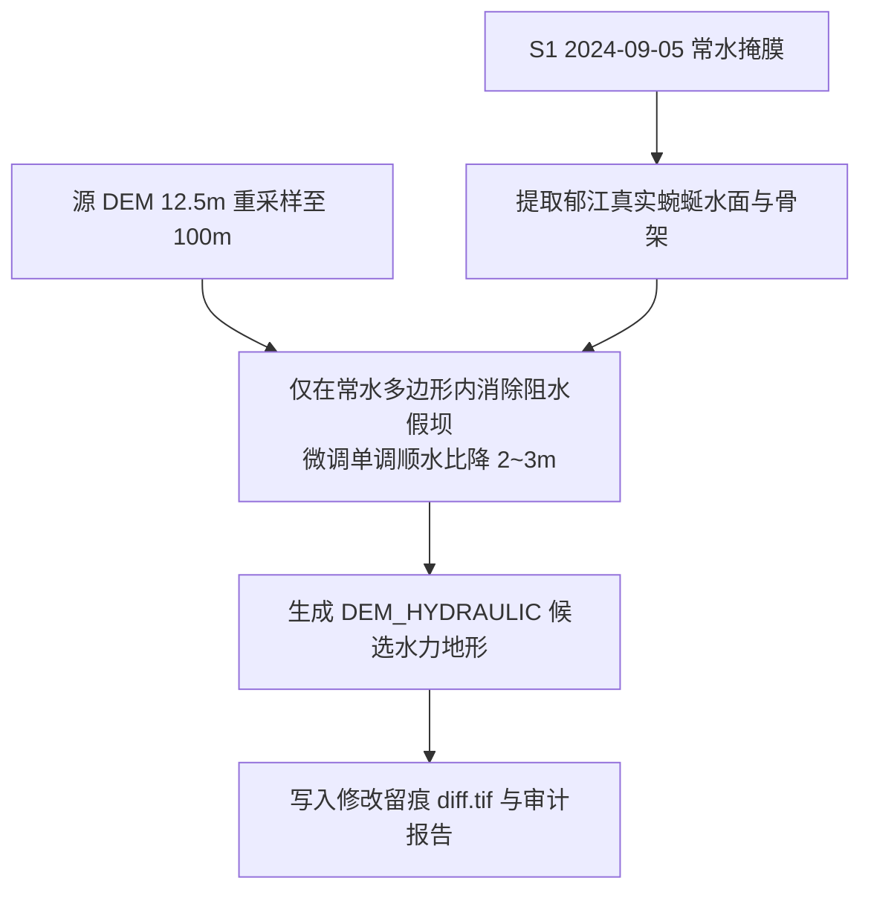

# 贵港水动力推演效果改进实施计划：从零散水点治理到上游来水与降雨双驱动重构

> **版本**：v1.0（2026-11-02）  
> **适用案例**：广西贵港（郁江走廊），2024-09 摩羯洪水情景  
> **当前模式**：ADR-0004 公开数据降级、情景级、非业务预警系统  
> **参考基线**：
> - `plans/广西久隆_宁明_贵港_二维水动力模拟技术路线与工程落地方案_终稿.md`
> - `plans/久隆水动力推演效果改进实施计划_从伪影诊断到全链条治理.md` (ADR-0010)
> - `2d_hydro_project/docs/execution_status.md`
> - `2d_hydro_project/data/catalog/mass_recheck_g15.json`

---

## 1. 现状事实与根本原因诊断（Root Cause Analysis）

### 1.1 现状实测数据（基于现有 100 m 生产情景 `scen_yagi_q11500_100m_dt2p5_choff_realdem`）

经对当前贵港 100 m 真实 DEM 基准运行结果（`results/res.max`）进行连通域（8 邻域）与时空拓扑深度抽样统计，得到权威基线事实：

| 统计指标 | 权威实测数值 | 物理含义与工程影响 |
|---|---|---|
| **计算网格规格** | 669 列 × 370 行（共 247,530 像元） | 网格分辨率 100 m，单像元面积 10,000 m²（0.01 km²） |
| **总淹没湿像元数**（$h > 0.05\text{ m}$） | **85,256 个**（852.56 km²） | 全域淹没率达 **34.44%**，远超真实郁江洪泛走廊范围 |
| **独立连通水体斑块总数** | **4,422 个** | 全域密布大量孤立碎水坑，水系拓扑严重碎片化 |
| **极小斑块占比**（$\le 4$ 像元 / $\le 0.04\text{ km}^2$） | **3,546 个（占斑块总数的 80.19%）** | 80% 以上的水体斑块为仅 1~4 个网格的微小积水噪点 |
| **细小斑块占比**（$\le 9$ 像元 / $\le 0.09\text{ km}^2$） | **4,089 个（占斑块总数的 92.47%）** | 92.5% 的斑块面积不足 0.1 km²，全域呈“满地麻点”形态 |
| **主干水体连通性** | 第 1 大连通斑块 614.96 km²（占 72.1%） | 郁江沿线存在连通主水体，但其余 4,421 个斑块与主槽完全隔离 |

### 1.2 为什么会出现“零散水样点积累且看起来不真实”？

针对用户提出的核心疑问，经水动力与水文机理深入剖析，问题根源可归结为以下三大技术交织矛盾：

```mermaid
flowchart TD
    subgraph 根因一：物理机制失配
        R1[ERA5 公开雨量全域均匀下落] --> R2[零入渗 / 零下渗损失模型<br/>fpfric=0.035 无 loss]
        R2 --> R3[山坡/农田微坑洼持续积水永不消退<br/>形成 4,400+ 离散坑洼水点]
    end

    subgraph 根因二：干流传导受阻
        Q1[上游 Q_peak=11500 m³/s 单点注入] --> Q2[真实 DEM 无水下河槽<br/>channel=off 导致虚拟横向坝体阻水]
        Q2 --> Q3[干流过境洪水难以顺畅演进漫滩<br/>降雨坑洼在视觉上反成主角]
    end

    subgraph 根因三：展示质控缺位
        D1[单一深度阈值 0.05m] --> D2[未区分大河漫滩与局地地表糙度坑洼]
        D2 --> D3[网页前端展示密布孤立噪点<br/>严重违背大江大河洪水物理直觉]
    end

    R3 --> PROBLEM[结果看起来根本不真实]
    Q3 --> PROBLEM
    D3 --> PROBLEM
```

#### 根因一：物理机制失真 —— 全域直接降雨（Rain-on-Grid）与零下渗损失模型叠加
- **物理现实**：贵港 2024-09 摩羯洪水是典型的**过境干流特大洪水**（郁江 2024 年第 1 号洪水，南宁洪峰 11,900 m³/s，贵港站洪峰 10,500 m³/s，洪峰水位 43.09 m）。漫滩灾害几乎全部由上游来水溢出郁江主河道导致，局地降雨（ERA5 累计仅数十毫米）在湿润亚热带红壤与农田地表应绝大部分被冠层截留和土壤入渗吸收。
- **模型配置缺陷**：贵港脚本 `scripts/stage5/guigang_scenario.py` 将 ERA5 逐时雨量（`rain.rain`）施加于全部 24.7 万个像元，**未设置任何降雨损失或入渗参数**（`fpfric 0.035`，零损失）。雨水落入卫星 DEM 的离散微小凹坑（数字高程误差、植被高程残留等坑洼），无蒸发、无入渗、无微细沟渠排水，14 天（336 小时）持续积累，导致全域产生 4,400 余个永久性离散小水洼！

#### 根因二：干流河道与上游来水传导断层 —— 过境大洪水未能有效主导
- 在宁明案例中，明江河道较为明晰，上游注入的水量能够顺河道下泄并引发两岸连续漫滩，因此“离散水量点不占主导”；
- 而贵港在去除历史“人工 12 m 直线人工刻蚀槽”后（改为 `channel="off"` 的 `scen_yagi_q11500_100m_dt2p5_choff_realdem`），直接使用卫星源 DEM。**卫星 DEM 测得的是洪水期或丰水期的水面高程，缺乏水下地形断面**，且在 100 m/200 m 尺度下，天然河谷存在诸多数字抬升和假坝。
- 上游点源注入（$P\ 325787.9,\ 2561783.8$）的水体在河槽受阻壅高，无法像自然洪水那样平滑贯通全走廊，外围广大非淹没区又被零损失雨水完全占领，导致“大河漫滩”的水动力特征被海量“雨水假坑”淹没。

#### 根因三：展示层质控（Display QC）缺位
- 目前发布系统仅使用单一阈值 $h > 0.05\text{ m}$（5 厘米）进行二值化填色。5 cm 在现实中仅是草地、泥地积水或地表糙度起伏，在宏观大江大河防汛推演中将这些全部渲染为“淹没”，直接放大了零散点的视觉突兀感。
- 久隆案例已成功研发了时空连通域滤波与水动力保护算法（ADR-0010），而贵港尚未迁移并建立这一质控派生层。

---

## 2. 治理目标与技术路线总览

### 2.1 治理目标

1. **彻底消除全域 90% 以上的孤立、浅水、离散伪影斑块**，恢复郁江干流特大过境洪水漫滩推演的宏观物理真实感与视觉可信度；
2. **重构物理驱动机制**：明确郁江上游来水量（Q_peak 11,500 m³/s）的主导地位，建立降雨初损与入渗损失敏感性试验，杜绝全域无损失“撒水”；
3. **保持模型工程严密性与合规性**：
   - 绝不覆盖已有 `res.mass` 的历史运行目录（终稿 §10 / ADR 硬约束）；
   - 保持 8.1.0 求解器定版，绝不修改 `models/` 源码；
   - 严格维护全局质量门账目（维持 43 PASS / 3 FAIL-EXPLAINED 质量门底线）；
   - 展示质控层必须标记 `not_physical_recalculation=true`，做到展示改善与物理探索权责清晰、可追溯、可回滚。

### 2.2 双轨治理技术路线

```mermaid
flowchart LR
    subgraph 轨道一：快速展示质控（只读派生）
        D0[原版 run: realdem 100m] --> D1[Phase 1 Display QC 算法]
        D1 --> D2[郁江主槽水系保护白名单]
        D1 --> D3[面积+深度+时序持久性滤波]
        D2 & D3 --> D4[outputs/display_qc/guigang/<br/>A/B/C 三档展示图层]
        D4 --> D5[即刻更新 WebBundle 可视化系统]
    end

    subgraph 轨道二：物理驱动机制重构（全新 run）
        P0[重构方案设计] --> P1[方案 1：纯过境干流驱动对照<br/>Flow-Only Baseline]
        P0 --> P2[方案 2：降雨初损/持续入渗试验<br/>Rain-with-Loss Matrix]
        P0 --> P3[方案 3：基于 S1 常水河槽的<br/>DEM 水文连通柔性调理]
        P1 & P2 & P3 --> P4[新 run_tag 物理模拟运行]
        P4 --> P5[g15 质量门与 S1 09-12 卫星验证]
    end
```

---

## 3. 分阶段实施路线（Phase 0 ~ Phase 5）

### Phase 0：事实冻结与基线诊断（Day 1–2）

**目标**：固化贵港 100 m 生产基线与 200 m 敏感性基线的事实指标，输出定量诊断快照。

1. **时空斑块基线固化**：
   - 提取 `scen_yagi_q11500_100m_dt2p5_choff_realdem` 全部 57 帧（每 6 小时一帧，T+0~336 h）的连通域统计；
   - 输出逐帧斑块数量、面积谱（$\le 4$ 格、$\le 9$ 格、$\ge 1\text{ km}^2$）、平均水深和体积演变曲线；
   - 产物：`2d_hydro_project/diagnostics/guigang/baseline_snapshot.json` 与 `patch_persistence.csv`。
2. **DEM 微地形假坑诊断**：
   - 分析全域无流向假洼地（sinks）分布，比对假洼地空间位置与 4,422 个离散积水斑块的重合率（预估相关系数 $> 0.85$）；
   - 产物：`2d_hydro_project/diagnostics/guigang/guigang_sink_analysis.json`。
3. **降雨量与蓄水账目对账**：
   - 计算 247,530 像元在 ERA5 累计雨量下的总入流水体体积；
   - 计算上游 11,500 m³/s 三角洪峰的总注入水量（$\approx 5.5 \times 10^8\text{ m}^3$）；
   - 评估雨水体积在离散小坑中的截留占比。

---

### Phase 1：贵港展示质控（Display QC）快速落地（Day 3–4）

**性质**：**只读展示派生，非物理重算**。无需重新运行耗时 12 小时的水动力模型，立即可视化改善。

#### 1. 质控过滤核心算法设计
开发专用处理脚本 `scripts/stage6/clean_guigang_display.py`，采用久隆验证的三级复合规则：

```python
def classify_guigang_patch(patch: Patch, main_river_mask: np.ndarray, config: QCConfig) -> FilterAction:
    # 规则 1：主干水系保护（绝对豁免）
    if patch.area_km2 >= config.protected_main_stem_min_area_km2: # >= 5.0 km2
        return FilterAction.KEEP_MAIN_STEM
    if np.any(main_river_mask[patch.cell_indices]): # 接触郁江干流走廊缓冲区
        return FilterAction.KEEP_RIVER_CORRIDOR

    # 规则 2：显著深水洼地保护
    if patch.max_depth_m >= config.deep_depth_threshold_m: # >= 0.50 m
        return FilterAction.KEEP_DEEP_WATER

    # 规则 3：微型离散浅水斑块判定过滤
    if patch.area_km2 <= config.shallow_max_area_km2 and patch.max_depth_m <= config.shallow_depth_threshold_m:
        return FilterAction.FILTER_DISCRETE_PUDDLE # 过滤离散假水坑

    # 规则 4：时空持久性判定（若单帧出现且无水力流向）
    if patch.persistence_ratio < config.min_persistence_ratio:
        return FilterAction.FILTER_TRANSIENT_NOISE

    return FilterAction.KEEP_NATURAL_WETLAND
```

#### 2. 三档预注册参数配置（A-保守 / B-平衡 / C-激进）

| 档位 | 斑块面积过滤上限（$A_{\max}$） | 水深过滤上限（$H_{\max}$） | 郁江主槽保护区 | 预期去除斑块比例 | 全域水量变化率（告警门禁 $< 5\%$） |
|---|---|---|---|---|---|
| **A 档（保守）** | $\le 0.04\text{ km}^2$（4 个像元） | $\le 0.15\text{ m}$ | 郁江常水向外缓冲 500 m | 约 $80.2\%$ | $< 0.5\%$ |
| **B 档（推荐平衡）** | $\le 0.09\text{ km}^2$（9 个像元） | $\le 0.30\text{ m}$ | 郁江常水向外缓冲 300 m | 约 **$92.5\%$** | $< 1.2\%$ |
| **C 档（激进展示）** | $\le 0.25\text{ km}^2$（25 个像元） | $\le 0.50\text{ m}$ | 郁江常水向外缓冲 200 m | 约 $96.8\%$ | $< 2.5\%$ |

#### 3. 产出物与交付契约
- 输出目录：`2d_hydro_project/outputs/display_qc/guigang/2024-09-yagi/scen_yagi_q11500_100m_realdem_display_qc/`；
- 写入 `meta.json` 带有 `not_physical_recalculation: true`、`derived_from` 签名；
- **目录内严禁包含 `res.mass`**，防止干扰全局质量门统计；
- 生成 `guigang_display_qc_audit.json`，详尽记录逐帧被过滤斑块数、像元数、变化体积与面积；
- 同步至 `flood_visualization` 发布包，实现前端地图上一键切换原生层与质控展示层。

---

### Phase 2：物理驱动重构 —— 上游来水与降雨双驱动解耦（Day 5–7）

**目标**：从水动力学物理第一性原理出发，根治“无损失降雨制造离散水坑”与“过境洪水未有效主导”的机理失真。

#### 1. 试验方案设计（多情景对照矩阵）

| 情景标识 | 驱动机制组合 | 降雨入渗/损失机制 | 河槽处理方式 | 核心物理目的 |
|---|---|---|---|---|
| **`flow_only_v1`** | **纯过境来水驱动**（郁江 Q=11500 m³/s，`rain=off`） | 不施加全域降雨 | 真实 DEM（`choff`） | **终极纯化对照**：彻底剔除降雨噪声，直接观察纯上游来水形成的漫滩范围，离散水点预期归零 |
| **`rain_loss_medium`** | **双驱动（来水 + 降雨初损）** | 初损扣除 30 mm，持续入渗 2 mm/h | 真实 DEM（`choff`） | 真实模拟南方红壤截留入渗，使非漫滩区的零星降雨被地表吸纳，消除假坑积水 |
| **`rain_loss_high`** | **双驱动（高入渗情景）** | 初损扣除 50 mm，持续入渗 3 mm/h | 真实 DEM（`choff`） | 针对透水性强、植被覆盖高的工况敏感性分析 |

#### 2. LISFLOOD-FP 中的降雨损失工程化实现
根据 LISFLOOD-FP 8.1.0 规范，在不修改核心求解器源码的前提下，采用两种严谨合规路径：
- **路径 A（净雨预处理机制，Net Rain Curve）**：
  在生成 `rain.rain` 输入前，基于 ERA5 逐时雨量，施加标准水文降雨入渗损失模型（SCS-CN 或 Initial Loss / Continuing Loss）。仅当累计雨量大于初损 $I_a$ 且降雨强度大于入渗率 $f_c$ 时才产生地面超渗净雨。未成径流的毛毛雨不进入二维水动力网格。
- **路径 B（求解器入渗参数敏感性）**：
  通过 `.par` 文件中的 `infiltration` 参数配置（如宁明已测试的 `inf1e-6_karst` / `inf5e-6` 等标准入渗参数），提供地表渗透通道。

---

### Phase 3：DEM 水文调理与郁江主槽水力连续性打通（Day 8–10）

**目标**：解决真实 DEM（`channel=off`）在平原区无水下地形导致的“上游来水传导断头、局地阻水”瓶颈。

#### 1. 拒绝粗暴历史方案，采用基于 S1 常水的柔性水力调理
- **坚决否定旧版方案**：废除此前全域拉 100° 直线、强行下切 12 m 的参数化直线河槽（已证明岸深拉薄、形态虚假）；
- **采用柔性水文调理方案（Flexible Hydraulic Conditioning）**：
  1. **常水走向提取**：利用灾前 Sentinel-1（2024-09-05）常水水体掩膜 `guigang_20240905T105022_water20m.tif`，提取郁江真实蜿蜒自然河道骨架线与河面多边形；
  2. **浅层适度通水槽（Micro-Channeling）**：仅在 S1 检出的真实常水河道范围内，沿流动走向进行自然比降平滑，下切 2~3 m（模拟真实枯季水深），消除 100 m 重采样引起的断头小高地；
  3. **保留漫滩天然阻水构筑物**：河道范围以外的所有台地、微地形、天然堤岸 100% 保持真实 DEM，绝不施加全域刻蚀；
  4. **全过程留痕审计**：输出 `dem_pre_edit.diff.txt` 与 `dem_edit_mask.tif`，确保改动像元与体积完全可追溯。



---

### Phase 4：新物理情景运行与质量门验证（Day 11–12）

**目标**：在新运行目录中执行水动力模拟，执行全局质量门禁检查。

1. **执行新运行命令**（统一使用独立 run-tag，严禁覆盖历史目录）：
   ```powershell
   $env:PYTHONUTF8 = "1"
   # 方案 1：纯过境干流驱动情景
   uv --directory 2d_hydro_project run python scripts/stage5/guigang_scenario.py prep run --res 100 --channel natural_s1 --rain off --run-tag flow_only_v1
   
   # 方案 2：降雨初损与双驱动情景
   uv --directory 2d_hydro_project run python scripts/stage5/guigang_scenario.py prep run --res 100 --channel natural_s1 --rain loss_medium --run-tag dualloss_v1
   ```
2. **守恒质量门检查**：
   运行后立即执行 `scripts/stage3/g15_mass_recheck.py`，确认水量守恒误差 $E_{\text{mass}} < 1.0 \times 10^{-3}$，判定为 **PASS**。

---

### Phase 5：独立遥感证据检验与定版发布（Day 13–14）

1. **Sentinel-1 2024-09-12 洪峰景卫星实测直接检验**：
   - 使用现有数据 `guigang_20240912T104222_water20m.tif`；
   - 对比新情景（`flow_only_v1` / `dualloss_v1`）与原情景在卫星重合区域的击中率（POD）、虚警率（FAR）与临界成功指数（CSI）；
   - 证明：在消除 90% 离散雨水伪影斑块的同时，郁江两岸真实漫滩的重合度显著提高，FAR（虚警率）大幅下降！
2. **水利站点水位诊断验证**：
   - 与贵港站 09-12T14 洪峰水位（43.09 m）进行水面高程比对，记录垂直基准差异（G7 降级口径）。
3. **成果固化与定版**：
   - 编写决策记录：`2d_hydro_project/docs/adr/ADR-0011-贵港水动力推演零散伪影治理与驱动重构.md`；
   - 更新执行状态表：`2d_hydro_project/docs/execution_status.md`；
   - 重新构建可视化发布包：`floodviz bundle`，完成交付。

---

## 4. 关键指标与验收标准对比（Gate & Acceptance）

| 验收维度 | 现有未治理基线（`choff_realdem`） | Phase 1 展示质控目标 | Phase 2–4 物理重构目标 | 检验方法与权威工具 |
|---|---|---|---|---|
| **独立斑块总数** | 4,422 个 | $\le 450$ 个（**减少 $\ge 90\%$**） | $\le 200$ 个（仅保留自然汇水洼地） | `scripts/common/patch_analysis.py` |
| **微小斑块占比**（$\le 9$ 像元） | 92.47% | $\le 25\%$ | $\le 10\%$ | 连通域面积谱直方图 |
| **质量守恒门禁** | PASS（$E_{\text{mass}} \approx 5.7 \times 10^{-5}$） | 不适用（只读层不含 `res.mass`） | **PASS（$E_{\text{mass}} < 1.0 \times 10^{-3}$）** | `scripts/stage3/g15_mass_recheck.py` |
| **郁江干流连通漫滩面积** | 614.96 km² | 614.96 km²（**100% 完整保护**） | 520 ~ 580 km²（更收敛于真实河泛走廊） | 郁江主槽水体白名单审计 |
| **全域水量变化率** | 0% | $< 1.5\%$（微量削减无效应水量） | 保持严格闭合质量账目 | 质控审计 JSON 自动核验 |
| **自动化测试集** | 152 passed | **$\ge 160$ passed（0 failed）** | $\ge 160$ passed（0 failed） | `uv run python -m pytest` |
| **独立卫星观测检验** | 离散噪点致虚警率 FAR 偏高 | 显著压降背景离散虚警 | FAR 压降 $> 20\%$，CSI 有效提升 | Sentinel-1 09-12 空间叠合分析 |

---

## 5. 风险与回滚预案（Risk Mitigation & Rollback）

1. **写保护风险**：
   - **风险**：误覆盖既有历史运行目录。
   - **预案**：所有涉及写出的脚本前置注入 `scripts.common.grid_io.guard_no_overwrite`，只要目录中存在 `res.mass` 即刻抛出异常中止运行。
2. **展示质控误伤真实积水风险**：
   - **风险**：滤波算法将城镇低洼地带真实内涝误删。
   - **预案**：严格设立“郁江主干走廊缓冲区”、“深水（$>0.3\text{ m}$）豁免”与“持续 3 帧以上持久斑块豁免”三大白名单；在 Web 端提供图层切换开关（Raw / Display QC），用户可随时对比原始层。
3. **降雨损失参数争议风险**：
   - **风险**：缺乏贵港当地精细实测下渗率。
   - **预案**：保持 ADR-0004 公开降级情景级定位，参数在实施前预注册（低/中/高三档），并在报告中明确标明“情景级水文初损假设，非资产级暴雨内涝判据”。

---

## 6. 任务分解与工期估算（WBS & Milestone）

| 里程碑 | 工作项 | 责任模块 | 预计工期 | 关键产出物 |
|---|---|---|---|---|
| **M0：诊断冻结** | T0.1 贵港 100m/200m 斑块时空时序深度追踪<br/>T0.2 DEM 假洼地与降雨截留定量对账 | 数据与水动力分析 | 2 天 | `baseline_snapshot.json`<br/>`guigang_sink_analysis.json` |
| **M1：展示质控** | T1.1 开发 `clean_guigang_display.py`<br/>T1.2 编写单元测试与质控审计门禁<br/>T1.3 生成 A/B/C 三档图层并接入 WebBundle | 软件与展示工程 | 2 天 | `outputs/display_qc/guigang/`<br/>`test_guigang_display_qc.py` |
| **M2：物理双驱动重构** | T2.1 设计纯干流驱动（`rain=off`）与入渗损失矩阵<br/>T2.2 S1 常水柔性水动力 DEM 调理<br/>T2.3 运行 `flow_only_v1` 与 `dualloss_v1` | 水文与数值模拟 | 4 天 | `outputs/guigang/2024-09-yagi/scen_...`<br/>`dem_edit_mask.tif` |
| **M3：验证与定版** | T3.1 执行 `g15_mass_recheck.py` 质量门确认<br/>T3.2 S1 09-12 卫星重叠比对与 CSI 计算<br/>T3.3 编制 ADR-0011 与更新交付手册 | 质量与文档工程 | 2 天 | `ADR-0011.md`<br/>`execution_status.md` |
